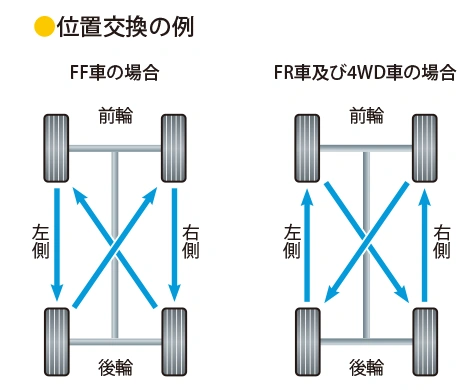
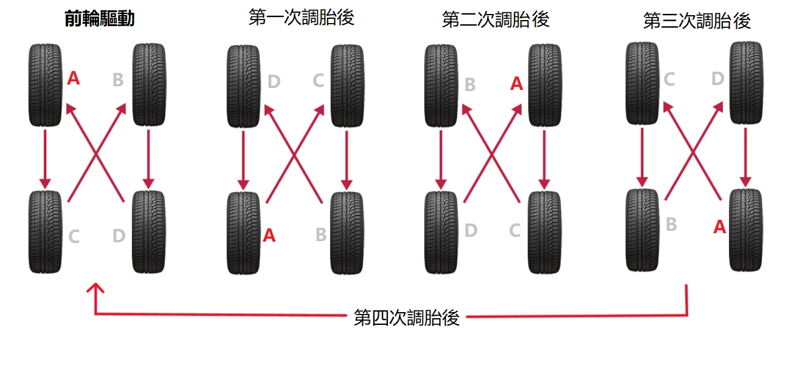
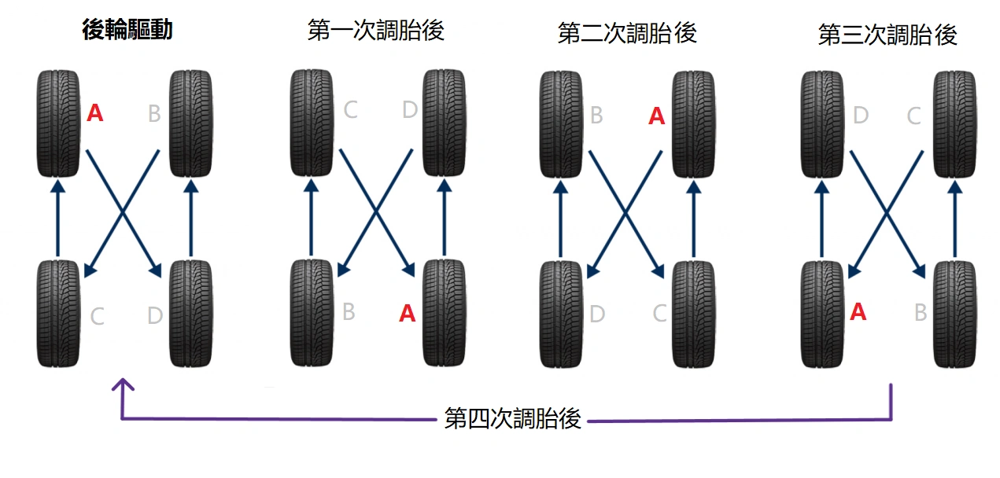

من الحقائق الهندسية الثابتة أن تدوير الإطارات بانتظام كل **5000 كم** يضمن توزيع قوى الاحتكاك بالتساوي، مما يسهم بفاعلية في إطالة العمر التشغيلي للإطارات وحمايتها من التآكل غير المنتظم.

ورغم تعدد الآراء في الأسواق، فإن كلاً من **الإدارة الوطنية الأمريكية لسلامة المرور على الطرق السريعة (NHTSA)** و**الجمعية اليابانية لمصنعي إطارات السيارات (JATMA)** تعتمدان **دليلاً هندسياً متطابقاً تماماً**.

ومن خلال **ثلاث عمليات تبديل دورية**، سيكون كل إطار قد استُخدم في جميع زوايا ومواقع المركبة الأربع؛ وهي طريقة منطقية وذكية للغاية. يمكنك عند زيارة مركز الإطارات توجيه الفني للالتزام بهذا الترتيب بدقة.

## ملخص الترتيب القياسي المعتمد من NHTSA و JATMA

لتسهيل حفظ القاعدة دون عناء: «عجلات المحور الدافع تتحرك في خط مستقيم، بينما عجلات المحور غير الدافع تتبادل قطرياً (بشكل مقص X)»:

| نظام الدفع في المركبة | حركة الإطارات الأمامية | حركة الإطارات الخلفية | القاعدة الميكانيكية |
| :--- | :--- | :--- | :--- |
| **الدفع الأمامي (FF / FWD)** | ترجع **مستقيمة** إلى الخلف | تصعد **متقاطعة** إلى الأمام | المحور الدافع (الأمامي) مستقيم، وغير الدافع (الخلفي) متقاطع |
| **الدفع الخلفي (FR / RWD)** / **الدفع الرباعي (AWD)** | ترجع **متقاطعة** إلى الخلف | تصعد **مستقيمة** إلى الأمام | المحور الدافع (الخلفي) مستقيم، وغير الدافع (الأمامي) متقاطع |

## مخطط تدوير الإطارات لسيارات الدفع الأمامي (FF / FWD)
في سيارات الدفع الأمامي، تقع على عاتق الإطارات الأمامية مهمتا التوجيه والدفع معاً، مما يسرع وتيرة استهلاكها. عند التبديل، **تنتقل الإطارات الخلفية إلى الأمام متقاطعة، بينما ترجع الإطارات الأمامية إلى الخلف مستقيمة**.

## مخطط تدوير الإطارات لسيارات الدفع الخلفي (FR / RWD) والرباعي (AWD)
في سيارات الدفع الخلفي والدفع الرباعي المستمر، تكون الحركة معاكسة تماماً لمنطق الدفع الأمامي. **تنتقل الإطارات الأمامية إلى الخلف بشكل متقاطع، بينما تتقدم الإطارات الخلفية إلى الأمام في خط مستقيم**.

