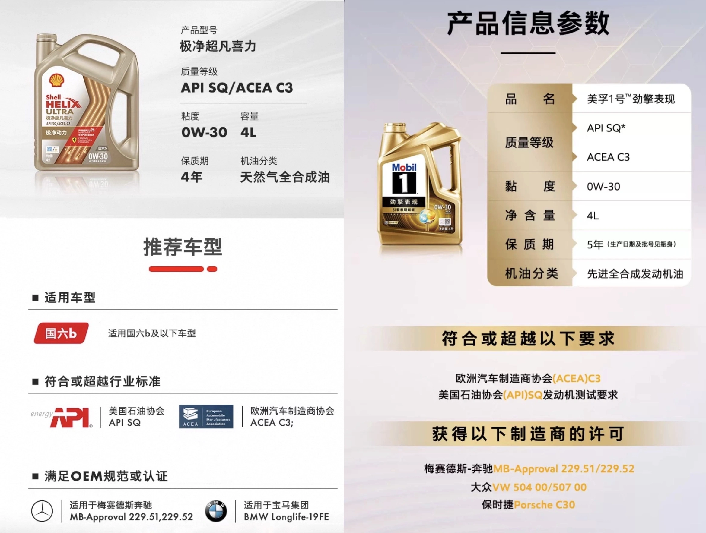

## مبادئ اختيار زيت المحرك

أياً كانت العلامة التجارية للسيارة، فإن القاعدة الهندسية الراسخة تنص على أن **اختيار الزيت يبدأ حصراً من الاعتماد الرسمي للمصنع**. وعند تطابق الاعتماد، نبدأ في مفاضلة اللزوجة ومؤشرات الاختبارات المعملية.  
بالنسبة لمحركات البنزين في سيارات مرسيدس W205، تظل اعتمادات **MB 229.5 و MB 229.6** هي الخيار الأكثر تفضيلاً لاحتوائها على رقم قاعدي كلي (TBN) أعلى.

### **معضلة الإشعال المسبق LSPI ومعايير اختيار الزيت**
نظراً لاعتماد محركات W205 على نظام الحقن المباشر داخل الأسطوانة، فإنها تواجه ظاهرة **LSPI (Low-Speed Pre-Ignition / الإشعال المسبق عند السرعات المنخفضة)** والتي تؤدي إلى كسر وتصدع المكابس. ولتفادي ذلك:
- **عند القيادة بترس مرتفع وسرعة دوران منخفضة للمحرك، قم بتسقيط ترس (Downshift) قبل الضغط بقوة على دواسة الوقود**
- مواصفات الزيت حاسمة: فإلى جانب البحث عن **[تركيبة منخفضة الكالسيوم (<2000ppm)](/ar/2021/oil-parameter.html)**، من الضروري جداً التأكد من اختيار زيوت **تشترط اجتياز اختبار LSPI المعملي الصارم (Sequence IX)**.

### **الاعتمادات التي تفرض اختبارات LSPI**
- **DEXOS1 GEN 2 / GEN 3**: تشترط اجتياز اختبار LSPI
- **DEXOS2**
  - المخصصة لمحركات البنزين: تشترط اجتياز اختبار LSPI
  - **المشتركة بين البنزين والديزل: لا تشترط اختبار LSPI**
- **API SN Plus**: مواصفة صدرت في مايو 2018 مخصصة لاجتياز اختبار LSPI
- **API SP**: صدرت في مايو 2020 وتلزم باجتياز اختبار LSPI مع حماية مضاعفة لسلاسل التوقيت (الجنازير)
- **API SQ**: **أحدث أجيال الاعتماد**، تفرض اختبارات غاية في الصرامة لمكافحة LSPI لمحركات الحقن المباشر وترفع كفاءة استهلاك الوقود ومقاومة التآكل
- **MB 229.5 / 229.51 / 229.52 / 229.6**: النسخ المحدثة الصادرة بعد عام 2018 ملزمة باختبارات LSPI

## **أبرز زيوت المحركات المعتمدة من مرسيدس والمجتازة لاختبارات LSPI**
تفي الزيوت التالية بمطابقة اعتمادات مرسيدس الرسمية وتوفر حماية مثبتة من LSPI (يُرجى التحقق دائماً من علامة SP أو SQ على العبوة):

| العلامة التجارية | الطراز | اللزوجة | الاعتماد الرسمي | الفئة / التركيب | الخصائص البارزة |
|---------|------|------|------|------|------|
| RAVENOL | SSV  | 0W-30 | **229.6** (معتمد 2019) | SL PAO | خيار نادر بلزوجة 0W-30 229.6 |
| Shell   | HELIX ULTRA | 0W-40 | **229.5** VW | SP/SQ | تحديث مستمر وسريع للاعتمادات |
| Shell   | HELIX ULTRA | 5W-40 | **229.5** A40 LL01 | SP/SQ | لزوجة قياسية متوازنة واعتماد فائق |
| Shell   | HELIX ULTRA | 5W-30 | **229.5** LL01 | SP/SQ | أفضل خيار 5W-30 229.5 |
| Total   | Quartz INEO MC3 | 5W-30 | **229.52** LL04 D2 | SN+/SP | قيمة ممتازة مقابل السعر في 229.52 |
| Castrol | EDGE M | 5W-30 | **229.52** LL04 | SN+/SP | واسع الانتشار للمركبات الأوروبية |

### **مقارنة تفصيلية بين زيوت المحركات**
للمزيد من المقارنات المعمقة، تابع القراءة في المقال التالي:  
[اعتمادات مرسيدس + زيوت مكافحة LSPI (الجزء 2)](/ar/2021/benz-and-lspi-02.html)

## **تحليل هندسي: مقارنة اعتماد MB 229.5 مقابل MB 229.52**
- **اعتماد MB 229.5**: يفرض HTHS > 3.5، ورقم قاعدي TBN > 10، وتطاير Noack < 10%
- **اعتماد MB 229.52**: يفرض رماداً كبريتياً منخفضاً (Low-SAPS)، ورقم قاعدي TBN > 6  
  يمكنك الرجوع إلى **[ملاحظات المعايير الفيزيائية للزيوت](/ar/2021/oil-parameter.html)**

توفر هذه الاعتمادات حماية فائقة لكتلة المحرك، ويمكن الاعتماد عليها بكل ثقة.

## **اختيار لزوجة زيت المحرك**
يعتقد البعض خطأً بضرورة تغيير درجة اللزوجة بحسب طبيعة القيادة داخل المدينة أو على الطرق السريعة، إلا أن **درجة حرارة عمل المحرك ثابتة ومحكومة بالثرموستات**:
- يقوم نظام التبريد في المركبة بضبط درجة حرارة السوائل أوتوماتيكياً سواء في الازدحام أو على السرعات العالية.
- إن ارتفاع حرارة المحرك بشكل غير طبيعي يعكس **خللاً في دائرة التبريد** وليس بسبب اختيار درجة اللزوجة.

### **المحركات ذات الكيلومترات العالية واختيار اللزوجة**
استناداً إلى الأدلة الفنية لشركات التزييت:
- للسيارات التي قطعت أكثر من **75,000 ميل (نحو 120,000 كم)**، يُستحسن تقييم استخدام لزوجة أعلى:
  - **نظراً لاتساع الخلوصات بين الأجزاء الميكانيكية، يساهم الزيت ذو اللزوجة الأعلى في ملء الفراغات واستعادة ضغط الانضغاط.**
- تتوفر أيضاً ما تُعرف بـ **زيوت المحركات المقطوعة (High Mileage Oils)**:
  - تحافظ على لزوجة 30 الأصلية دون الحاجة لرفع اللزوجة بشكل مفرط
  - تدمج إضافات تعيد المرونة للصوف والربلات وتمنع تسريب الضغط ورشح الزيوت
  - **[مرجع تقني إضافي](https://www.machinerylubrication.com/Read/31414/high-mileage-oil)**

## **الجيل الأحدث: زيوت تجمع بين API SQ و MB 229.52**
انتشرت في الأسواق العالمية مؤخراً سلاسل الزيوت المتطورة التي تحمل اعتماد **API SQ مع MB 229.52**.

ملاحظات هامة عند الشراء:
- احذر من بعض شحنات الاستيراد الموازي التي قد توزع زيوت مخزنة منذ سنوات بتواريخ إنتاج قديمة.
- تأكد من ختم دائرة الاعتماد الرسمية (API Donut) على ظهر العبوة للتأكد من مواكبة أحدث معايير التصنيف (SP أو SQ).

### **صورة توضيحية: Shell Helix Ultra X 0W-30 / وموبيل 1 المقابل**

