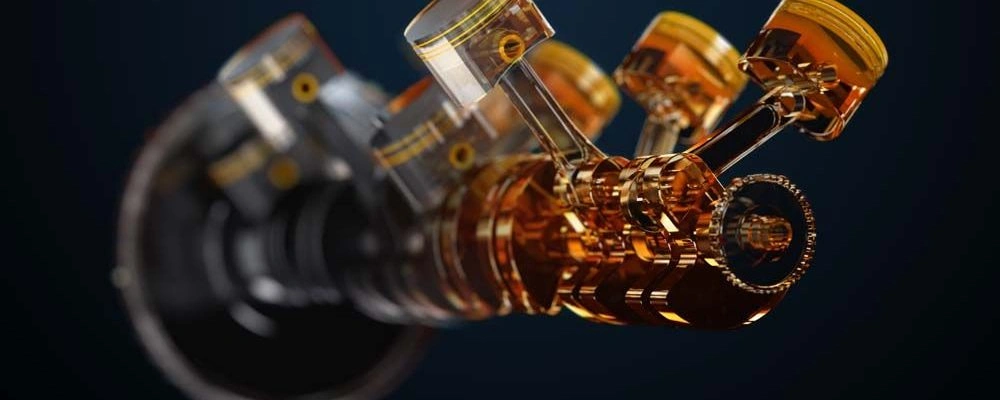

## أبرز الاعتمادات والمواصفات الرسمية

### تصنيفات معهد البترول الأمريكي (API)
- **SN Plus / SP**: تلزم بالخضوع لاختبار مكافحة الإشعال المسبق LSPI.
- **SQ (ILSAC GF-7)**: أحدث المعايير الهندسية لعام 2025 وما بعده، تعزز حماية سلاسل التوقيت وترفع كفاءة استهلاك الوقود مع وضع حد أقصى للرماد الكبريتي (≤ 0.9%) لحماية فلاتر الجسيمات (GPF).

### اعتمادات صانعي السيارات الأوروبية

| الاعتماد الرسمي | HTHS (mPa.s) | TBN (mg KOH/g) | نسبة التطاير Noack (%) |
|------|------|------|------|
| **API SP / SQ** | > 2.6 | غير محدد | غير محدد |
| **ACEA A3/B4** | > 3.5 | > 10 | < 13 |
| **ACEA A5/B5** | 2.9 - 3.5 | > 8 | < 13 |
| **ACEA C3** | > 3.5 | > 6 | < 13 |
| **MB 229.5** | > 3.5 | > 10 | < 10 |
| **MB 229.51 / 52** | > 3.5 | > 6 | < 10 |
| **VW 502.00 / 505.00** | > 3.7 | > 7 | - |
| **VW 504.00 / 507.00** | > 3.5 | > 6 | < 11 |
| **BMW Longlife-98** | > 3.5 | > 9.5 | - |
| **BMW Longlife-01** | > 3.5 | > 10 | - |
| **BMW LL-01 FE** | > 3.0 | > 9.5 | - |

## تكامل وتراكب الاعتمادات

- **اعتماد MB 229.5**: يفرض معايير تآكل ميكانيكية بالغة الصرامة، ولكنه يفتقر في نسخه القديمة لاختبار LSPI.
- **تصنيف API SP / SQ**: يضع حداً صارماً ضد LSPI مع معايير ميكانيكية عامة متوازنة.
- **الزيت الذي يجمع بين MB 229.5 و API SP/SQ** → يحقق أعلى حماية ضد التآكل الميكانيكي مع درء كامل لمخاطر LSPI.
- **رسم بياني للمقارنة والتكامل**: [أداة المقارنة التفاعلية من Lubrizol](https://online.lubrizol.com/relperftool/pc.html)

## كشف التلاعب اللفظي على عبوات الزيت

**المصطلحات المؤكدة للاعتماد الحقيقي:**
- Approvals
- Freigaben

**المصطلحات التسويقية الخالية من الاعتماد الرسمي (يُفضل تجنبها):**
- Performance Level
- OEM Performances
- Recommendations
- OEM Compatibility
- Suitable for

## مؤشرات المقارنة عند تطابق الاعتماد

- **نقطة الوميض (Flash Point)**: درجة حرارة اشتعال أبخرة الزيت؛ كلما ارتفعت دلت على ثبات حراري ممتاز.
- **اللزوجة عند 100°م**: لنفس درجة اللزوجة المعتمدة، الرقم المعتدل الأدنى يخفف من مقاومة التدفق.
- **اللزوجة عند 40°م**: كلما انخفضت، زادت سرعة تدفق الزيت وتزييته للمحرك عند بدء التشغيل البارد.
- **نسبة التطاير (Noack)**: تقيس نسبة تبخر الزيت تحت الحرارة العالية (250°م)؛ يُفضل ألا تتجاوز 10%.
- **قوة القص الحراري (HTHS)**: قدرة فيلم الزيت على التماسك عند 150°م تحت أحمال قص عالية؛ القيمة المرتفعة تحمي عند السرعات العالية (> 2.9 mPa.s ممتاز لمحركات التيربو).
- **الرقم القاعدي الكلي (TBN)**: احتياطي الزيت من القلويات لمعادلة الأحماض؛ يُفضل أن يتجاوز 8 mg KOH/g للمسافات الطويلة.
- **نقطة الانسكاب (Pour Point)**: أدنى درجة حرارة يظل الزيت عندها سائلاً؛ انخفاضها دون -50°م يشير غالباً لوجود نسبة مرتفعة من PAO.
- **مؤشر اللزوجة (VI)**: معدل تغير اللزوجة بتغير الحرارة؛ يُؤخذ بحذر وفق ثبات البوليمرات المضافة.

## أنواع زيوت الأساس التخليقية

- **الإسترات (Esters / Polyolesters)**: قمة الأداء، التصاق قطبي ممتاز بالمعادن، ولكنها تتأكسد وتتحلل أسرع في المسافات الطويلة.
- **الألكيل نفتالين (ANs)**: سوائل تخليقية متقدمة تُضاف مع PAO لتحسين ذوبان باقة الإضافات.
- **PAO (بولي ألفا أولفين)**: المجموعة الرابعة التخليقية بالكامل، تمتاز بمقاومة حرارية استثنائية وانسيابية باردة فائقة.
- **GTL (Gas-to-Liquid)**: المجموعة الثالثة بلس المحولة من الغاز الطبيعي عبر تقنية فيشر-تروبش، أداؤها يقارب PAO بدرجة كبيرة.
- **VHVI**: زيوت معدنية مكررة ومُعالجة بالهيدروجين الفائق (المجموعة الثالثة).

## عناصر الإضافات ووظائفها

- **الكالسيوم (Ca)**: منظف رئيسي، لكنه محفز لظاهرة LSPI؛ مقيد بأقل من 2000 جزء في المليون في مواصفات API SP/SQ.
- **المغنسيوم (Mg)**: منظف بديل لا يسبب LSPI.
- **الموليبدينوم (Mo)**: معدل احتكاك ومضاد تآكل فائق الفاعلية.
- **الفوسفور (P)**: مضاد تآكل للضغوط الشديدة.
- **الزنك (Zn)**: مركب ZDDP الشهير مع الفوسفور، الركيزة الأساسية لحماية المعادن.
- **البورون (B)**: مشتت ومثبط تآكل وتأكسد.
- **التنغستن (W) / التيتانيوم (Ti)**: تقنيات نانوية حديثة لتعديل أسطح الاحتكاك.

## العلامات التجارية الموصى بها

### للاستخدام اليومي المعتاد *(احرص على الشراء من الوكلاء المعتمدين لضمان الأصالة)*
- **Mobil**
- **Shell**
- **Castrol**

### للأداء الرياضي والضغط العالي
- **Liqui Moly**
- **Motul**
- **AMSOIL**
- **Red Line**
- **Ravenol**

### ما ينبغي تجنبه
- العلامات المجهولة أو التي تخلط زيوتها لدى ورش غير متخصصة.
- إذا واجهتك علامة غير مألوفة، ابحث عنها في بوابة [Mercedes-Benz Bevo](https://bevo.mercedes-benz.com/bevolisten/bevo-sheets-sort1.html)؛ وإذا لم تجد لها اعتمادات رسمية مسجلة تتجاوز 10 اعتمادات، فتجنب الشراء.

## **قراءات هندسية موصى بها**
- [Technical QA - منتدى فيراري FerrariChat](https://www.ferrarichat.com/forum/threads/motor-oil-all-chapters-inclusive-copy-and-save-this.136052/)

