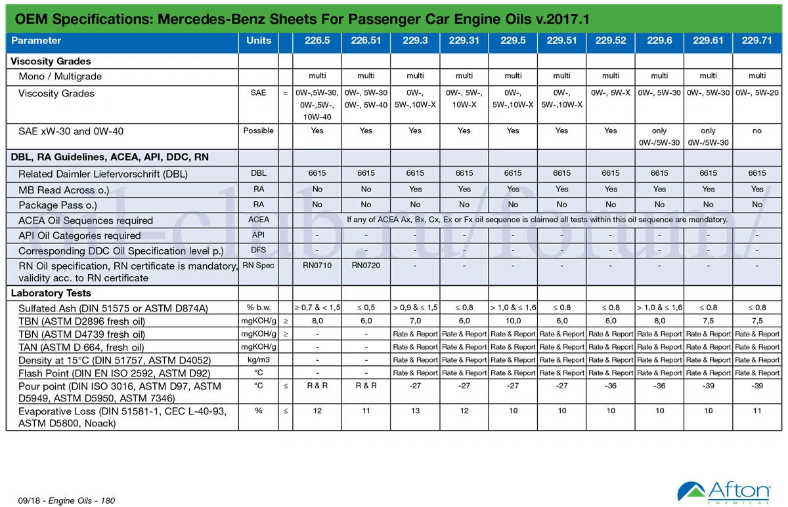
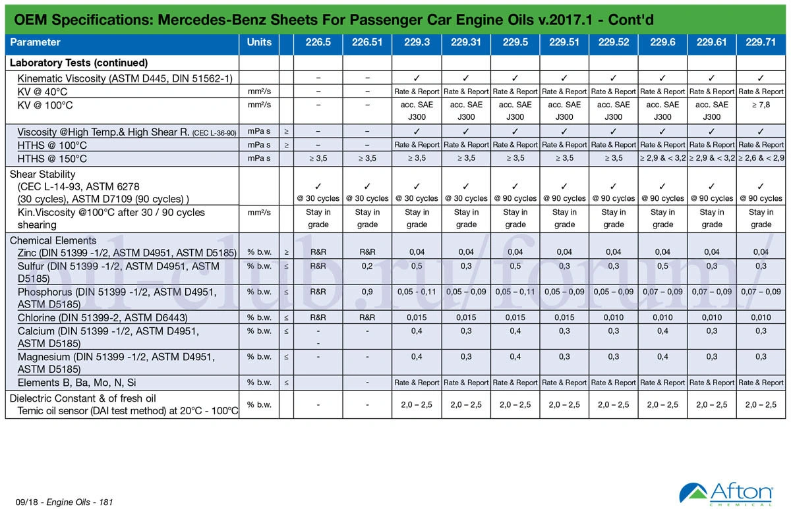
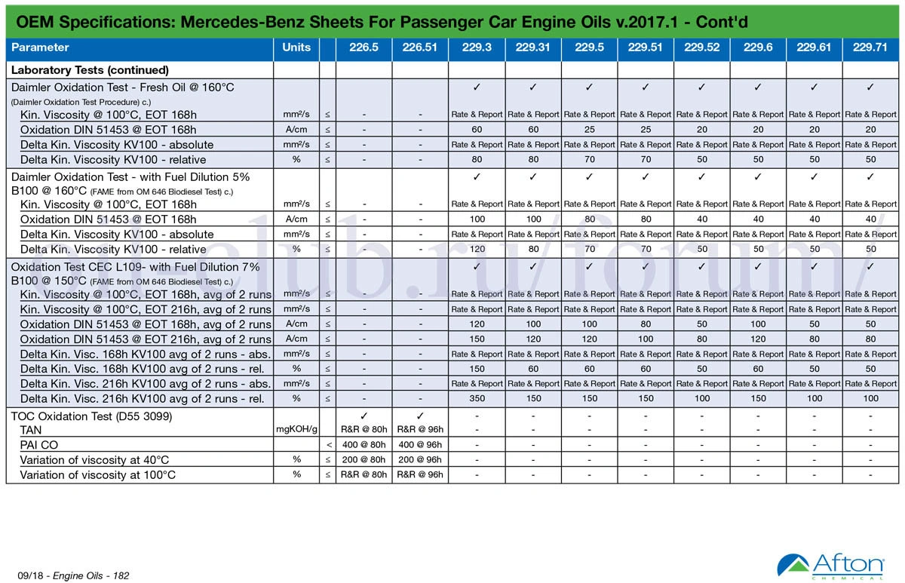
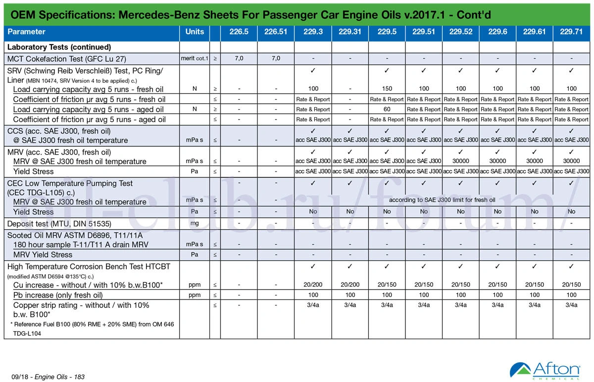
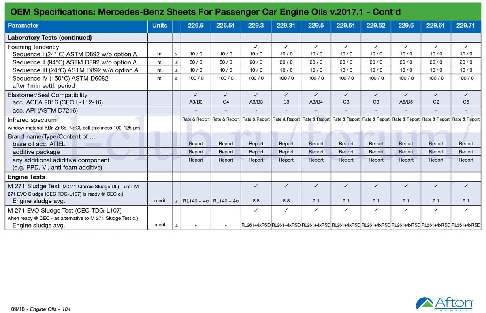
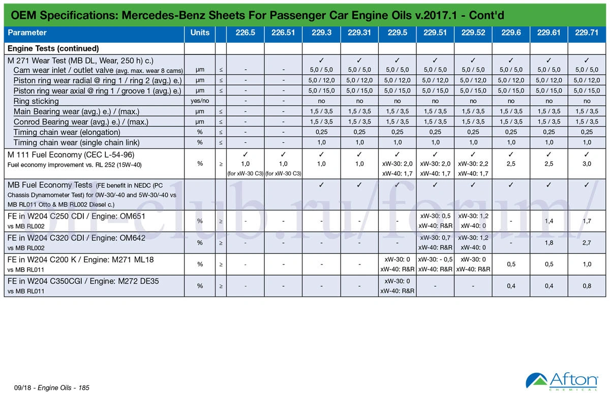
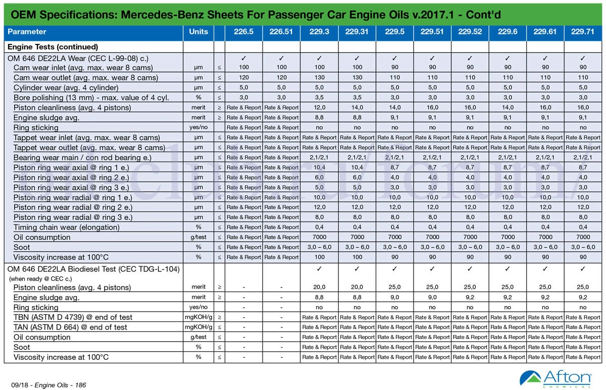
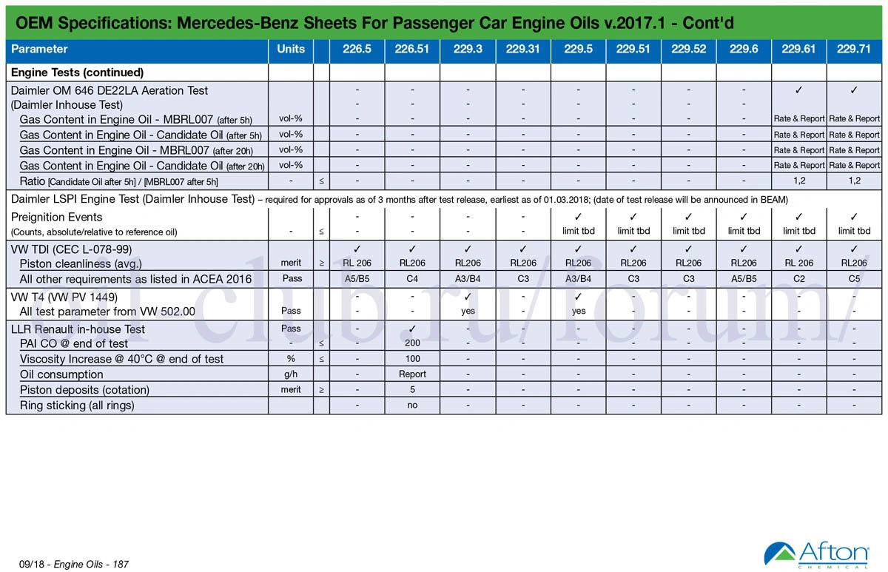

## مصدر البيانات الهندسية
- [www.oil-club.ru](https://www.oil-club.ru/forum/topic/38632-mercedes-benz-mb-2291-mb-2293-mb-2295-mb-22951-mb-22952-mb-22971-mb-2296-mb-22961-mb-2265-mb-22651-требования-стандартов-новая-версия-2017-года/)

## المخططات والرسوم البيانية المقارنة

