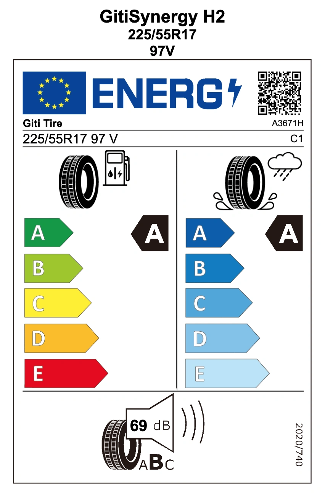
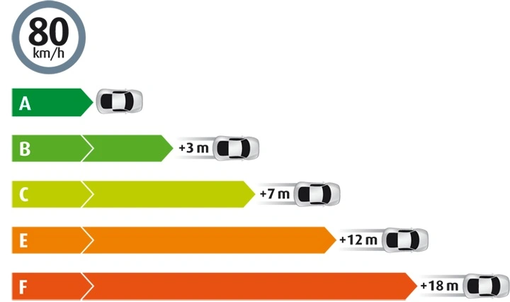

تتسبب الأمطار المفاجئة والسيول في حوادث انزلاق مائي (Hydroplaning) بالغة الخطورة على الطرق السريعة. يركز الكثير من السائقين على السعر ومعدل تآكل المداس فقط، متجاهلين **ملصق أداء وكفاءة الإطار** الذي يحدد مباشرة المسافة اللازمة للتوقف الاضطراري على الأسفلت المبلل. وتستند جميع المعايير الدولية إلى **لائحة الأمم المتحدة ECE R117** الصارمة لاختبار وتصريح تداول الإطارات.

يمتلك المستهلك اليوم أدوات فحص دقيقة تعتمد على قياسات معملية موثقة تغطي **التماسك على الرطب (A إلى E)**، و**مقاومة الدوران (A إلى E)**، و**الضجيج الخارجي للإطار (A/B)**، مع إمكانية التحقق الفوري عبر رمز الاستجابة السريعة (QR Code).

## منصات الاستعلام عن بطاقات كفاءة الإطارات

### 1. قواعد البيانات الدولية الرسمية
- **قاعدة بيانات الاتحاد الأوروبي الرسمية EPREL**: [https://eprel.ec.europa.eu/screen/product/tyres](https://eprel.ec.europa.eu/screen/product/tyres)
- **قاعدة بيانات الإطارات اليابانية Kakaku**: [https://kakaku.com/car_goods/tire/](https://kakaku.com/car_goods/tire/)

### 2. المنصات الإقليمية وحاسبات الوقود
- **منصة كفاءة طاقة الإطارات الرسمية (ARTC / CNS 1431)**: [https://tire.artc.org.tw/](https://tire.artc.org.tw/)
- **حاسبة التوفير في استهلاك الوقود بمقاومة الدوران RRC**: [https://energy.artc.org.tw/Tire/rrCalculate](https://energy.artc.org.tw/Tire/rrCalculate)

قبل استبدال إطاراتك، احرص دوماً على مراجعة هذه التقييمات. طالما تطابق **المقاس، ومؤشر الحمولة، ورمز السرعة**، فإن أداء الإطار يظل ثابتاً وموثوقاً. **تجنب** تماماً شراء إطارات تفتقر للاعتماد الدولي أو تحمل **تصنيف تماسك على الرطب أقل من الدرجة A**.

ما لم تكن أسعار الوقود مرتفعة بصورة استثنائية، فلا تضحِ أبداً بسلامة الكبح في المطر من أجل مكاسب طفيفة في مقاومة الدوران.  
**ترتيب الأولويات الهندسي الموصى به**: **التماسك في المطر > الراحة والهدوء الصوتي > كفاءة استهلاك الوقود**.

## فئات التماسك على الطرق الرطبة

| معامل التماسك (قيمة G) | الفئة الأوروبية (EU 2020/740) | الفئة اليابانية (JATMA) | الفئة القياسية الدولية |
| :--- | :---: | :---: | :---: |
| 1.55 ≤ G | **A** | **a** | **A** |
| 1.40 ≤ G ≤ 1.54 | **B** | **b** | **B** |
| 1.25 ≤ G ≤ 1.39 | **C** | **c** | **C** |
| 1.10 ≤ G ≤ 1.24 | **D** | **d** | **D** |
| G ≤ 1.09 | **E** | - | **E** |

> *ملاحظة: تتوافق الدرجات من A إلى E دولياً بالاستناد إلى اللائحة الفنية للأمم المتحدة ECE R117.*

## فئات كفاءة استهلاك الوقود (مقاومة الدوران RRC)

| معامل مقاومة الدوران (RRC كجم/طن) | الفئة الأوروبية | الفئة اليابانية | الفئة القياسية الحديثة |
| :--- | :---: | :---: | :---: |
| RRC ≤ 6.5 | **A** | **AAA** | **A** |
| 6.6 ≤ RRC ≤ 7.7 | **B** | **AA** | **B** |
| 7.8 ≤ RRC ≤ 9.0 | **C** | **A** | **C** |
| 9.1 ≤ RRC ≤ 10.5 | **D** | **B** | **D** |
| RRC ≥ 10.6 | **E** | **C** | **E** |

> *ملاحظة: يُعد المقياس الأوروبي الخماسي (A إلى E) المرجع الدولي لمقارنة كفاءة تدحرج الإطارات.*

## فئات الضجيج الخارجي للإطارات

| فئة الضجيج | الحد المسموح به في اللائحة الأوروبية | التوصيف الفني |
| :--- | :---: | :--- |
| **الفئة A** | **أقل من الحد القانوني بمقدار ≥ 3 ديسيبل** | هدوء استثنائي على الطريق وأقل انبعاث صوتي خارجي |
| الفئة B | بين 0 و 2 ديسيبل دون الحد القانوني | متوافق تماماً مع المعايير والحدود النظامية الحالية |
| الفئة C | أعلى من الحد القانوني المسموح به | غير مصرح ببيعه لسيارات الركوب الجديدة |

> *ملاحظة: تُظهر البطاقة الرقم الفعلي المقاس بـ **الديسيبل (dB)**؛ وكلما قل الرقم زاد الإطار هدوءاً.*

## جدول تحويل ضغط الإطارات

### المرجع الرسمي المعتمد لسيارات مرسيدس-بنز (المصدر: ملصق المصنع A205 584 70 11)
> *ملاحظة: تم ضبط قيم Bar بفوارق دقيقة قدرها 0.05 لسهولة ضبطها بمضخات الهواء اليدوية.*

| PSI | kPa | **Bar** |
| :---: | :---: | :---: |
| 31 | 210 | 2.10 |
| 32 | 220 | 2.20 |
| **33** | **230** | **2.30** |
| **34** | - | **2.35** |
| **35** | **240** | **2.40** |
| **36** | **250** | **2.50** |
| **37** | - | **2.55** |
| **38** | **260** | **2.60** |
| 39 | 270 | 2.70 |
| 40 | - | 2.75 |
| 41 | 280 | 2.80 |
| 42 | 290 | 2.90 |

## المراجع واللوائح الرسمية

- **بوابة الاتحاد الأوروبي الرسمية EPREL**: [بوابة معلومات الإطارات EPREL](https://eprel.ec.europa.eu/screen/product/tyres)
- **اللائحة الأوروبية EU 2020/740 (PDF)**: [النص الرسمي المعتمد من البرلمان الأوروبي](https://eur-lex.europa.eu/legal-content/EN/TXT/PDF/?uri=CELEX:32020R0740&from=EN)
- **توجيهات جمعية مصنعي الإطارات اليابانية JATMA**: [المخطط التوجيهي لملصقات JATMA](https://www.jatma.or.jp/labeling/outline.html)
