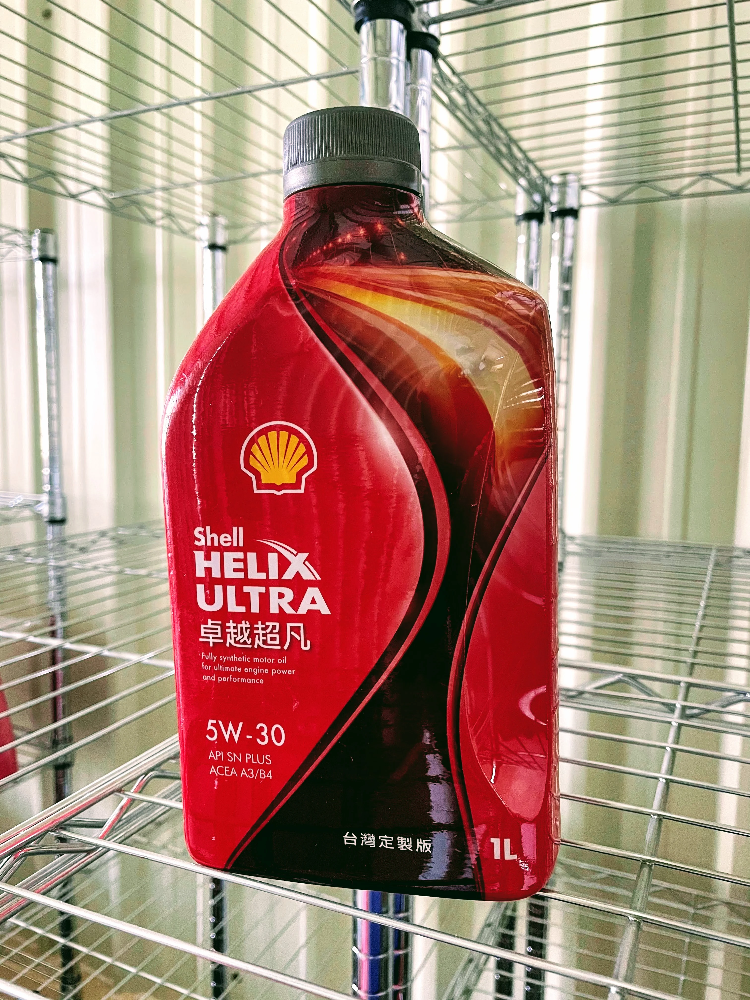

## **تجربة وتقييم زيت Shell Helix Ultra X 5W-30**
**【درجة SAE 30، اعتماد MB 229.5، تصنيف API SP/SQ، قاعدة Group 3+ GTL】**

من تابع أجزاء سلسلتي السابقة يعلم أن قراري النهائي استقر على اختيار **Shell Helix Ultra X 5W-30** (ويُرمز له اختصاراً بـ HUX530). يسعدني اليوم مشاركتكم تقييم الأداء الميداني بعد قطع مسافة 7,500 كم مقارنة بزيت الوكالة الأصلي المعتمد **MB 229.5 5W-40** (MB540):

* **زمن تسخين المحرك**
    زمن الوصول لدرجة حرارة التشغيل القياسية أقصر بوضوح. تساعد اللزوجة المعتدلة عند 40°م الزيت في التدفق بسرعة فائقة نحو عمود الكامات والتيربو منذ اللحظة الأولى للتشغيل.

* **هدوء المحرك في وضع السلانسيه**
    انخفضت الاهتزازات الدقيقة والضجيج الميكانيكي للمحرك أثناء التوقف مقارنة بزيت MB540 الأصلي. ورغم أن الزيوت الأثقل لزوجة تفترض هدوءاً أكبر، إلا أن النقاء الجزيئي التام لتركيبة GTL (المحولة من الغاز الطبيعي) من شل أظهرت فاعلية استثنائية في تخميد الصوت.

* **استجابة التسارع وصعود عدد الدورات (RPM)**
    بفضل انخفاض قوى الإعاقة الهيدروديناميكية للزوجة SAE 30، يتسارع المحرك بخفة ورشاقة لافتة. ويظهر ذلك جلياً على الطرق السريعة عند تسقيط التروس لتجاوز المركبات الأخرى.

* **مسافة التدحرج الحر (القصور الذاتي)**
    تقطع السيارة مسافة حرة أطول بكثير عند رفع القدم عن دواسة الوقود، حيث تتلاشى قوى الكبح الميكانيكي المعيقة للمحرك شبه كلياً بفضل تقليل الاحتكاك الداخلي.

* **الثبات الحراري ومعدل نقص الزيت**
    حتى بعد قطع 7,500 كم، لم يتراجع أداء المحرك ولا هدوءه الصوتي، وأكد فحص مقياس الزيت استقرار المستوى دون أي تبخر ملحوظ.

### **الخلاصة الهندسية**
مقارنة بالزيت المعتمد التقليدي في الوكالات، يقدم HUX530 نقلة نوعية ملموسة وفورية في سلاسة وانسيابية القيادة.

ومع التحديث العالمي لهذا الزيت ليلبي معايير **API SQ** الصارمة، أصبح يوفر حصانة مضاعفة لسلاسل التوقيت وحماية جذرية من أضرار ظاهرة الإشعال المسبق LSPI. ويظل في تقديري الخيار الأفضل لمحركات مرسيدس W205 جامعاً بين **SAE 30، واعتماد MB 229.5 الصريح، ومعايير API SP/SQ، وقاعدة الزيت التخليقية GTL (Group 3+)**.

