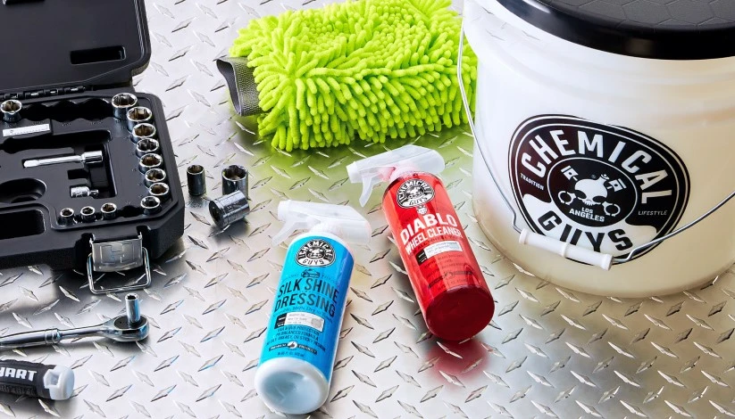

**الترتيب الهندسي المعتمد للعمل: المقصورة الداخلية > العجلات والجنوط > الهيكل الخارجي**

### العناية بالمقصورة الداخلية

* **التنظيف وإزالة الدهون**
    * منظف شامل Meguiar's D101 All Purpose Cleaner (تخفيف 1:10)
    * منظف المقصورة الشامل من سوناكس SONAX Interior Cleaner
    * شمع تنظيف الجلود والفينيل Collinite Leather & Vinyl #855
* **الحماية والتغذية ومقاومة الشمس (UV)**
    * مجدد الجلود والفينيل من 3M PN38143
    * ملمع وحامي البلاستيك Meguiar's Ultimate Protectant, G14716
    * سائل العناية بالمقصورة Meguiar's Ultimate Interior Detailer, G16216
    * منظف وملمع الطبلون Turtle Wax DASH & GLASS Interior Detailer
    * واقي الأسطح Turtle Wax INSIDE & OUT Car Protectant

---

**مراحل الطلاء الخارجي: غسيل > صلصال كلاي > كومباوند قص > بولش تنعيم > جليز تعبئة > سيلنت عازل > شمع واكس > كويك ديتيلر**

### ترشيحات المنتجات ذات القيمة العالية مقابل السعر (للهواة والمبتدئين)

#### 1. مركبات القص وإزالة الخدوش
> *تحتوي على حبيبات كاشطة مصممة لتسوية خدوش طبقة الورنيش.*
* **مركبات القص الخشن (Heavy Cut - إزالة الخدوش العميقة):**
    * Finish Kare BWM 114: Rubbing Compound
    * Poorboy's Master Cut Super Cut Compound
    * Poorboy's SSR3
    * Meguiar's Ultimate Compound, G17216
* **مركبات التنعيم والصقل الناعم (Polish / AIO - كشط ناعم للتلميع الشامل):**
    * Turtle Wax Hybrid Solutions Ceramic Polish & Wax (AIO)
    * Turtle Wax Hybrid Solutions Pro 1 & Done
    * Collinite 631 (Fleetwax) / 920

#### 2. الجليز (Glaze - ملء العيوب وإبراز عمق اللون)
> *مركبات غير كاشطة تغذي المسام بالزيوت وتمنح لمعاناً وانعكاساً كمرآة عميقة.*
* Poorboy's White Diamond (للألوان الفاتحة) / Black Hole (للألوان الداكنة)
* 3M Hand Glaze 5990 (مغذي وملمع نقي خالٍ من الحماية)

#### 3. السيلنت التخليقي (Paint Sealants - حماية كيميائية طويلة المدى)
> *بوليمرات صناعية عازلة تتميز بقدرة تحمل فائقة للعوامل الجوية.*
* **Finish Kare 1000P**: Hi-Temp Paste Wax (شمع أسطوري فائق التحمل لدرجات الحرارة العالية)
* Finish Kare 2180 / 118
* Meguiar's M21 Synthetic Sealant
* Poorboy's EX Sealant مع الكارنوبا
* 3M 39030 Performance Finish
* Collinite 476S / 885 (مقاوم فائق للغسيل والصابون)
* Meguiar's M27 SiO2 Sealant
* Turtle Wax Hybrid Solutions Pro to The Max Wax

#### 4. شمع الكارنوبا الطبيعي (Carnauba Wax - لمعان نضر ومظهر مبلل)
> *يعطي لمعاناً دافئاً وطاقة طرد هائلة لقطرات الماء؛ الخيار الأمثل كطبقة فوق السيلنت.*
* Finish Kare #2685: Cherry Pink Paste Wax
* 3M Perfect-It Boat Wax 36112 / 36113
* Collinite 915 (Marque D'Elegance) / Collinite 845 (Insulator Wax السائل)
* Poorboy's World Liquid Natty's Blue / Red
* Turtle Wax Super Hard Shell

#### 5. بخاخات الإنهاء والشمع السريع
* **بخاخات التنظيف والتليين السريع (Quick Detailers):**
    * Meguiar's Quik Detailer Mist & Wipe, A3316
    * Meguiar's D155 Last Touch Spray Detailer
* **بخاخات الشمع السائل وتعزيز الحماية (Spray Wax / Boosters):**
    * Meguiar's Ultimate Quik Detailer, G14422 (UQD)
    * Meguiar's M799 Pro Hybrid Ceramic Bead Booster
    * Turtle Wax Hybrid Solutions Ceramic Wax 3-in-1 Detailer
    * Turtle Wax Express Shine Carnauba Spray
    * Turtle Wax Pro Graphene Flex Wax

### مراجع هندسية وإرشادات:
* [دليل العناية بالطلاء بخمس خطوات من مجوايرز Meguiar's](https://meguiarsonline.com/forum/information-station/how-to-articles/66299-meguiar-s-5-step-paint-care-cycle)
* [دليل تلميع وعناية السيارات الشامل من تيرتل واكس Turtle Wax](https://www.turtlewax.com/blogs/how-to/the-complete-car-detailing-guide)
