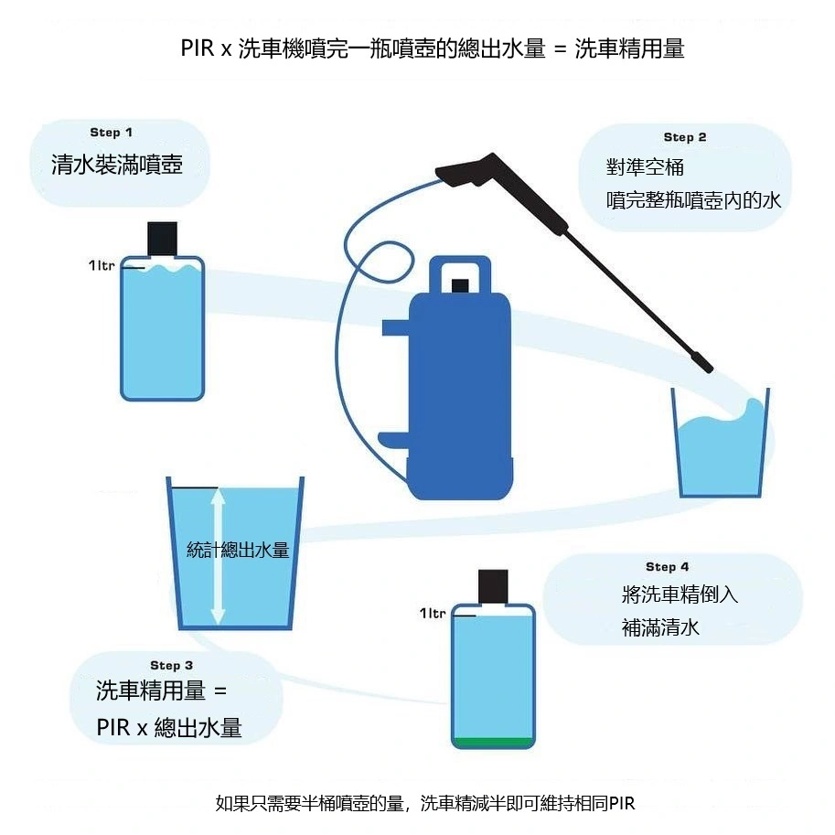

## فهم مفهوم نسبة التأثير على السطح (PIR)

يعتمد معظم الهواة على التخمين العشوائي عند خلط شامبو غسيل السيارات في خزان مدفع الرغوة (مثل وضع نسبة 1:10 تقريبياً)، مما يؤدي في الغالب إما إلى رغوة خفيفة تسيل فوراً دون إذابة الأوساخ، أو رغوة كثيفة بشكل مفرط تهدر الشامبو دون فائدة. ويرجع ذلك إلى اختلاف معدل تدفق المياه وضغطها بين ماكينات الغسيل.  

يُعد حساب **PIR** الأسلوب العلمي والهندسي الأدق لمعرفة «التركيز الفعلي النهائي» للرغوة الساقطة على طلاء المركبة.

## قياس معدل تدفق المياه الفعلي لمعداتك

قبل تطبيق المعادلة، يجب أن تقيس بدقة **إجمالي تدفق المياه** الناتج عن ماكينة الضغط العالي ومدفع الرغوة الخاصين بك.

### خطوات القياس المعملية البسيطة:
1.  **ملء الخزان:** ضع في خزان مدفع الرغوة **1 لتر بالضبط** من الماء العادي الصافي (بدون شامبو).
2.  **ضبط المحبس:** أغلق مقبض التحكم في الرغوة أعلى المدفع بالكامل في اتجاه العلامة (-) للحصول على أقصى كثافة رغوة ممكنة.
3.  **الرش والجمع:** وجّه مسدس الرش نحو سطل أو برميل كبير فارغ، واضغط على الزناد باستمرار حتى يتم سحب واستهلاك لتر الماء بالكامل من خزان المدفع.
4.  **قياس السطل:** قس الحجم الكلي للماء المتجمع في السطل.  
    * *مثال: إذا تجمّع في السطل 10 لترات من الماء، فإن معدل تخفيف جهازك الإجمالي هو 1:10.*

## المعادلة الهندسية لحساب نسبة PIR

بمجرد معرفة **إجمالي تدفق المياه**، استخدم نسبة PIR الموصى بها على عبوة الشامبو لحساب الحجم الدقيق للمركز الواجب وضعه في الخزان:

> **كمية الشامبو المركز = نسبة PIR × إجمالي تدفق المياه**

### مثال تطبيقي عملي:
إذا كنت تستخدم شامبو **Meguiar's D110 Hyper Wash** الموصى بنسبة PIR قدرها **1:100 (أي 1%)**، وكان **إجمالي تدفق المياه** الذي قسته هو **10,000 مل (10 لترات)**:

* **10,000 مل × 0.01 (1%) = 100 مل**

**النتيجة العملية:** يجب عليك سكب **100 مل** فقط من الشامبو المركز داخل خزان المدفع، ثم إكمال باقي الخزان بالماء. بهذه الطريقة ستضمن أن الرغوة المتدفقة على سيارتك تطابق تماماً نسبة 1:100 التي صممها كيميائيو الشركة.

## لماذا يُعد حساب PIR بالغ الأهمية؟

1.  **توفير مالي كبير:** يحميك من استنزاف وهدر عبوات الشامبو الاحترافية باهظة الثمن.
2.  **أداء تنظيف مثالي:** يمنح الرغوة اللزوجة الكافية لتغليف ذرات الغبار وتفكيكها دون إزالة طبقات الشمع أو السيلنت الحامية للطلاء.
3.  **ثبات المعايير:** حتى لو قمت بتغيير ماكينة الغسيل في المستقبل، ستضمن الحفاظ على نفس جودة النظافة والتركيز.

### نصيحة فنية للمحترفين:
في ماكينات الغسيل المنزلية ذات معدل التدفق المنخفض، يمكن استبدال الفونية الداخلية في مدفع الرغوة بفتحة **1.1 مم** (بدلاً من 1.25 مم القياسية) لتحسين كثافة الرغوة وتقليل استهلاك الماء. واحرص دائماً على إعادة قياس تدفق المياه في السطل عند تعديل أي قطعة من معداتك!
