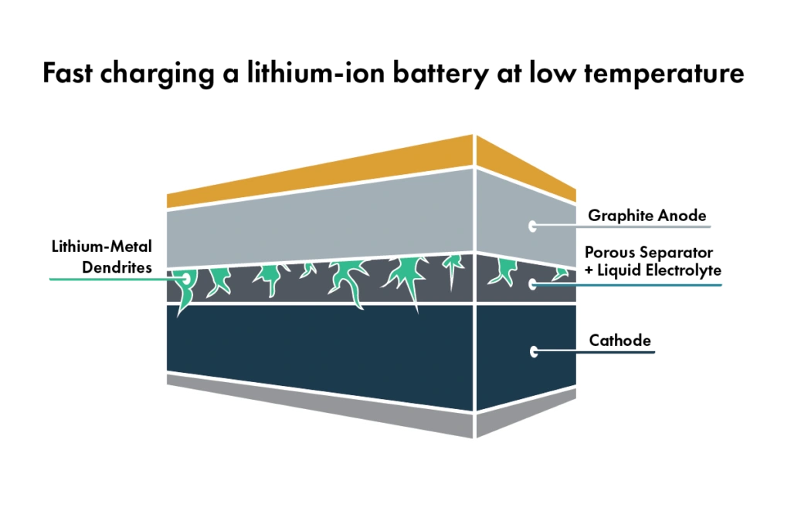

يُعد معيار SAE J537 أحد أقدم وأشهر اختبارات الأداء لبدء التشغيل على البارد، وقد وضعته **جمعية مهندسي السيارات الأمريكية (SAE)** خصيصاً لـ **بطاريات الرصاص الحمضية التقليدية**. والهدف منه هو قياس قدرة البطارية على مد المحرك بتيار التدوير الأولي في الأجواء المتجمدة. ولكن في السنوات الأخيرة، دأبت بعض الشركات المصنعة على الترويج لبطاريات فوسفات حديد الليثيوم (LiFePO₄) بزعم اجتيازها هذا الاختبار. وهذا الاستخدام مضلل علمياً وهندسياً لجمهور السائقين.

## محتوى ومنهجية اختبار SAE J537

يرتكز جوهر اختبار SAE J537 على الخطوات التالية:
- وضع البطارية في غرفة تبريد بدرجة حرارة **-18°م** لمدة 24 ساعة متواصلة.
- إجراء تفريغ بتيار عالي مستمر (مثل 150 أمبير لمدة 30 ثانية متواصلة).
- **إخراج البطارية وشحنها في درجة حرارة الغرفة العادية.**
- قياس قدرة استرداد الفولتية ومعدل فقدان السعة.

صُمم هذا البروتوكول بالكامل ليناسب التفاعل الكيميائي لصفائح الرصاص وحمض الكبريتيك، **وهو لا يراعي بأي حال الخصائص الكهروكيميائية الدقيقة لمركبات الليثيوم أيون أثناء استقبال تيار الشحن.**

## الخطر القاتل المتجاهل: الشحن البارد وتكون شعيرات الليثيوم

تواجه بطاريات الليثيوم خطراً بنيوياً حرجاً عند استقبال تيار الشحن في درجات حرارة منخفضة (وخاصة تحت **صفر مئوي 0°م**): وهو ما يُعرف بـ **ترسب الليثيوم المعدني (Lithium Plating)**.

1.  **ترسب الليثيوم المعدني:** في درجات الحرارة الباردة، تتباطأ حركة الأيونات بشدة، فتعجز عن التخلل داخل بنية قطب الجرافيت السالب، وبدلاً من ذلك تترسب على السطح كطبقة من معدن الليثيوم النقي غير المستقر.
2.  **نمو الشعيرات الحادة (Dendrites):** مع تكرار دورات الشحن البارد، تتجمع تلك الترسبات لتشكل إبراً بلورية حادة تشبه الشجيرات المتفرعة.
3.  **الالتماس الداخلي والاشتعال الكيميائي:** تخترق هذه الإبر الحادة العازل البوليمري الدقيق الفاصل بين القطبين، مما يتسبب في شورت داخلي مباشر، وانفجار البطارية أو اشتعالها ذاتياً (الهروب الحراري Thermal Runaway).

**إن الثغرة الهندسية الفاضحة في اختبار SAE J537 تكمن في شحن البطارية بعد تدفئتها في درجة حرارة الغرفة.** وهذا يلغي تماماً السيناريو الأخطر في واقع قيادة السيارات: وهو قيام دينامو السيارة (Alternator) بضخ تيار شحن جارف يتراوح بين 50 إلى 100 أمبير في بطارية ليثيوم متجمدة عند تشغيل السيارة في صباح شتوي قارس.

## الخلاصة: لا تنخدع بالأرقام الانتقائية

حينما تتفاخر جهة معينة بنجاح بطارية ليثيوم في اختبار SAE J537، فإنها تتبع نصاً إعلانياً يتفادى الحديث عن مخاطر الشحن في الأجواء الباردة.

إن الأمان الحقيقي لبطاريات الليثيوم في السيارات يُقاس عبر معايير متقدمة وصارمة مثل **UL 2580** أو **IEC 62660**، والتي تفرض فحوصات قاسية تشمل اختبارات سوء الاستخدام الحراري ووجود نظام ذكي لإدارة البطارية (BMS) يمنع الشحن منعاً باتاً تحت الصفر المئوي ما لم تكن الخلايا مزودة بنظام تدفئة ذاتي.
