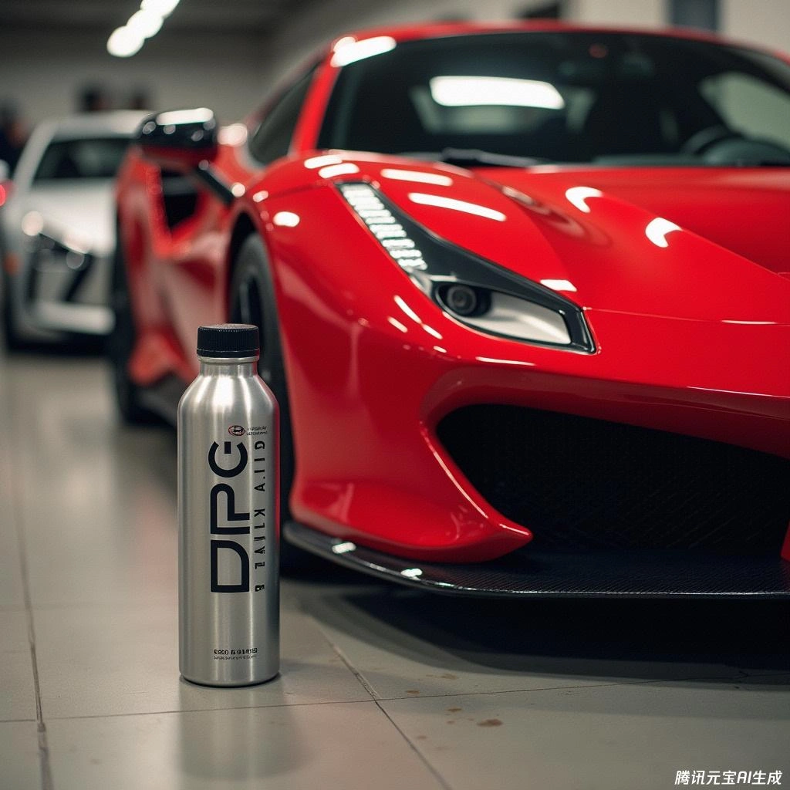

## منظف البخاخات RedLine SI-1 (بمركب PEA عالي التركيز)

> **حساب التركيز النظري المعتمد** > 15 أونصة في 20 غالون أمريكي ≈ 0.0058 (0.6%)

### جرعة الصدمة المكثفة (تنظيف عميق وإزالة ترسبات الكربون)
* **25 لتر بنزين : 150 مل**

### جرعة الصيانة الدورية المنتظمة
* **25 لتر بنزين : 75 مل**

## منظف شيفرون تيكرون Chevron Techron Concentrate Plus

> **حساب التركيز النظري المعتمد** > 1 أونصة في 1 غالون أمريكي ≈ 0.0078 (0.8%)

### الجرعة الموصى بها
* **25 لتر بنزين : 200 مل**

## كحول الأيزوبروبيل (IPA) لطرد الرطوبة وامتصاص الماء من التانك

> **حساب التركيز النظري المعتمد** > 8 أونصات في 17 غالون أمريكي ≈ 0.0036 (0.37%)

### الجرعة الموصى بها
* **25 لتر بنزين : 92 مل**

## خلطة التنظيف المنزلية DPC Mix DIY Fuel Additive

> ⚠️ **【تحذير أمان وإخلاء مسؤولية قانونية وهندسية】** ⚠️
> إن تركيبة DPC والنسب المعروضة هنا مخصصة حصراً للدراسة الفنية والبحثية بين عشاق ومعدلي السيارات المتمرسين.
> * **مخاطر التعامل الكيميائي:** النفثا الخفيفة والكيروسين مذيبات بترولية سريعة الاشتعال والتطاير. يجب الخلط والتحضير في أماكن خارجية مفتوحة جيدة التهوية بعيداً عن مصادر الحرارة والشرر، مع ارتداء نظارات واقية وقفازات مقاومة للمذيبات.
> * **تحمل المحرك:** تختلف قدرة تحمّل دورات الحقن المباشر للمذيبات من محرك لآخر.
> * **إخلاء المسؤولية:** تقع مسؤولية استخدام هذه الخلطة على عاتق القارئ تماماً، ولا يتحمل الموقع أو الكاتب أي تبعات قانونية أو أضرار ميكانيكية. للاستخدام اليومي الخالي من القلق، يُنصح دائماً بالاعتماد على المنتجات الرسمية المعتمدة من كبرى الشركات العالمية.

### الحدود القصوى للمكونات في تانك البنزين
* الديزل (السولار) < 1%
* الكيروسين المنقى < 0.2%
* نفثا التنظيف البترولية (Cleaning Naphtha) < 0.05%

### نسب خلط المكونات مسبقاً في عبوة التحضير
> **D (ديزل) : P (كيروسين) : C (نفثا) = 2 لتر : 0.5 لتر : 0.1 لتر**

### مقدار الإضافة في تانك السيارة
* **25 لتر بنزين : 300 مل**
* **27 لتر بنزين : 325 مل**
