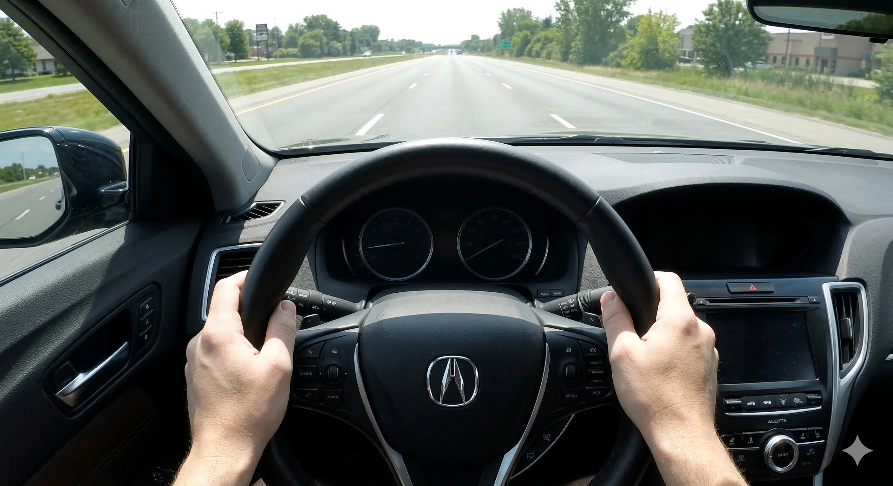

عند استلام سيارة جديدة تماماً من الوكالة، يتوقع كل مالك تجربة قيادة خالية من أدنى عيب. ولكن يلاحظ بعض السائقين أنه حتى في خط مستقيم، يبدو المقود «مائلاً بدرجات يسيرة نحو أحد الجانبين». فهل هذا خلل في شاسيه السيارة أم خطأ في ضبط المحاذاة والميزان؟

في الحقيقة، هذه الظاهرة مألوفة جداً في الهندسة الميكانيكية. وقبل التسرع والذهاب للشكوى في مركز الصيانة، دعونا نتعرف على الأسباب الهندسية والفيزيائية الأربعة الأكثر شيوعاً.

## 1. هندسة وتصميم الطرق: تقوس ميول التصريف
معظم الشوارع والطرق السريعة ليست مستوية أفقياً بنسبة 100%. فلضمان سرعة تصريف مياه الأمطار ومنع تشكل البرك المائية، تُبنى الطرق بشكل محدب أو مقوس؛ بحيث يكون منتصف المسار مرتفعاً وأطرافه منحدرة تدريجياً لليمين واليسار.

أثناء القيادة، تجذب قوة الجاذبية السيارة بشكل طبيعي نحو الجانب المنحدر من الطريق. وحتى تسير السيارة في خط مستقيم تماماً، يقوم السائق دون وعي منه بممارسة ضغط تصحيحي خفيف جداً على المقود في الاتجاه المعاكس. وهذا التعديل المستمر يخلق وهماً بصرياً بأن عجلة القيادة مائلة في وضع السير المستقيم.

## 2. عزم التوجيه الطارئ (Torque Steer) في سيارات الدفع الأمامي
تعتمد الغالبية العظمى من سيارات السيدان والكروس أوفر العائلية الحديثة على محركات مثبتة بشكل عرضي في المقدمة. وبسبب موقع ناقل الحركة، يكون عمود الدفع (العكس) الأيمن مختلفاً في الطول والوزن عن العمود الأيسر.

عند الضغط القوي والمفاجئ على دواسة الوقود، يؤدي فارق الطول وزوايا التمفصل إلى وصول عزم الدوران بشكل غير متطابق جزئياً للعجلات الأمامية، مما يسبب سحبة خفيفة ومؤقتة لعجلة القيادة نحو أحد الجوانب. هذه سمة ميكانيكية حركية ناتجة عن عدم تكافؤ أطوال العكوس وليست عيباً تصنيعياً.

## 3. معايرة نقطة الصفر لنظام التوجيه الكهربائي (EPS Zero-Point)
تعتمد جميع السيارات الحديثة على نظام التوجيه الكهربائي المؤازر (EPS). ويعتمد الكمبيوتر على حساس رقمي شديد الدقة لمعرفة نقطة المنتصف الصريحة (درجة 0 بالضبط). فإذا كانت المعايرة الابتدائية من المصنع مائلة بأجزاء من الدرجة، أو إذا لم يُقم الفني بتصفير زاوية التوجيه بالكمبيوتر بعد فحص الميزان، فسيظل الموتور الكهربائي يضخ مساعدة خفيفة في الاتجاه الخاطئ تجعلك تشعر بأن المقود مائل.

## 4. هوامش وتفاوتات ضبط المحاذاة المصنعية
أثناء تجميع السيارة في المصنع، لا يتم ضبط زوايا الكامبر والتو والكاستر عند رقم حسابي مفرد، بل ضمن **نطاق هوامش مقبولة (Tolerance Range)**. فإذا خرجت السيارة مضبوطة عند الحد الأقصى أو الأدنى لهذا النطاق، ومع استقرار وهبوط جلب المقصات والمطاط خلال أول 1000 كم، قد يظهر انحراف خفيف في توازن التوجيه.

## كيف تفحص وتتعامل مع المشكلة بدقة؟
إذا كنت تشك في توازن مقود سيارتك، قم بإجراء الفحص العملي التالي:
1. اختر **مكاناً واسعاً ومستوياً تماماً وخالياً من الميول والتصريف** (كموقف سيارات كبير فارغ أو مدرج مستوٍ).
2. سر بسرعة ثابتة وآمنة، ثم ارفع يديك بحذر للحظات عن عجلة القيادة.
3. إذا استمرت السيارة في السير في خط مستقيم بينما المقود مائل فقط، فالمشكلة تنحصر في تصفير حساس EPS أو ضبط أذرعة التوجيه.
4. إذا انحرفت السيارة فوراً وبقوة نحو جانب محدد، فتحقق أولاً من **تساوي ضغط الهواء في الإطارات الأربعة**.

وإذا استمر الانحراف، توجه للوكيل لإجراء فحص ميزان إلكتروني ثلاثي الأبعاد 3D مع **إعادة تصفير وبرمجة النقطة الصفرية لعجلة القيادة (EPS Zeroing)** عبر جهاز كشف الأعطال.
