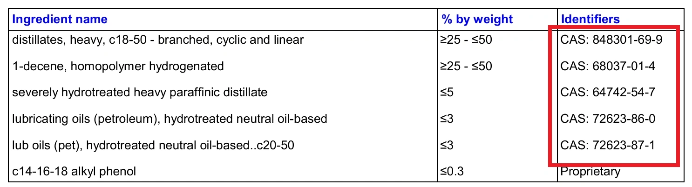

عند اختيار زيت المحرك، يتساءل الكثير من السائقين وهواة التعديل عما إذا كانت عبارة "تخليقي بالكامل" (Full Synthetic) تعني استخدام قواعد PAO التخليقية الحقيقية (المجموعة الرابعة) أو الإسترات (المجموعة الخامسة)، أم أنها مجرد زيوت معدنية مكررة ومكسرة بالهيدروجين VHVI (المجموعة الثالثة). وتظل الطريقة الأكثر حيادية وتجرداً لكشف أسرار تركيبة الزيت هي مراجعة **صحيفة بيانات سلامة المادة (SDS / MSDS)**.

<figure>
  
  <figcaption align="center">صورة توضيحية: صحيفة SDS لزيت Mobil 1 0W-40</figcaption>
</figure>

في وثيقة SDS، يتم تمييز كل مادة برقم كيميائي فريد يُعرف بـ **رقم CAS (Chemical Abstracts Service)**، وهو بمثابة الرقم القومي أو الهوية الرسمية للمادة الكيميائية. ولمساعدتك في فك شفرة هذه المصطلحات، يجمع هذا الدليل جدولاً مرجعياً منظماً لأشهر أرقام CAS لقواعد الزيوت (المجموعات من I إلى V) وباقات الإضافات المتقدمة (ZDDP، ومعدلات الاحتكاك MoDTC، والمنظفات، والمشتتات).

  <label for="casSearchInput" style="font-weight: bold; margin-left: 10px;">البحث السريع:</label>
  <input type="text" id="casSearchInput" placeholder="أدخل رقم CAS (مثال: 68037-01-4)" style="padding: 8px; width: 250px; border: 1px solid #ccc; border-radius: 4px; direction: ltr;">
  <button onclick="searchCAS()" style="padding: 8px 15px; background-color: #04384c; color: white; border: none; border-radius: 4px; cursor: pointer;">بحث</button>
  

| تصنيف زيت الأساس / الإضافة | رقم CAS | التوصيف الكيميائي للمادة |
| :--- | :--- | :--- |
| **المجموعة الرابعة (تخليقي PAO)** | 68037-01-4 | 1-Decene, homopolymer, hydrogenated (بوليمر مهدروج) |
| | 68649-12-7 | رباعي 1-decene مخلوط مع ثلاثي 1-decene مهدروج |
| | 68649-11-6 | 1-Decene, ثنائي مهدروج |
| | 163149-29-9 *(وكذلك 8002-05-9)* | بوليمرات أولفينات مهدروجة C8, C12 |
| | 151006-63-2 | 1-Dodecene, بوليمر متجانس مهدروج |
| | 151006-62-1 | 1-Dodecene, ثلاثي مهدروج |
| | 151006-60-9 | بوليمر 1-dodecene مع 1-decene مهدروج |
| | 163149-28-8 | بوليمر 1-decene مع 1-octene و 1-dodecene مهدروج |
| **المجموعة الثالثة (تحويل الغاز GTL)**| 848301-69-9 | نواتج تقطير فيشر-تروبش الثقيلة C18-50 المتفرعة والخطية |
| | 1262661-88-0| نواتج تقطير تحويل الغاز الثقيلة C18-50 |
| **المجموعة الثالثة (الهيدروكراك VHVI)** | 64741-89-5 | زيوت برافينية مكررة ومعالجة بالهيدروجين الفائق |
| | 64742-54-7 | نواتج تقطير برافينية ثقيلة عالية المعالجة بالهيدروجين |
| | 64742-55-8 | نواتج تقطير برافينية خفيفة عالية المعالجة بالهيدروجين |
| | 64742-70-7 | زيوت برافينية منزوعة الشمع حفزياً |
| | 72623-87-1 | هيدروكربونات برافينية معالجة بالهيدروجين الشديد (C20-50) |
| | 72623-85-9 | زيوت تزييت محايدة عالية اللزوجة معالجة هيدروجينياً |
| | 72623-86-0 | زيوت أساس محايدة معالجة بالهيدروجين |
| | 178603-64-0 | زيوت مكسرة ومؤزمرة هيدروجينياً C15-30، مؤشر لزوجة مرتفع |
| | 178603-65-1 | زيوت مكسرة ومؤزمرة هيدروجينياً C20-40، مؤشر لزوجة مرتفع |
| | 178603-66-2 | زيوت مكسرة ومؤزمرة هيدروجينياً C25-55، مؤشر لزوجة مرتفع |
| **المجموعة الأولى والثانية (الزيوت المعدنية)** | 64741-50-0 | نواتج تقطير بترولية برافينية خفيفة |
| | 64741-50-5 | نواتج تقطير بترولية برافينية |
| | 64741-52-2 | نواتج تقطير نفثينية خفيفة |
| | 64742-65-0 | نواتج تقطير برافينية ثقيلة منزوعة الشمع بالمذيب |
| | 64742-58-1 | زيوت تزييت مستهلكة ومعاد تكريرها بالهيدروجين |
| | 64742-56-9 | نواتج تقطير برافينية خفيفة منزوعة الشمع بالمذيب |
| | 64742-62-7 | زيوت متبقية منزوعة الشمع بالمذيب |
| **المجموعة الخامسة (الإسترات / المتنوعة)** | 27178-16-1 | ثنائي إيزوديسيل أديبات (Diisodecyl adipate) |
| | 16958-92-2 | زيوت أساس تخليقية إسترية |
| | 28472-97-1 | ثنائي إيزوديسيل أزيلات (Di-isodecyl azelate) |
| | 9003-13-8 | بولي ألكيلين جليكول (PAG) |
| **إضافات مكافحة التآكل (ZDTP / ZDDP)** | 68649-42-3 | ثنائي ألكيل ثنائي ثيوفوسفات الزنك ZDTP |
| | 84605-29-8 | أملاح زنك لحمض فوسفورو ثنائي الثيويك |
| **معدلات الاحتكاك (MoDTC / MoDTP)**| 68958-92-7 | ثنائي ثيوفوسفات الموليبدينوم |
| | 68958-92-9 | ثنائي (2-إيثيل هكسيل) فوسفورو ثنائي ثيوات الموليبدينوم |
| **مضادات الأكسدة**| 36878-20-3 | ثنائي (نونيل فينيل) أمين |
| | 128-39-2 | 2,6-ثنائي ثالثي بوتيل فينول |
| **المنظفات (Detergents)**| 61789-86-4 | سلفونات كالسيوم بترولية |
| | 68783-96-0 | أملاح كالسيوم لأحماض سلفونية فائقة القاعدية |
| | 115733-09-0 | كبريتيد فينات ألكيل الكالسيوم طويل السلسلة |
| **المشتتات (Dispersants)** | بدون CAS | بولي أولفين بولي أمين سكسينيميد، بوليول |
| | 296-404-1 *(رقم المفوضية الأوروبية)*| إسترات حمض الفوسفوريك |
| | 84605-20-9 | بولي إيزوبوتيلين سكسينيميد (PIBSI) |
| **محسنات مؤشر اللزوجة (VM)** | 25038-36-2 | بوليمر مشترك للأولفينات (OCP) |
| | 127883-08-3 | بوليمر إيثيلين / بروبيلين أروماتي |
| **خافضات نقطة الانسكاب (PPD)** | بدون CAS | إستر بولي ميثيل ميثاكريلات |
| **مضادات الرغوة**| 63148-62-9 | بولي ثنائي ميثيل سيلوكسان (زيت سيليكون) |

## المراجع الهندسية
* [دراسة التركيب الكيميائي للزيوت - PAO المجموعة الرابعة، GTL، الهيدروكراك، الإسترات - منتدى Oil-Club.ru](https://www.oil-club.ru/forum/topic/2120-izuchaem-sostav-masla-pao-group-iv-gtl-gidrokreking-vhvi-group-iii-mineralnoe-maslo-group-i-ili-ii-estery-itd/page/31/)
