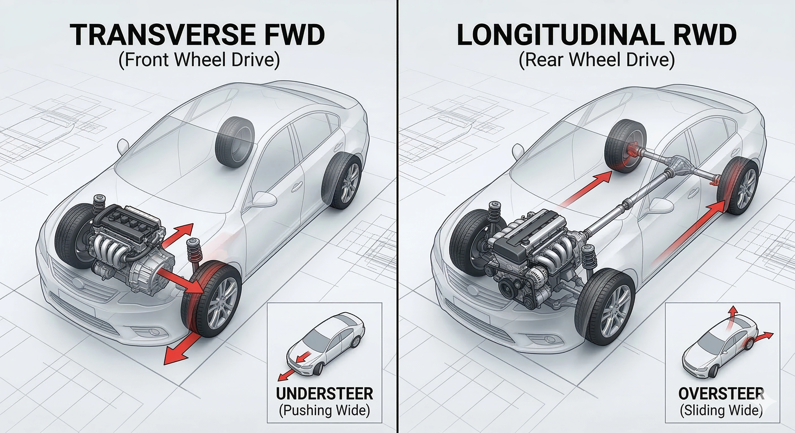

امتداداً لمقالنا السابق حول توازن وانحراف مقود السيارة، طرح الكثير من القراء أسئلة فنية حول الفوارق الجوهرية الحقيقية بين منظومة «الدفع الأمامي» ومنظومة «الدفع الخلفي». سنشرح هنا كيف يحدد تصميم الشاسيه ومحور الدفع أسلوب سيارتك على الطريق.

## 1. الدفع الأمامي بالمحرك العرضي (FWD): بطل استغلال المساحة
كما يوحي الاسم، يُثبت المحرك بشكل عرضي (جنباً إلى جنب) في مقدمة السيارة، وينقل طاقته الميكانيكية مباشرة إلى العجلات الأمامية. وهي المنظومة السائدة في معظم سيارات السيدان العائلية وسيارات الكروس أوفر الحديثة.

**خصائص وسلوكيات القيادة:**
* **استغلال أقصى للمساحة:** لعدم الحاجة لعمود نقل حركة ميكانيكي (عمود كردان) يمتد على طول الشاسيه إلى الخلف، تكون مقصورة الركاب أكثر اتساعاً وتمتاز بأرضية خلفية مستوية دون نفق وسطي بارز.
* **ثبات رائع في الانطلاق اليومي:** يستقر وزن كتلة المحرك وناقل الحركة الثقيل مباشرة فوق العجلات الدافعة في الأمام، مما يوفر تماسكاً ممتازاً عند الانطلاق من السكون في الأيام الممطرة والزلقة.
* **حدود ظاهرة انزلاق المقدمة (Understeer):** تتحمل الإطارات الأمامية عبئاً مزدوجاً ومرهقاً؛ فهي المسؤولة عن توجيه السيارة وعن دفعها للأمام في آن واحد. وعند دخول المنعطفات بسرعة زائدة، تفقد الإطارات الأمامية تماسكها وتنزلق السيارة نحو خارج المنحنى.
* **عزم التوجيه الطارئ (Torque Steer):** كما بيّنا سابقاً، يؤدي عدم تساوي أطوال محاور الدفع الأمامية (العكوس) إلى سحبة خفيفة في المقود عند التسارع القوي.

## 2. الدفع الخلفي بالمحرك الطولي (RWD): معشوق عشاق القيادة والرياضة
في هذه المنظومة العريقة، يُثبت المحرك في وضعية طولية متناسقة مع خط منتصف السيارة، وتنتقل القوة الحركية عبر عمود كردان صلب إلى الدفرنس والعجلات الخلفية. وتُعد البصمة المميزة لسيارات السيدان الفاخرة والسيارات الرياضية الأصيلة.

**خصائص وسلوكيات القيادة:**
* **توزيع أوزان شبه مثالي:** يتيح التثبيت الطولي للمحرك إرجاع كتلته للخلف باتجاه منتصف الشاسيه، ومع وجود وزن الدفرنس في المؤخرة، يتحقق توزيع أوزان عبقري يقترب من نسبة **50:50 بين الأمام والخلف**، مما يمنح توازناً خرافياً في المناورات.
* **الفصل التام للمهام الميكانيكية:** العجلات الأمامية مكرسة كلياً للتوجيه الدقيق، بينما تتولى العجلات الخلفية مهمة الدفع ودفع السيارة للأمام. هذا التوزيع يمنح المقود خفة ودقة متناهية وإحساساً واضحاً بكل تفاصيل الطريق.
* **إثارة انزلاق المؤخرة الممتع (Oversteer):** عند بلوغ حدود التماسك القصوى أو الضغط على دواسة الوقود في قلب المنعطف، قد تفقد العجلات الخلفية تماسكها وتنزلق المؤخرة بحرية، مما يتيح التوجيه بالدواسة والمناورة الرشيقة التي يعشقها محترفو القيادة.
* **التضحية ببعض المساحة:** يفرض عمود الكردان وجود نفق بارز في منتصف أرضية المقاعد الخلفية، مما يضيق المساحة المخصصة لأقدام الراكب الأوسط.

## الخلاصة: أي المنظومتين تناسب أسلوبك واحتياجك؟

* **اختر الدفع الأمامي (FWD)** إذا كان اهتمامك الأول ينصب على التوفير في استهلاك الوقود، وسعة المقصورة لراحة عائلتك، والقيادة الهادئة والآمنة سهلة التوقع في المشاوير اليومية.
* **اختر الدفع الخلفي (RWD)** إذا كنت تبحث عن المتعة الخالصة لقيادة السيارات، ودقة الانعطاف الرياضي، والشعور الفاخر بالدفع القوي والثبات الملوكي على السرعات العالية.

وأياً كان خيارك، فإن فهم فيزياء سيارتك هو الخطوة الأولى والأهم لقيادة آمنة وممتعة في كل رحلة!
