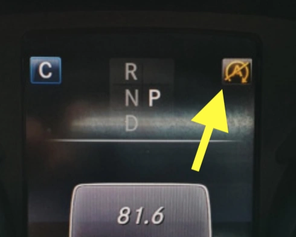

## علامات ومؤشرات انتهاء عمر البطارية الأصلية

- **اختفاء نظام التوقف والتشغيل التلقائي (Eco Start-Stop):** العلامة الأكثر وضوحاً هي بقاء أيقونة «A» في لوحة العدادات باللون الأصفر، أو توقف المحرك عن الانطفاء التلقائي عند التوقف في الإشارات. يحدث هذا لأن كمبيوتر السيارة (BMS) يستشعر انخفاض كفاءة شحن أو صحة بطارية AGM الأصلية دون الحد المسموح به.
- **تنبيهات مهندسي الصيانة:** يقوم الفنيون بفحص كفاءة البطارية أثناء الصيانة الدورية. فإذا أظهر جهاز الفحص انخفاضاً حاداً في الفولتية أو انتفاخاً في جوانب البطارية، فقد حان وقت التبديل الفوري.
- **ثقل دوران المحرك في الصباح:** إذا شعرت أن دوران المارش أصبح أبطأ وأثقل من المعتاد، فلا تؤجل التبديل حتى لا تتعرض لموقف محرج وتتعطل السيارة فجأة في الطريق.

## جدول مقارنة العلامات التجارية للبطاريات

| العلامة التجارية | مصدر الخلايا والمواصفات الفنية | زر التشغيل الطارئ | الضمان | مستوى السعر |
|:---|:---|:---:|:---:|:---|
| **Great Power (GreenRun)** | خلايا مصنعية أصلية معتمدة ([شهادة مقاومة الاشتعال لمواصفات السيارات](https://batteryfinds.com/wp-content/uploads/2021/09/Great-Power-100Ah-Lithium-Iron-PhosphateLiFePO4-LFP-Battery-Cell-Product-Specification.pdf)) | لا | سنتان | اقتصادي ممتاز |
| **Houny** | مصنع OEM سابق لبطاريات نوكيا / [جودة تصنيع وبناء داخلي رفيع](https://youtu.be/qL8HSL3h-MU) | لا | 3 سنوات | متوسط |
| **Tieli** | علامة حديثة / مصدر الخلايا غير معلن | لا | سنتان | متوسط |

## لماذا وقع اختياري على بطارية Green Run 2 (خلايا Great Power)

- **استبعاد الورش المجهولة:** أتجنب تماماً البطاريات المجمعة يدوياً في ورش صغيرة تفتقر للمواصفات القياسية وتعتمد على المبالغات التسويقية.
- **الأمان المطلق:** تستخدم Great Power خلايا موثقة بشهادات عدم الاحتراق الرسمية. وبالنسبة لقطعة ميكانيكية تستقر في حوض محرك مرتفع الحرارة، فإن الأمان يأتي أولاً دائماً.
- **القيمة مقابل السعر:** تقدم التوازن الأفضل بين الموثوقية العالية والسعر المعقول لمالكي W205 الراغبين في التخلص نهائياً من مشاكل بطاريات AGM دون تكبد مبالغ طائلة.

### مكاسب بطارية LiFePO4 مقارنة ببطاريات الرصاص AGM:
1.  **تخفيف ملحوظ للوزن:** تخفف ما يقارب **20 كجم** من وزن المحرك الأمامي، مما يعزز فوراً خفة واستجابة توجيه السيارة في المنعطفات.
2.  **ثبات الفولتية:** خط الفولتية المستقر والأعلى يمنح شمعات الاحتراق (البواجي) شرارة أنقى وأقوى ويجعل تبديلات القير أكثر نعومة وسلاسة.
3.  **عمر افتراضي طويل:** تدوم من 5 إلى 10 سنوات، متفوقة على بطاريات AGM التي غالباً ما تتلف بعد سنتين إلى 3 سنوات نتيجة الحرارة العالية في حوض المحرك.

### **إرشادات التركيب الحيوية**
احرص دائماً على استخدام **وصلة حفظ الذاكرة عبر منفذ OBD-II** أثناء التبديل. إن المنظومة الإلكترونية في مرسيدس W205 حساسة لانقطاع التيار المفاجئ؛ ويضمن الحفاظ على التيار الاحتياطي عدم ضياع إعدادات المقاعد والزجاج وفتحة السقف وظهور أكواد أخطاء في الكومبيوتر.
