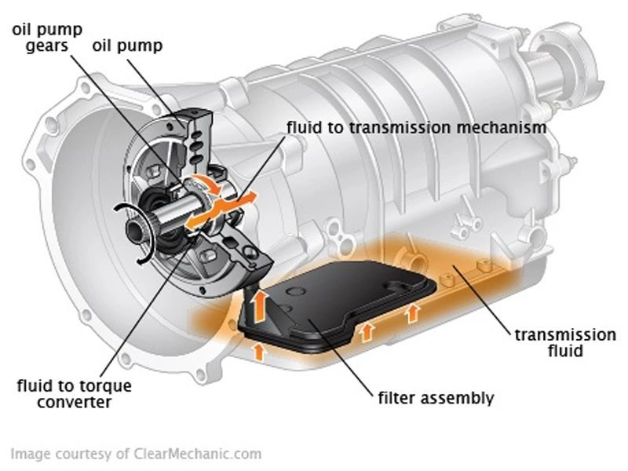
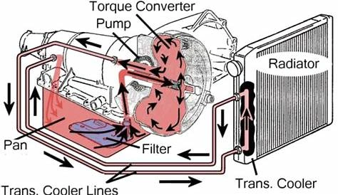

<iframe width="560" height="315" src="https://www.youtube.com/embed/zcwG97VMOVk?si=svbJ4WHcnP2I0Zgr&amp;start=410" title="YouTube video player" frameborder="0" allow="accelerometer; autoplay; clipboard-write; encrypted-media; gyroscope; picture-in-picture; web-share" referrerpolicy="strict-origin-when-cross-origin" allowfullscreen></iframe>

يوضح المقطع التوضيحي أعلاه مسار تدوير سائل ناقل الحركة (ATF) بدقة:
- تسحب **مضخة الزيت** السائل المتجمع في **وعاء الزيت (الكارتير)**، ويمر الزيت أولاً عبر **الفلتر / المصفاة**، ثم يتفرع إلى مسارين هيدروليكيين أساسيين:
  - مسار يغذي **محول العزم (Torque Converter)**.
  - مسار يغذي **مجموعة التروس وجسم الصمامات الهيدروليكية (مخ القير)**.
- بعد قيام السائل بوظائف التزييت والتحكم بالضغط الهيدروليكي، **يعود بالجاذبية ليستقر مجدداً في الكارتير**.

### مخططات الدوائر الهيدروليكية لناقل الحركة
 

هذا التكوين الهندسي مطابق تماماً لـ **دورة تزييت محرك الاحتراق الداخلي**:
- **بمجرد أن تسحب المضخة الزيت، تكون الخطوة الأولى هي مروره عبر عنصر التنقية.**
- يضمن ذلك وصول زيت نقي خالٍ من الحبيبات الكاشطة إلى الصمامات والمحابس الكهرومغناطيسية الحساسة للغاية.

## الأهمية القصوى لفلتر ناقل الحركة

يقلق العديد من ملاك السيارات عند رؤية رواسب أو برادة ناعمة في قاع الكارتير أثناء تفريغ الزيت. ومع ذلك، طالما أن **الفلتر** يؤدي دوره بكفاءة، فإن هذه الجسيمات تظل محصورة في القاع أو داخل نسيج الفلتر بعيداً عن مخ القير الحساس.

### تصميمات فلاتر ناقل الحركة:

1.  **المصافي السلكية التقليدية:** تستخدم شبكة معدنية ناعمة. تحجز الجسيمات الكبيرة وشظايا التآكل، لكنها تمرر دقائق طين الكلتشات المجهرية.
2.  **أنظمة الفلترة المزدوجة (عالية الأداء والحديثة):** تجمع بين مصفاة معدنية في الكارتير و**فلتر ورقي إضافي** خارجي أو مدمج. يوفر هذا النظام حماية فائقة للمحابس الكهربائية الدقيقة.
3.  **الفلاتر الداخلية غير القابلة للاستبدال:** تضع بعض الشركات المصنعة الفلتر في مكان مغلق بقلب هيكل القير، بحيث يتطلب تغييره فك وتجزئة القير بالكامل.

### **جدلية الفلاتر المسماة «مدى الحياة»**

عندما يُصمم ناقل الحركة بحيث لا يمكن استبدال فلتره أثناء الصيانة الدورية، فإن هذا يعني ببساطة أنه مع وصول الفلتر إلى قدرته الاستيعابية القصوى، سيبدأ الزيت بالتلوث التراكمي. يعتبر المتخصصون والمهندسون هذا النهج تجسيداً واضحاً لـ **التقادم المبرمج (Planned Obsolescence)**—وهو قرار تصميمي يقلل تكلفة الصيانة الظاهرية خلال فترة الضمان على حساب العمر التشغيلي الطويل للمركبة.

### الخلاصة:
أثناء صيانة ناقل الحركة الأوتوماتيكي، **تغيير الزيت وحده هو نصف المهمة فقط.** إذا كان تصميم سيارتك يتيح ذلك، **احرص دائماً على استبدال الفلتر أو المصفاة.** إن المحافظة على نظافة «كُلى» ناقل الحركة هي الضمان الوحيد لاستمرار عمل مخ القير ومحول العزم لمئات الآلاف من الكيلومترات دون أعطال.
