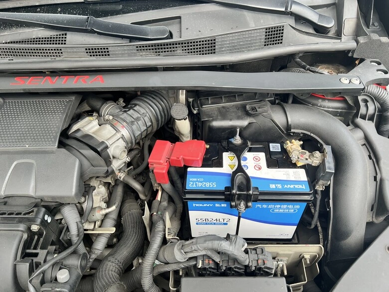
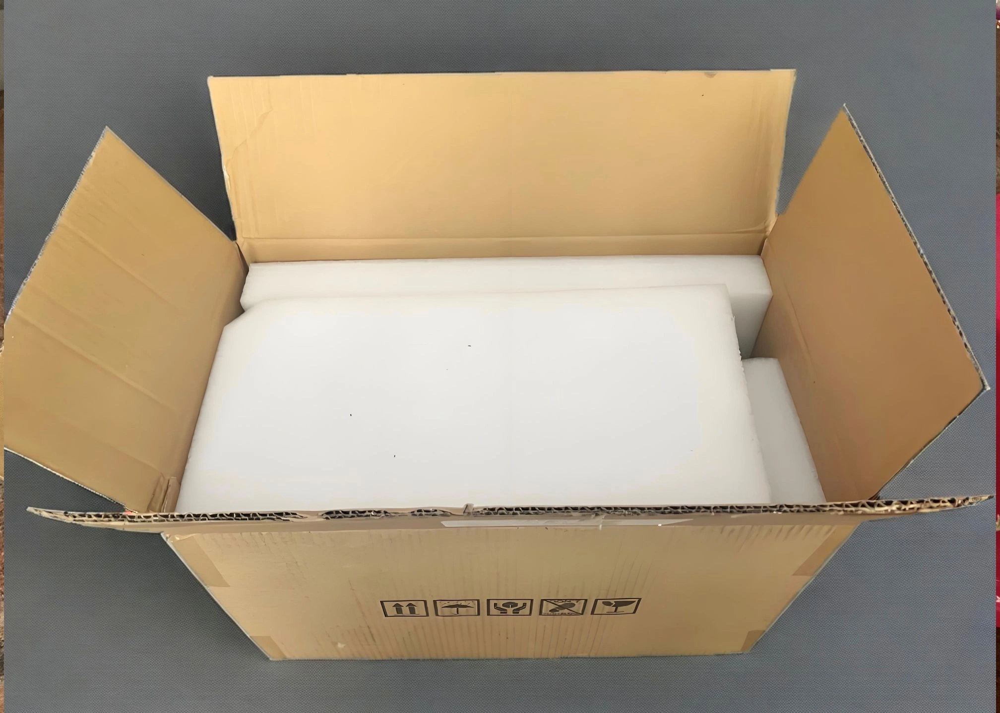
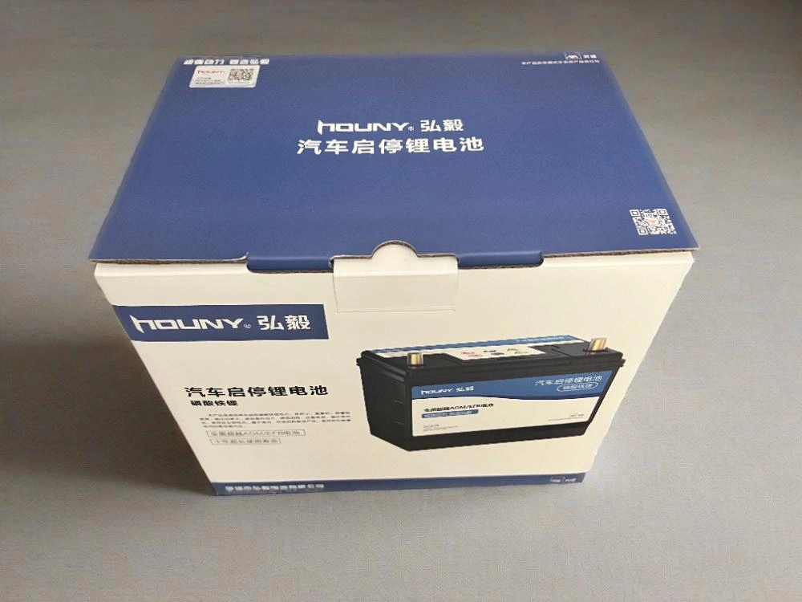
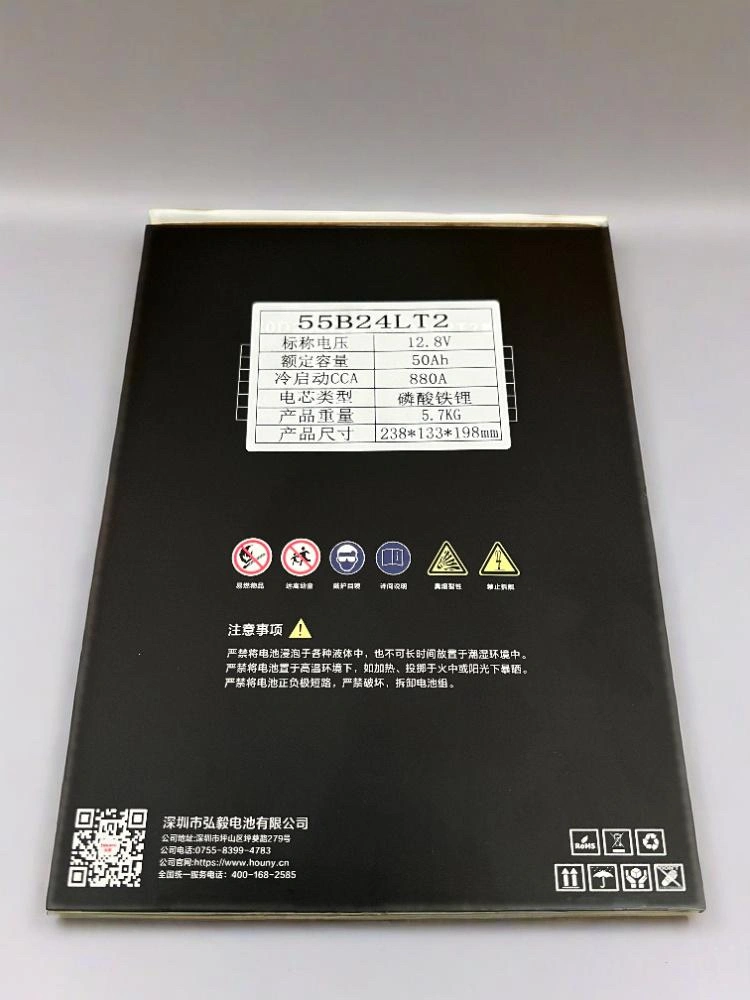
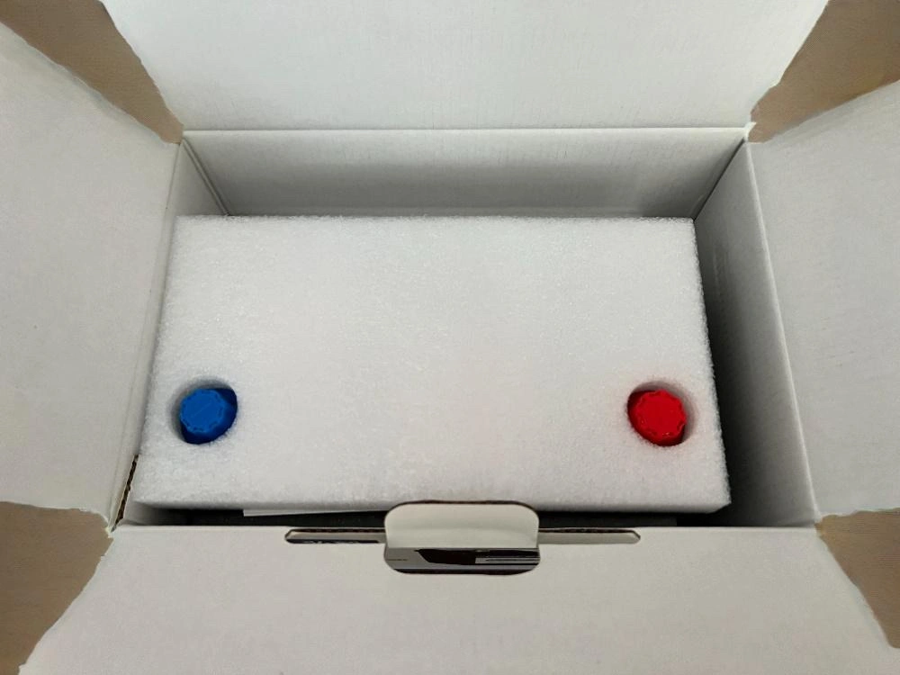
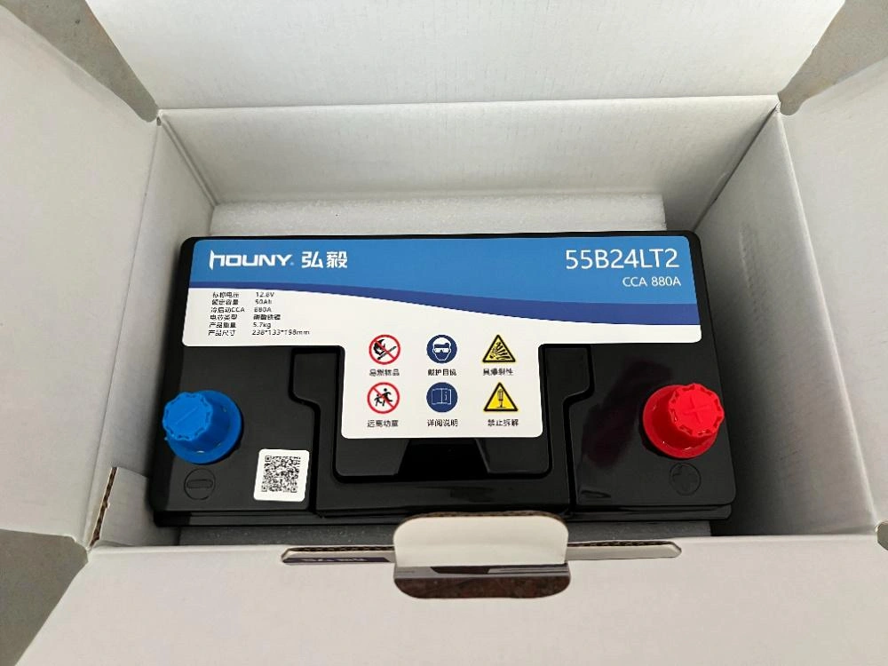
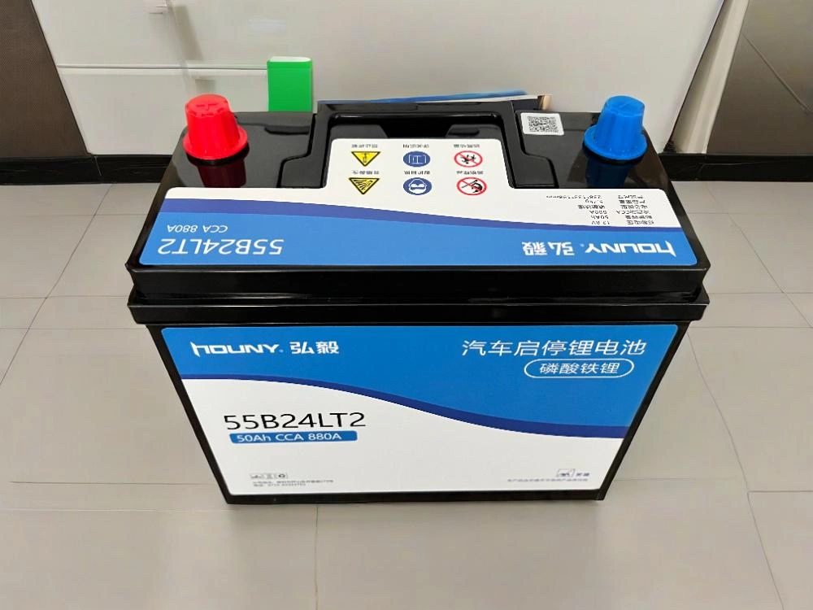
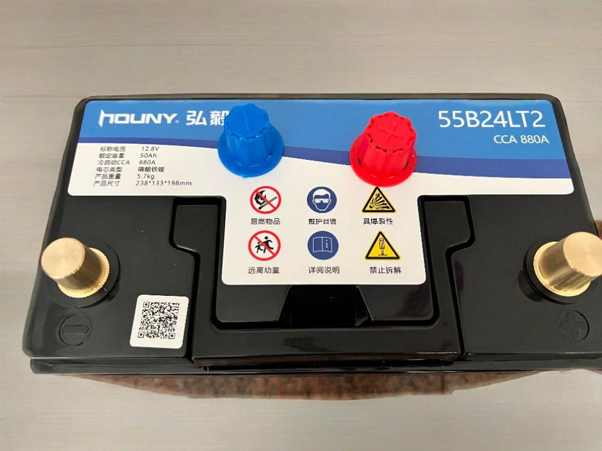
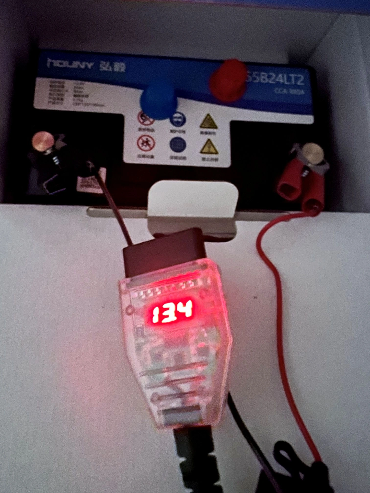
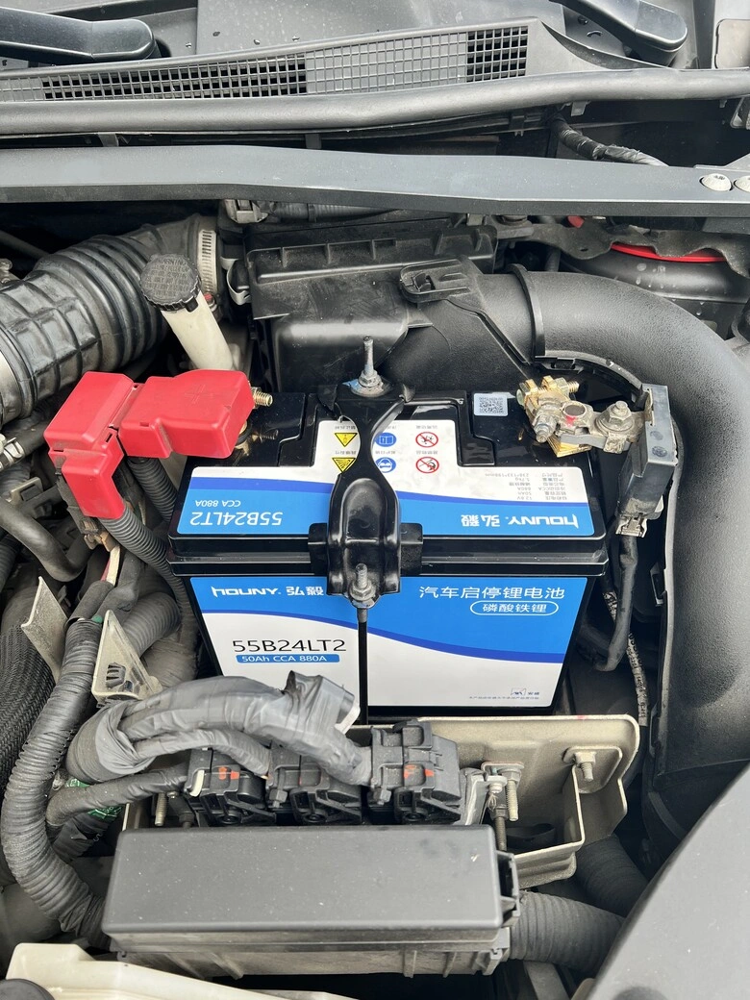

**طراز السيارة**: NISSAN SENTRA B17  
**العلامة التجارية للبطارية**: [Houny Battery (بطاريات هوويي)](https://www.houny.cn/)  
**رقم الطراز**: 55B24LT2، سعة 50Ah  

## أسباب وخلفية الاختيار

خلال السنوات الأخيرة، قامت العائلة بالترقية تدريجياً إلى [بطاريات الليثيوم والحديد من GreenRun](/ar/2025/greenrun.html)، وكانت التجربة مرضية للغاية سواء في سلاسة القيادة أو في العمر الافتراضي الطويل. ونظراً لأن بطارية الرصاص الزرقاء Panasonic CAOS المركبة على سيارة SENTRA بدأت تظهر عليها علامات التعب بعد أكثر من ثلاث سنوات من الخدمة، قررنا اغتنام الفرصة للترقية إلى بطارية فوسفات حديد الليثيوم (LiFePO4).

ومع ذلك، فإن الخيارات المتاحة لبطاريات الليثيوم بالمقاسات اليابانية في السوق المحلي محدودة للغاية وتقتصر غالباً على تجميعات فردية غير واضحة المصدر. ورغم وفرة العلامات التجارية لبطاريات 12V في السوق الصيني، إلا أن بعضها يعاني من تضخيم السعة وسوء المصنعية. وبعد مقارنة دقيقة، وقع اختيارنا على **Houny** للأسباب التالية:

- عملت سابقاً كـ **مُصنّع أصلي (OEM) لبطاريات هواتف نوكيا**، وتمتلك خبرة تكنولوجية عميقة.  
- تُصنّع حالياً بطاريات تخزين الطاقة لعلامات تجارية أوروبية وأمريكية مرموقة إلى جانب إنتاج بطاريات بدء تشغيل السيارات.  
- تحظى بتقييمات ممتازة من الخبراء التقنيين وتُعتبر [علامة تجارية رصينة ومعتمدة](/images/houny-lifepo4-battery-netizen-review.webp).  
- مقاطع الفيديو المنشورة لتفكيك البطارية، مثل [مقطع ريلز فيسبوك هذا](https://www.facebook.com/reel/670416912191093)، توضح إتقاناً داخلياً استثنائياً، كما خضعت البطارية لاختبارات أمان تدميرية قاسية أثبتت كفاءتها ([شاهد هذا الفيديو](https://www.facebook.com/reel/1804670450453719)).  
- توفر [وكيل رسمي لها في تايوان](https://imgur.com/a/mkuKuAg) مؤخراً، مع ضمان مصنعي مدته ثلاث سنوات.

نظراً لعمق التفريغ الأكبر (DoD) لبطاريات LiFePO4، فإن سعتها الفعلية المستخدمة تعادل 1.6 ضعف بطارية الرصاص؛ وبناءً على ذلك، فإن سعة 50Ah من الليثيوم تكافئ بطارية رصاص حمضية بسعة 80Ah، مما يوفر طاقة وافرة لتشغيل السيارة.

## تفاصيل فتح الصندوق

### حماية التغليف
  
*الصندوق الخارجي مبطن بإسفنج عالي الكثافة لتوفير حماية ممتازة ضد الصدمات.*

  
*صندوق كرتوني داخلي أنيق ومصنوع من خامات متينة ومقاومة للضغط.*

  
*ملصق المواصفات الفنية على الجانب.*

  
*عند فتح الصندوق، توجد طبقة إسفنجية إضافية لحماية الجزء العلوي بالكامل.*

  
*الشكل الخارجي بعد رفع طبقة الإسفنج الأولى.*

### هيكل البطارية
  
*هيكل البطارية الخارجي وتصميمه القوي.*

  
*الأقطاب الموجبة والسالبة مصممة وفق المعيار الأوروبي العريض.*

## خطوات عملية التركيب

### تجهيز الأدوات
1. مفتاح ربط بحرف L مقاس 10 ملم [/images/L-socket.webp](/images/L-socket.webp)  
2. [جهاز حفظ ذاكرة OBD](/ar/2025/memory-saving-battery.html) (لتركيب البطارية دون فصل التيار عن حاسوب السيارة)  
3. بطارية مساعدة أو بادئ تشغيل محمول 12V

### تنبيه هام: مسألة اختلاف مقاس أقطاب البطارية
عند استلام البطارية، ظهر تفصيل لم ننتبه إليه مسبقاً: **اختلاف مقاس قطر الأقطاب**:  
- تعتمد معظم السيارات في الصين على **الأقطاب العريضة وفق المعيار الأوروبي (19.5 / 17.9 ملم)**.  
- بينما تستخدم السيارات اليابانية مثل سينترا **الأقطاب النحيفة وفق معيار JIS (14.7 / 13 ملم)**.

ورغم أن الشركة توفر طرازاً بأقطاب نحيفة، إلا أننا اضطررنا لشراء جلبات تحويل نحاسية أصلية (من عريض إلى نحيف)، مما تسبب في تأجيل التركيب لمدة أسبوع.

### خطوات التبديل
تم استبدال البطارية بنجاح باستخدام جهاز الـ OBD للحفاظ على الطاقة ودون فقدان برمجة وحدة التحكم الإلكترونية (ECU).

  
*قياس الجهد عبر شاشة جهاز الـ OBD قبل التركيب؛ الجهد عند الاستلام بلغ 13.4 فولت.*

## اكتمال التركيب وتقييم الأداء

  
*اكتمال التركيب وتثبيت البطارية في حوض المحرك.*

الانطباعات الأولية:
- **جودة الصنع**: التغليف محكم للغاية وتشطيب الهيكل الخارجي رفيع المستوى.  
- **أداء الجهد**: يصل نظام إدارة البطارية (BMS) إلى جهد الاستعداد بمعدل أسرع بكثير من السابق.  
- **استجابة بدء التشغيل**: دوران السلف أكثر قوة وسرعة بالمقارنة مع بطارية الرصاص القديمة.  
- **الاعتمادية على المدى الطويل**: سيتضح مع الوقت ما إذا كانت ستنافس جودة وعمر بطاريات [GreenRun](/ar/2025/greenrun.html).

بعد مرور ستة أشهر من التشغيل:  
أفاد مستخدمو السيارة بأن المشاكل العرضية السابقة المتعلقة بـ "تعليق أو تأخر نقلات القير" قد تلاشت نهائياً ولم تتكرر على الإطلاق منذ تركيب بطارية الليثيوم والحديد.
