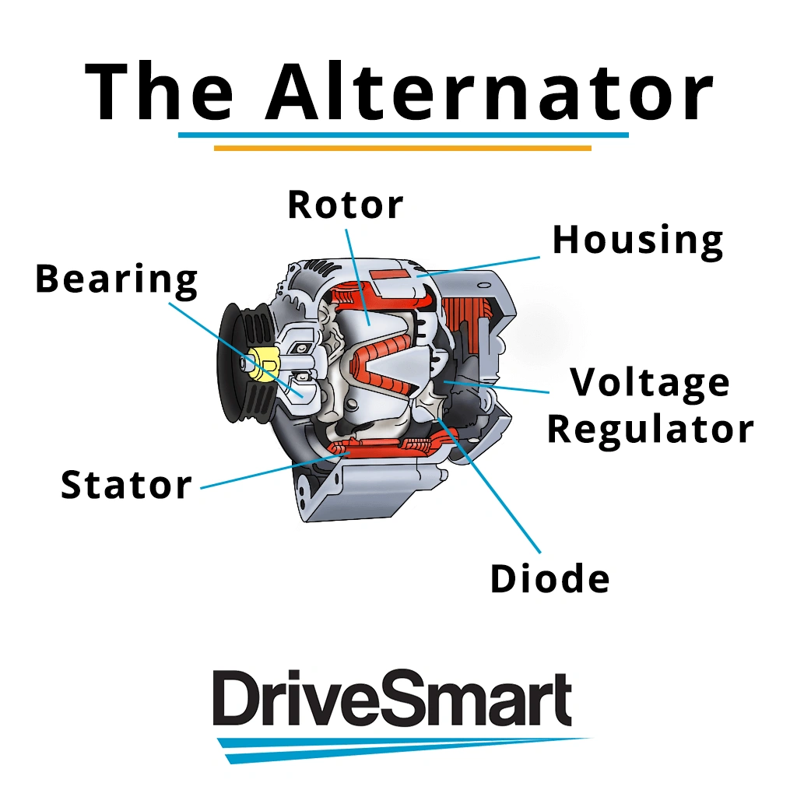
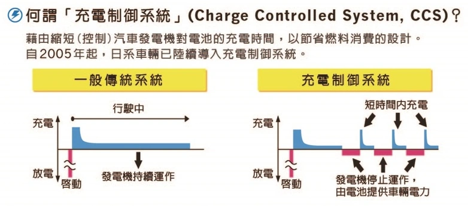

### العوامل المحددة لعمر دينامو السيارة (المولد)

تتأثر ديمومة الدينامو بعدد من الأجزاء الميكانيكية والكهربائية المعرضة للاستهلاك:

- **فحمات الدينامو الكربونية (Carbon Brushes)**: تتآكل تدريجياً نتيجة الاحتكاك الدائري المتواصل مع حلقات التلامس النحاسية.  
- **رولمانات البلي (المحامل Bearings)**: تتعرض للإجهاد الميكانيكي المستمر والحرارة الناتجة عن سرعة الدوران.  
- **قنطرة التوحيد (جسر الدايودات Rectifier)**: المسؤولة عن تحويل التيار المتردد إلى مستمر؛ وتتعرض للتلف نتيجة درجات الحرارة الزائدة.

## تقنية التحكم الذكي في الشحن ومعدل C-rate

العضو الدوار (Rotor) في دينامو السيارة هو في جوهره **مغناطيس كهربائي دوار**. ومن خلال التحكم في شدة التيار المغناطيسي، ينظم النظام كمية الكهرباء المنتجة. وعندما تطلب السيارة تياراً عالياً:

- يشتد المجال المغناطيسي ← تزداد مقاومة العضو الدوار ← يثقل الحمل على بكرة الكرنك والمحرك ← **يرتفع استهلاك الوقود.**

سعياً لتقليل الانبعاثات وتوفير الطاقة، ابتكرت شركات السيارات الحديثة **نظام التحكم الذكي في الشحن (Charging Control System - CCS)**:  
يقوم الدينامو بالشحن القوي فقط عندما يكون مستوى شحن البطارية منخفضاً. وبمجرد اكتمال شحنها، يخفف النظام التيار المغناطيسي فوراً، مما يسمح للدينامو بـ **الدوران بحرية شبه تامة ودون أي مقاومة مغناطيسية تذكر**.

### كيف يحدد معدل C-rate كفاءة الشحن؟

يعبر معيار C-rate عن مدى سرعة البطارية في "ابتلاع" واستيعاب الطاقة الكهربائية مقارنة بسعتها:

- **بطارية ذات C-rate مرتفع (مثل فوسفات حديد الليثيوم LiFePO4)**: إذا ضخ الدينامو 10 أمبير، يمكن للبطارية امتصاص 8 أمبير فوراً.  
- **بطارية ذات C-rate منخفض (مثل بطاريات الرصاص الحمضية)**: إذا ضخ الدينامو 10 أمبير، قد لا تقوى البطارية إلا على امتصاص نحو 2 أمبير بسبب مقاومتها الداخلية العالية.

نظراً لأن بطارية الليثيوم تمتص التيار بسرعة مضاعفة، فإن فترة شحنها تنتهي في وقت قياسي. يعود الدينامو سريعاً إلى وضع "الدوران الحر الخفيف"، مما يرفع الحمل الثقيل عن كاهل محرك السيارة. يؤدي ذلك مباشرة إلى **تحسن ملحوظ في كفاءة استهلاك البنزين** و**إطالة عمر فحمات الدينامو** بتقليل فترات التحميل الحراري والشرر الكهربائي.

## لماذا لا يعد تيتانات الليثيوم (LTO) دائماً هو الحل الأمثل؟

على الرغم من أن خلايا **تيتانات الليثيوم (LTO)** تمنح معدلات تفريغ وشحن أعلى بكثير من LiFePO4 وعمراً يصل لعشرات آلاف الدورات، إلا أنها تواجه عوائق في بطاريات السيارات التقليدية:

1.  **عدم توافق نطاق الجهد**: يبلغ الجهد الاسمي لخلية LTO ما بين 2.3V و 2.4V؛ وتوصيل 5 خلايا يمنح ~14.0V (غير كافٍ للشحن المتوازن) بينما 6 خلايا تتطلب ~16.2V (جهد مفرط يتلف أنظمة السيارة المصممة لـ 14.4V).
2.  **كثافة طاقة أقل**: مقارنة بسعة مكافئة من LiFePO4، تكون بطاريات LTO أثقل وزناً وأكبر حجماً بصورة لافتة.
3.  **التكلفة الاقتصادية**: الجدوى السعرية لوظيفة تشغيل المحرك البسيطة ترجح كفة بطاريات LiFePO4 الموثوقة والمزودة بنظام BMS متقدم.
