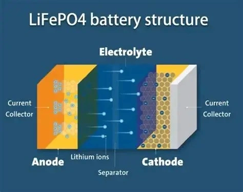

## زمن الاستجابة لتفريغ تيار البطارية

| نوع البطارية | المقاومة الداخلية | زمن الاستجابة لتفريغ (0 إلى 200A) | الخصائص الحركية للتفاعل |
| :--- | :---: | :---: | :--- |
| **LiFePO4 (فوسفات حديد الليثيوم)** | منخفضة جداً | **أقل من 10ms** | استجابة ذرية شبه فورية |
| **الرصاص الحمضية (AGM / EFB / العادية)** | مرتفعة | **من 100 إلى 500ms** | تفاعلات كيميائية بطيئة تعتمد على الطور |

يلاحظ العديد من السائقين أن استجابة تسارع السيارة تصبح أكثر نشاطاً وحيوية بمجرد الترقية إلى بطارية ليثيوم. وهذا ليس تأثيراً نفسياً أو انطباعاً خادعاً؛ فمن منظور الحركية الكهروكيميائية، فإن السرعة التي تطلق بها البطارية تيارها الكهربائي تؤثر مباشرة وبشكل حاسم على **سرعة تشبع كويلات الإشعال (Ignition Coils)** واستقرار جهد البخاخات الكهربائية.

## لماذا تتفوق بطاريات LiFePO4 في سرعة الاستجابة؟

### 1. القابلية العالية للانعكاس الكهروكيميائي
تعتمد خلايا LiFePO4 على آلية **تداخل واستخلاص (Intercalation)** أيونات الليثيوم الدقيقة داخل الشبكة البلورية لهيكل الأوليفين دون هدم للبنية أو تحول طوري معقد، مما يسمح بحركة تدفق إلكتروني شبه فورية وبأقل قدر من الممانعة.

### 2. مقاومة داخلية متناهية الصغر وإلكتروليت عضوي متطور
تستخدم بطاريات الليثيوم **مذيبات عضوية ذات موصلية أيونية فائقة** كإلكتروليت بدلاً من المحاليل المائية، مما يمنع حدوث انخفاضات حادة في الجهد اللحظي عند طلب أمبيرات تفريغ عالية ومفاجئة.

### 3. مساحة سطحية نشطة بمقياس النانو
تتم هندسة المادة الفعالة لأقطاب LiFePO4 عند **مستوى مقياس النانو**. وتوفر هذه المساحة السطحية الهائلة ملايين القنوات التفاعلية المتزامنة لتحرك الأيونات في اللحظة ذاتها.

## القيود الكيميائية والفيزيائية لبطاريات الرصاص

في المقابل، تخضع بطاريات الرصاص لتفاعلات معقدة ومقيدة:
- **ترسيب كبريتات الرصاص العازلة:** أثناء سحب التيار العالي، تتكون طبقة من كبريتات الرصاص (PbSO4) على الألواح؛ ونظراً لأن هذه المادة عازلة كهربائياً، فإنها تخنق التفاعل اللحظي وتزيد المقاومة.
- **محدودية المساحة السطحية:** تتكون مواد الرصاص من جزيئات ميكرونية خشنة مقارنة بمسحوق النانو في الليثيوم، مما يقلل عدد الأيونات القادرة على التفاعل في أجزاء الثانية الأولى.
- **مقاومة المحلول المائي:** يمتلك حمض الكبريتيك المخفف استقطاباً مقاوماً يؤدي لتأخير تدفق التيار لما بين 100 و 500 ميلي ثانية.

### الخلاصة
في السيارات الحديثة المزودة بأنظمة حقن الوقود الإلكتروني المباشر وأنظمة الإشعال المتعدد، تضمن البطارية فائقة السرعة تزويد شمعات الاحتراق (البواجي) بشرارات إشعال قوية وثابتة تماماً في أجزاء الثانية الحرجة. يؤدي ذلك إلى **احتراق وقود أكثر اكتمالاً**، و**استجابة أسرع وأوضح لدواسة البنزين**، وعمل متناغم وأكثر سلاسة للمحرك.
