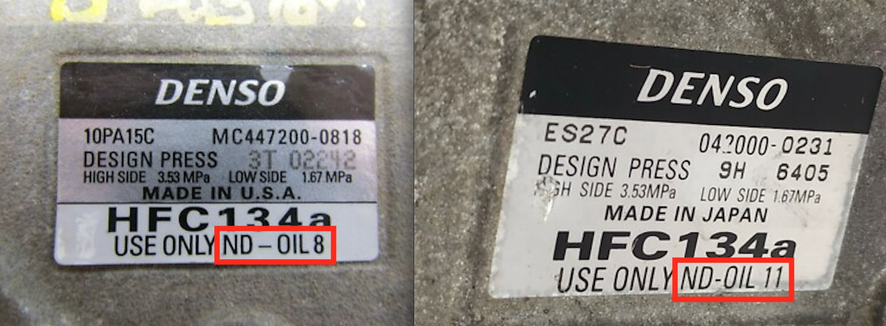

<figure>
  
  <figcaption>ضواغط دينسو: استخدم حصرياً سلسلة ND (تشمل ND-OIL 8 و ND-OIL 11)</figcaption>
</figure>

## فهم طبيعة زيت التبريد ND8 (ND-OIL 8)

إذا كنت تقود إحدى السيارات اليابانية الشهيرة مثل **تويوتا** أو **لكزس** أو **هوندا**، فمن المؤكد تقريباً أن ضاغط الهواء (الكمبروسر) في سيارتك من تصنيع شركة **دينسو (Denso)**. هذه الضواغط الهندسية الدقيقة صُممت لتعمل بزيت تزييت محدد للغاية وهو: **ND8**. ورغم أن هذا الزيت ينتمي لعائلة زيوت **PAG (بولي ألكيلين جلايكول)**، إلا أنه يتميز بتركيبة تخليقية فائقة التنقية تمنحه تفوقاً حاسماً على زيوت الـ PAG "الشاملة" الرخيصة المستخدمة في العديد من ورش الصيانة.

## المزايا الأساسية لزيت ND8 مقارنة بزيوت PAG التجارية

### 1. مقاومة امتصاص الرطوبة (انخفاض الشراهة المائية)
تُعرف زيوت PAG التقليدية بأنها مواد "شرهة للماء"، حيث تمتص الرطوبة وبخار الماء من الهواء المحيط بسرعة بالغة فور فتح عبوة الزيت أو تفريغ الدورة.
* **الخطر الكيميائي:** تتفاعل الرطوبة مع غاز التبريد R134a لتكوين **حمض الهيدروفلوريك** الشديد التآكل.
* **حلول زيت ND8:** صُمم زيت ND8 ببنية جزيئية تمنع امتصاص الرطوبة، مما يحمي مجاري الألمنيوم الدقيقة ومكابس الضاغط المصقولة من التآكل الحمضي الداخلي.

### 2. امتزاجية مثالية ومستمرة مع فريون HFC-134a
يجب أن يتحرك زيت التبريد ذائباً وممتزجاً مع سائل وغاز الفريون داخل دورة المكيف بالكامل، ليعود بسلاسة إلى حوض الضاغط. يتميز زيت ND8 بلزوجة متوازنة تضمن عودة الزيت بشكل موثوق دون أن يترسب في ثلاجة المكيف (المبخر) أو يسبب نقصاً في تزييت الضاغط على السرعات العالية.

### 3. ثبات فائق ضد الأكسدة ودرجات الحرارة المرتفعة
تعمل ضواغط المكيف تحت ضغوط وحرارة ميكانيكية شديدة؛ مما يجعل الزيوت التجارية الرديئة تتأكسد لتتحول إلى **شوائب صمغية ووحول حمضية** تسد بلف التمدد (Expansion Valve). يضمن الاستقرار العالي لزيت ND8 بقاء الدورة نظيفة تماماً لسنوات طويلة.

## مخاطر الزيوت التجارية المسماة «الشاملة»

تلجأ بعض ورش الصيانة إلى استخدام زيوت PAG 46 أو PAG 100 رخيصة تحت مسمى "صالحة لجميع أنواع السيارات". لكن خلوص الأجزاء الميكانيكية في ضواغط دينسو يُقاس بالميكرون، واستخدام زيت مخالف يسبب:
* **خشونة وضجيج في التشغيل:** اهتزاز وصوت ونين ملحوظ عند تعشيق كلتش المكيف.
* **هبوط ملحوظ في أداء التبريد:** بسبب تكون طبقة زيتية ثقيلة تعزل انتقال الحرارة عبر رديتر المكيف وثلاجته.
* **تصلب وقفل الضاغط بالكامل (Seizure):** وهو العطل الأكثر كلفة وتعقيداً في منظومة التكييف.

## الخلاصة

عند القيام بشحن الفريون أو صيانة أي جزء من دورة التكييف، احرص على التأكيد للفني بضرورة استخدام **زيت Denso ND8 الأصلي** (أو ND11 للضواغط الكهربائية في السيارات الهجينة). هذا الزيت هو شريان الحياة لمكيف سيارتك، واستخدامه يضمن لك هواءً منعشاً ويحميك من فواتير إصلاح باهظة ومفاجئة.
