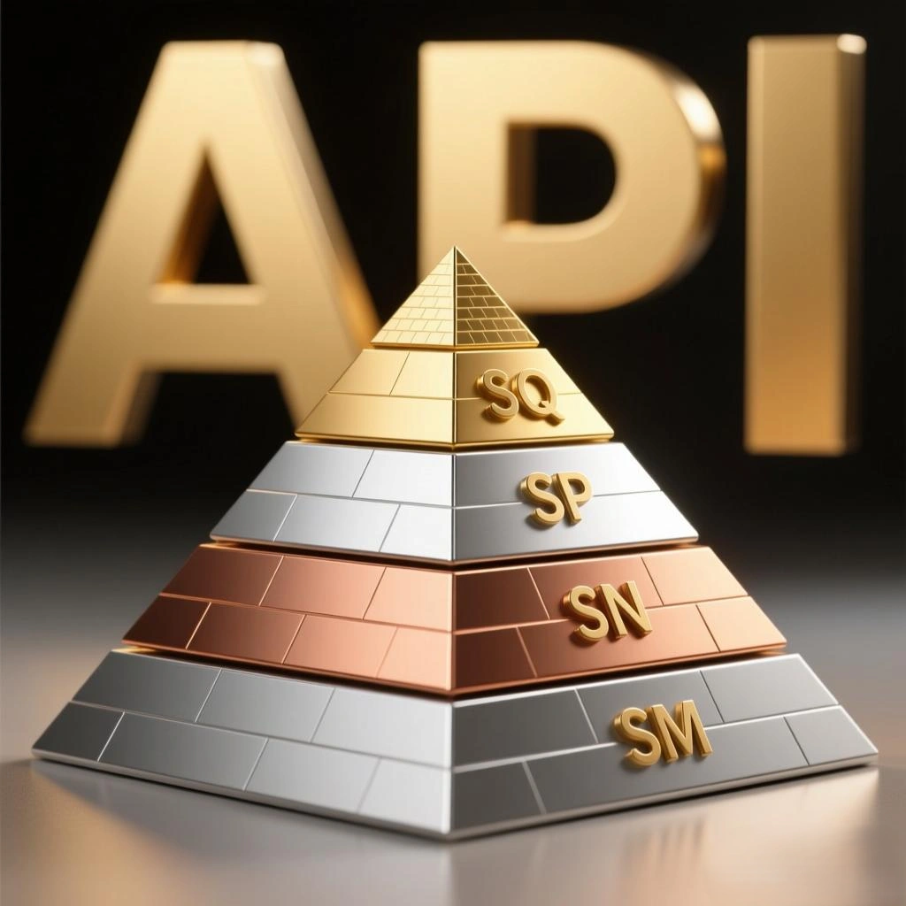

- **لم يحدث قط في تاريخ مواصفات زيوت المحركات أن تم خفض سقف المعايير؛ فكل مواصفة جديدة تمثل قفزة نوعية للأمام وليست خطوة للوراء.**
- **الادعاء القائل بأن ‘الجديد أسوأ من القديم’ ليس سوى جهل علمي فاضح وتضليل تسويقي رخيص لتصريف الزيوت المنتهية الصلاحية الراكدة في المستودعات.**

## جدول المقارنة الفنية لنتائج الاختبارات المعملية القياسية

| فئة الاختبار المعملي القياسي (Sequence) | API SM (2004) | API SN (2010) | API SP (2020) | API SQ (2024) |
| :--- | :--- | :--- | :--- | :--- |
| **ترسبات المكابس (IIIH)** | غير متاح (IIIG) | لا توجد متطلبات صريحة | ≥ 3.5 نقطة | **≥ 4.0 نقطة** |
| **ارتفاع اللزوجة بالأكسدة (IIIH)** | ≤ 275% | ≤ 200% | ≤ 150% | **≤ 125%** |
| **تطاير الزيت وتبخره (IIIH)** | غير متاح (IIIG) | لا توجد متطلبات صريحة | ≤ 80 mL | **≤ 60 mL** |
| **الرواسب الطينية على البارد (VH)** | المكبس ≥ 4.0 (VG) | المكبس ≥ 5.0 | المكبس ≥ 7.6 | **المكبس ≥ 8.0** |
| **تآكل عمود الكامات والبلوف (IVB)** | غير متاح (IVA) | المتوسط < 90µm | فقد الحجم < 2.7% | **فقد الحجم < 2.3%** |
| **حماية الإشعال المسبق (LSPI - IX)** | غير متاح | غير متاح | متوسط 0 نقرة إشعال | **سقف اختبار أكثر صرامة** |
| **تآكل جنزير التايمنج (X)** | غير متاح | غير متاح | التمدد ≤ 0.085% | **التمدد ≤ 0.070%** |
| **التوافق مع أنواع الوقود** | وقود تقليدي | وقود تقليدي | وقود تقليدي | **دعم وقود E85 الحيوي** |
| **التوافق مع محركات الهايبرد** | غير مدعوم | غير مدعوم | دعم أساسي | **دعم كامل ومتقدم** |

## تحليل الركائز التقنية لمعيار API SQ (ILSAC GF-7)

### 1. قدرة تنظيف استثنائية ونقاء للمكابس (Sequence IIIH)
في اختبار Sequence IIIH الحاسم، تم رفع متطلب نظافة مجاري شنابر المكبس من 3.5 إلى **4.0 نقاط**. وهذا يفرض على شركات الزيوت استخدام منظفات ومشتتات فائقة لمنع تحجر كربون الاحتراق وحماية ضغط غرف المحرك.

### 2. مقاومة التصلب وثبات اللزوجة الحرارية
تم تقليص الحد الأقصى لارتفاع اللزوجة تحت وطأة الحرارة الشديدة إلى **125%** فقط، مما يمنع تحول الزيت إلى وحل متخثر في المحركات المزودة بشواحن تيربو فائقة السخونة.

### 3. حماية جنزير الصمامات
مع انتشار محركات الحقن المباشر (GDI)، يتسبب هباب الكربون الناعم في تآكل مفاصل جنزير التايمنج واستطالته؛ وقد شدد معيار SQ نسبة الاستطالة المقبولة لتصبح **0.070%** فقط بدلاً من 0.085%، لحماية المحرك من اختلال توقيت فتح البلوف.

### 4. حماية فلاتر البيئة وأنظمة العادم الحديثة
يتوافق زيت API SQ مع أحدث فلاتر حجز جزيئات العادم في سيارات البنزين (GPF) والديزل (DPF)، مما يضمن عدم تسميم المعادن الثمينة داخل دبات التلوث أو انسدادها بالرماد الكبريتي.

## الخلاصة

تمثل مسيرة الانتقال من معايير SM وصولاً إلى SQ ارتقاءً مستمراً في حماية مكونات المحرك وتوفير الوقود وحماية البيئة. وعند شراء زيت لسيارتك، احرص دائماً على اختيار أعلى مواصفة معتمدة تناسب كتيب سيارتك؛ فمعيار **API SQ (GF-7)** ليس مجرد ملصق تجاري، بل هو حصيلة اختبارات معملية قاسية تلبي أدق متطلبات محركات الحقن المباشر والتوربو والسيارات الهجينة الحديثة.
