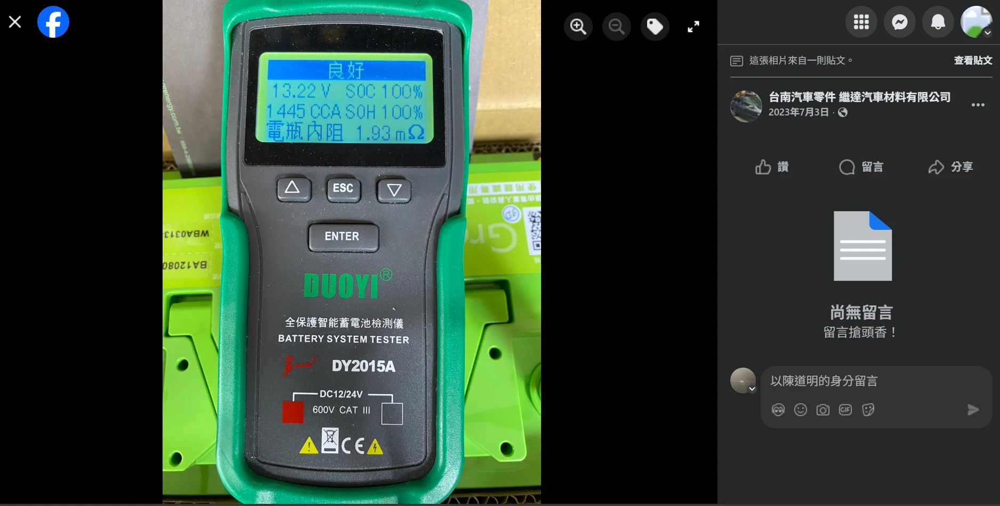
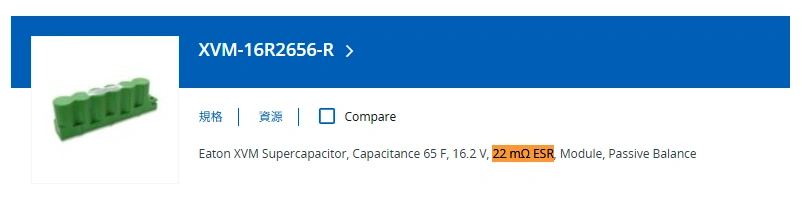

إذا كانت لديك ميزانية مخصصة وترغب في تحسين الأداء الكهربائي لسيارتك، فقد تواجه هذا الخيار المحير:

👉 هل تدفع المال لشراء وتركيب **«مكثف فائق (Supercapacitor)»**؟  
👉 أم ترقي سيارتك مباشرة إلى **«بطارية فوسفات حديد الليثيوم (LiFePO4)»**؟

**دعني أقدم لك الإجابة الهندسية المباشرة دون مواربة: تركيب المكثف الفائق ليس فقط مساراً فرعياً مكلفاً، بل هو في الواقع «تراجع تقني (Downgrade)».**

## القواعد الأساسية للهندسة الكهربائية: قانون التوازي وتوزيع التيار

قبل المقارنة بين الجهازين، دعنا نستحضر مبدأين فيزيائيين راسخين:

### 1. قانون التوصيل على التوازي
معادلة المقاومة الكلية للمقاومات المتصلة على التوازي هي: ([حاسبة المقاومة الداخلية على التوازي](/ar/2026/ir-caculator.html))

  Rالمقاومة الكلية = 
  
    Rالبطارية × Rالمكثف
    Rالبطارية + Rالمكثف
  

وهذا يفرض حقيقة حسابية حتمية: **إذا كانت مقاومة أحد المكونين أقل بكثير من الآخر، فإن التحسن المحقق في المقاومة الكلية للمنظومة سيكون ضئيلاً جداً وشبه معدوم.**

### 2. مبدأ توزيع التيار
يسري التيار الكهربائي مثل تدفق الماء؛ فهو يسلك دائماً المسار ذو **المقاومة الداخلية الأقل (Impedance)**. وعندما يطلب أي حمل كهربائي مفاجئ (مثل محرك السلف أو مضخم الصوت) تياراً لحظياً ضخماً، فإن المكون ذو المقاومة الأقل هو الذي يتولى ضخ وتزويد هذا التيار فعلياً.

## السبب الأول: بطارية LiFePO4 هي بالفعل وحش كاسح في الأداء

كان الهدف الأصلي من ابتكار المكثفات الفائقة هو تعويض عيوب بطاريات الرصاص الحمضية التقليدية، التي تعاني من [مقاومة داخلية عالية واستجابة بطيئة](/ar/2025/lithium-vs-lead-analysis.html)—تماماً كإضافة ذاكرة كاش وسيطة لتسريع قرص صلب قديم وبطيء.

لكن بطارية LiFePO4 تمتلك بطبيعتها الكيميائية:
- [مقاومة داخلية بالغة الانخفاض (2 إلى 3 ملي أوم)](/images/greenrun_ir.webp)
- معدل تفريغ تيار لحظي هائل (من 50C إلى 80C)
- [سرعة استجابة فائقة تقل عن 10 أجزاء من الألف من الثانية](/ar/2025/lithium-vs-lead-analysis.html)

👉 إن قدرة بطارية LiFePO4 على إطلاق التيار **تتجاوز بمراحل أي دور "مساعد" تافه قد يقدمه المكثف الفائق.**

## السبب الثاني: المكثف الفائق في الواقع أبطأ استجابة من بطارية LiFePO4

نظرياً، تفرغ المكثفات طاقتها بلمح البصر. لكن في الواقع العملي، يتطلب تصنيع وحدة مكثف فائق للسيارات توصيل خلايا متعددة على التوالي مع دوائر موازنة إلكترونية، مما يرفع المقاومة المكافئة الكلية (ESR) للموديول لتصل إلى **20 إلى 30 ملي أوم**—وهو رقم أسوأ من بطارية رصاص جيدة! وعند الحاجة لتيار عالٍ، تسبب هذه المقاومة هبوطاً حاداً في الجهد وتحول الطاقة إلى حرارة مهدورة، فتكون استجابتها اللحظية أبطأ من بطارية LiFePO4 التي تمتلك مقاومة 2 ملي أوم فقط.

## السبب الثالث: توصيل المكثف بالتوازي مع LiFePO4 نتيجته تقارب الصفر

دعنا نطبق الأرقام الحقيقية في معادلة التوازي:

- المقاومة الداخلية لبطارية LiFePO4: **حوالي 2 إلى 3 mΩ**  
  
- المقاومة الداخلية لموديول المكثف الفائق: **حوالي 20 إلى 30 mΩ**  
  

باستخدام المعادلة، فإن وضع مكثف فائق من شركة عريقة مثل Eaton بالتوازي مع بطارية LiFePO4 يخفض المقاومة الكلية بنحو **0.15 ملي أوم فقط**—وهو فارق تافه تبتلعه مقاومة أسلاك التوصيل النحاسية!  
ووفقاً لقانون تقسيم التيار، فإن أكثر من 90% من أمبيرات التيار تخرج مباشرة من بطارية الليثيوم، ويبقى المكثف كقطعة زينة عديمة الفائدة.

> في المرة القادمة التي تشاهد فيها إعلانات المكثفات، دقق في المقارنة المعروضة: ستجدها دائماً **"بطارية رصاص + مكثف مقابل بطارية رصاص فقط"**.  
> ولن تجرؤ الشركات على نشر مقارنة **"بطارية LiFePO4 + مكثف مقابل LiFePO4 وحدها"**؛ لأن ذلك سيفضح أن وضع المكثف لم يغير في الأداء **أي شيء إطلاقاً.**

## السبب الرابع: التفريغ الذاتي المرتفع للمكثفات

فضلاً عن سعتها التخزينية الهزيلة وحساسيتها الشديدة للحرارة، تعاني المكثفات الفائقة من استنزاف شحنتها ذاتياً:
- التفريغ الذاتي للمكثف الفائق: **من عدة ملي أمبير إلى مئات الملي أمبير**
- التفريغ الذاتي لبطارية LiFePO4: **عشرات الميكرو أمبير فقط** (1 ملي أمبير = 1000 ميكرو أمبير)

وإذا تركت السيارة مركونة لأيام معدودة، ينخفض جهد المكثف بشدة، ليتحول إلى حمل طفيلي يسحب الطاقة من بطارية سيارتك ليعيد شحن نفسه.

## السبب الخامس: مخاطر الأسلاك الإضافية في حوض المحرك

- **مخاطر التركيب والتوصيل**: تمديد كابلات إضافية في حوض المحرك يعرضها للاحتكاك بحواف الصاج والاهتزاز والالتماس الكهربائي، فضلاً عن خطر انفصال العلبة وارتطامها في الحوادث.
- **مخاطر انفجار وحرائق المنتج**: سجلت العديد من الحالات السابقة ارتفاعاً خطيراً في حرارة المكثفات وتسببها في حرائق بحوض المحرك.

وعلى العكس، تستقر بطارية LiFePO4 في مكان البطارية الأصلي بدقة متناهية ودون تعديل على أسلاك السيارة.

## السبب السادس: بطاريات LiFePO4 أصبحت اقتصادية وفي متناول الجميع

في السابق، كانت خلايا LiFePO4 باهظة الثمن، مما خلق سوقاً للمكثفات. واليوم هبطت أسعار بطاريات الليثيوم بشكل دراماتيكي:
- بطارية LiFePO4 سيارات 100Ah ممتازة: بسعر اقتصادي ومتاح.
- بطارية LiFePO4 للدراجات النارية 5.5Ah: بسعر زهيد ومنافس للرصاص.

👉 مع انخفاض أسعار بطاريات LiFePO4، **لماذا تهدر أموالك على مكثف فائق بسعة تقل عن 0.4Ah، ومقاومة مرتفعة، ولا يتحمل الحرارة، ويستنزف كهرباء سيارتك؟**

## السبب السابع: سعة المكثفات ثقيلة وبطيئة جداً في فلترة الترددات العالية

في علم تنقية الفولتية (Filtering)، **السرعة اللحظية أهم بكثير من السعة التخزينية الضخمة**:
- يعجز المكثف الفائق عن التفاعل مع ضوضاء الترددات العالية الصادرة من الدينامو أو بخاخات الحقن بسبب الحث التسلسلي المكافئ (ESL) المرتفع في بنيته الملفوفة.
- وتعتبر المكثفات الخزفية أو الإلكتروليتية الصغيرة ذات الميكروفاراد الضئيل أسرع بآلاف المرات وأقدر على تنقية الشوائب الكهربائية. المكثف الفائق ببساطة ليس الأداة المناسبة لهذه المهمة.

## الخلاصة: أنفق أموالك بحكمة

لقد ولى عصر المكثفات الفائقة في عالم تعديل السيارات:

* **إذا كنت تستخدم بطارية LiFePO4**: فالمكثف بالتوازي **عديم الفائدة إطلاقاً** لأن البطارية أسرع وأقوى منه بمراحل.
* **إذا كنت تستخدم بطارية رصاص**: فالمكثف **غير مجدٍ اقتصادياً** لأن تكلفة شرائه تقترب من سعر بطارية LiFePO4 كاملة تمنحك قفزة أداء حقيقية وشاملة.

👉 وفر الميزانية المخصصة للمكثف الفائق واستثمرها مباشرة في **شراء بطارية بدء تشغيل LiFePO4 عالية الجودة**. هذا هو المسار الأكثر ذكاءً وأماناً وفاعلية لكهرباء سيارتك.
