[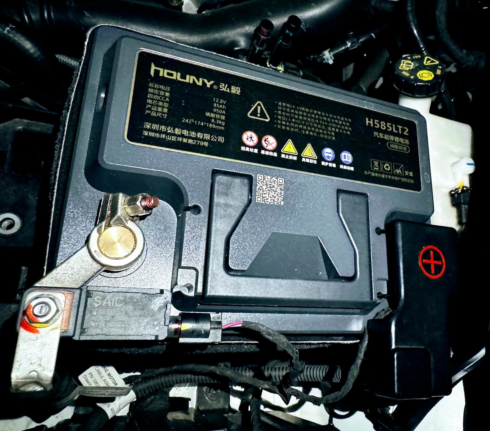](/images/LN2_HY_Install2.webp)

| البند | التفاصيل الفنية |
| :--- | :--- |
| **الطراز المطبق عليه** | MG HS 1.5T نسخة البنزين |
| **العلامة التجارية للترقية** | [بطاريات Houny (هوويي)](https://www.houny.cn/) |
| **رقم طراز البطارية** | H585LT2 سعة 85Ah (مقاس LN2 القياسي) |

## دوافع وخلفية الاختيار

منذ سنوات، قمنا بترقية إحدى سيارات العائلة إلى [بطارية فوسفات حديد الليثيوم من GreenRun](/ar/2025/greenrun.html)، وكانت التجربة فائقة الرضا من حيث متعة القيادة والعمر الافتراضي الطويل. ومؤخراً، لاحظ أحد الأصدقاء من ملاك MG HS 1.5T أن بطارية سيارته الأصلية بدأت تضعف مع ارتفاع تدريجي في مقاومتها الداخلية، فقرر بعد التشاور ترقيتها مباشرة إلى بطارية ليثيوم حديد (LiFePO4).

تأتي بطارية الوكالة في MG HS من نوع Sail 6-QW-63MG بالمقاس الأوروبي القياسي **LN2**. ومع أن صينية التثبيت في حوض المحرك تتسع لمقاس LN3 الأكبر، إلا أن اختيار LN3 كان سيتطلب التخلي عن الجراب العازل الحراري الأصلي المرفق من المصنع، لذا فضلنا البقاء على مقاس LN2 الأصلي.

وفي الأسواق المحلية، يعاني مقاس LN2 من قلة الخيارات الموثوقة لبطاريات الليثيوم المعتمدة؛ حيث تقتصر معظم المعروضات على تجميعات ورش غير معلومة المصنع. وبعد بحث دقيق، وقع اختيارنا على شركة **Houny** العريقة المتخصصة في تصنيع بطاريات بدء التشغيل وتوريدها كـ OEM/ODM لشركات أوروبية وأمريكية رائدة.

[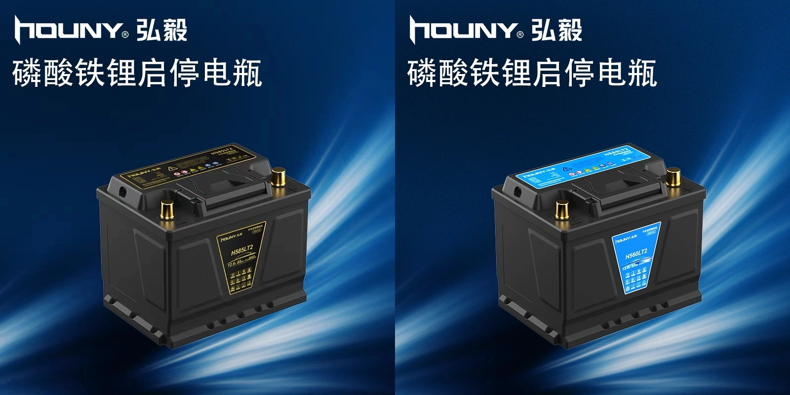](/images/LN2_HY_Type.webp)

بعد تحديث منتجات الشركة لعام 2025 (السلاسل الذهبية والزرقاء والخضراء)، وقع الاختيار على الفئة الذهبية بسعة 85Ah. ورغم وجود طراز بسعة 100Ah بنفس الأبعاد، إلا أن سيارة المالك بحالتها الأصلية دون تعديلات كهربائية وتُستخدم فقط في عطلات نهاية الأسبوع؛ ونظراً لأن عمق التفريغ لليثيوم يعادل 1.6 ضعف بطاريات الرصاص، فإن **سعة 85Ah من الليثيوم تمنح طاقة تشغيلية فعلية تعادل بطارية رصاص بسعة 130Ah**، وهو ما يفيض عن حاجة السيارة بكثير.

## تفاصيل فتح الصندوق وفحص المنتج

[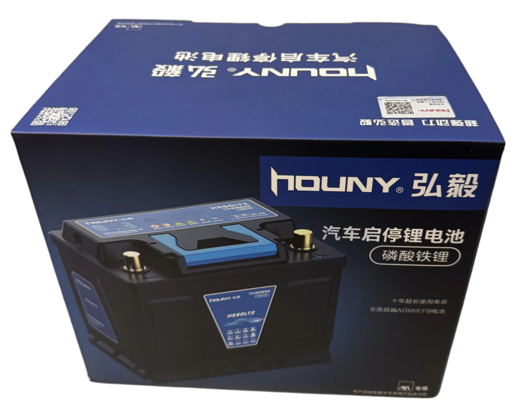](/images/LN2_HY_BOX.webp)  
*كرتون الشحن المتين وعالي الحماية*

[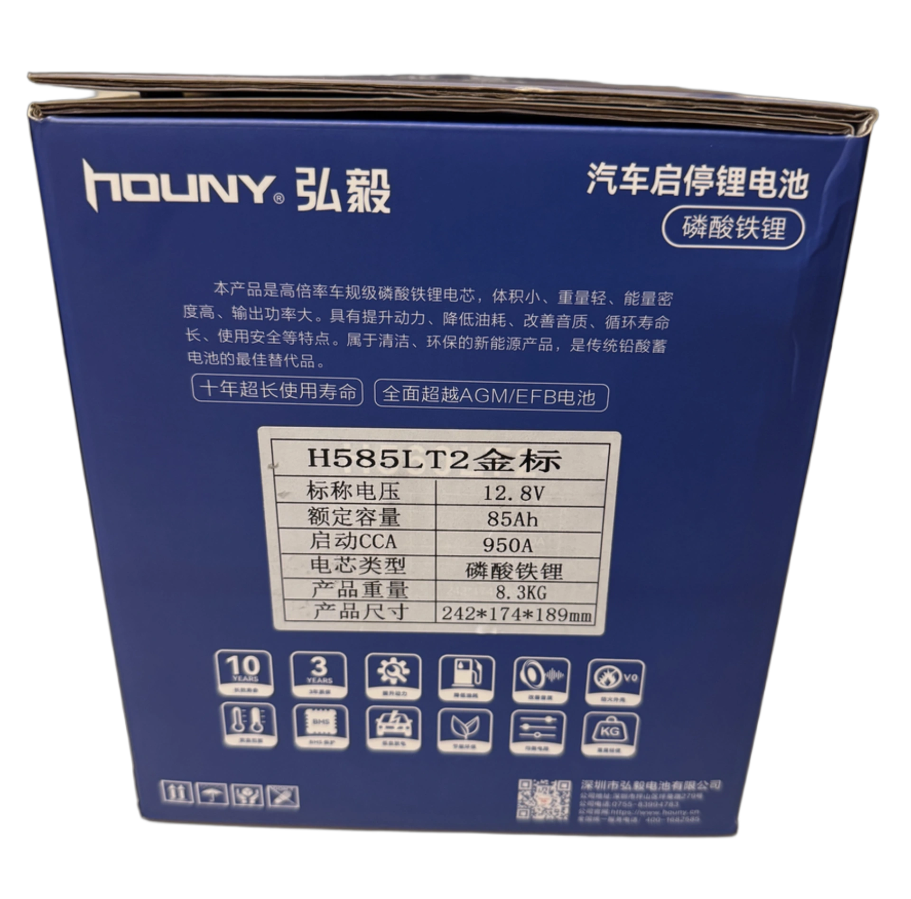](/images/LN2_HY_BOX2.webp)  
*ملصق بيانات الطراز والسعة الاسمية على جانب العبوة*

[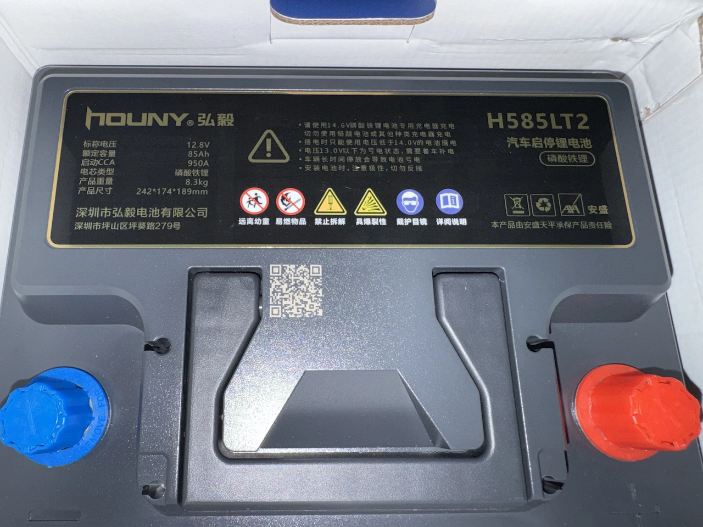](/images/LN2_HY_Top.webp)  
*الغطاء العلوي مع باركود المصنع وإرشادات الأمان*

[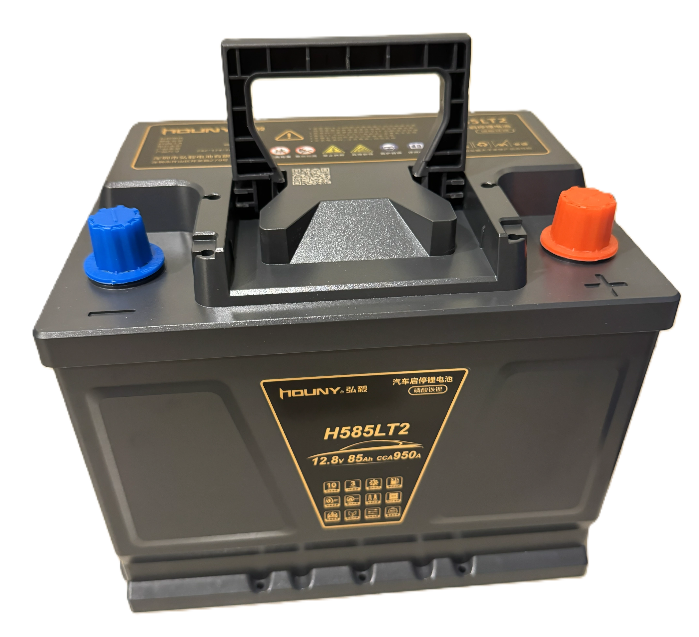](/images/LN2_HY_Front.webp)  
*البيانات الكهربائية التفصيلية المحفورة على الهيكل الأمامي*

[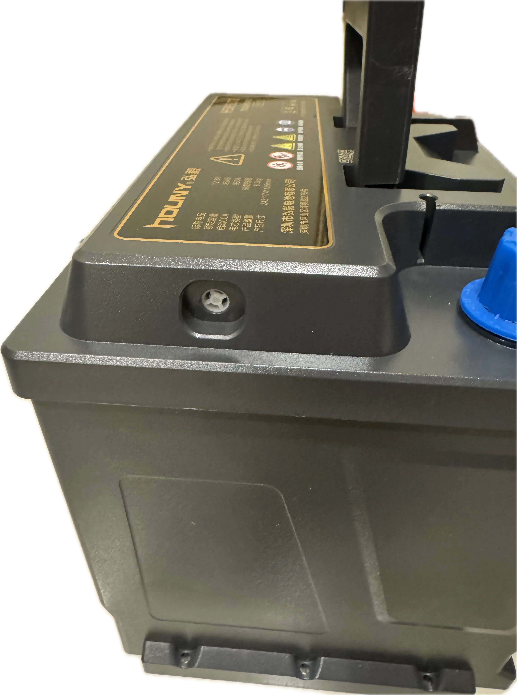](/images/LN2_HY_Side1.webp)  
*مجرى التنفيس الاتجاهي للأمان*

[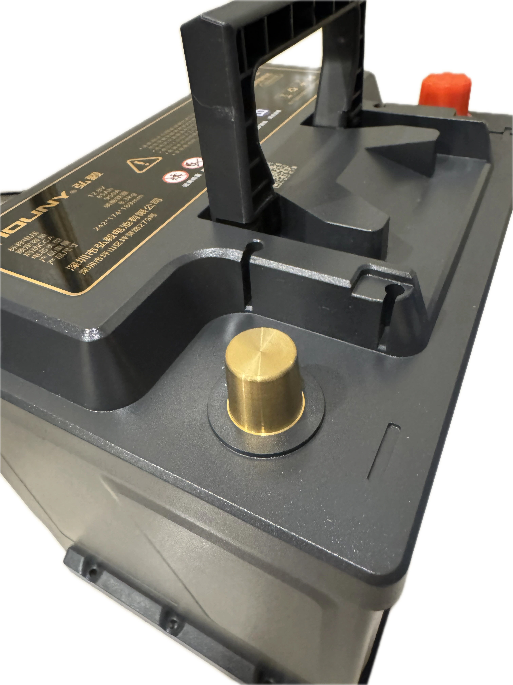](/images/LN2_HY_Side2.webp)  
*أقطاب توصيل مخروطية مصنعة من النحاس الخالص عالي التوصيل*

[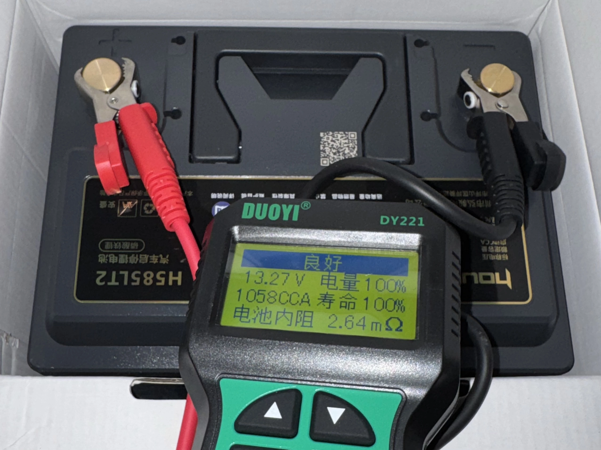](/images/LN2_HY_IR.webp)  
*فحص الاستلام: استقرار الجهد ومقاومة داخلية بالغة الصغر*

وتوضح الصور الداخلية الواردة من [تقرير فحص وتفكيك أحد المشترين](/images/hongytaobaoreview.webp) جودة التصنيع الداخلي:

[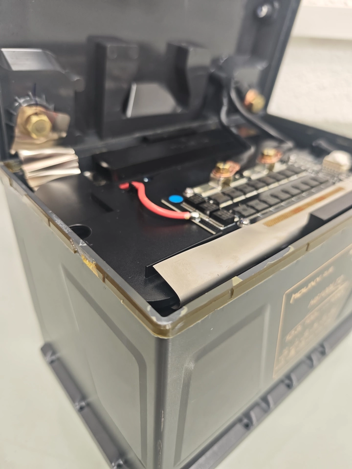](/images/hongyStruct1.webp)  
*لوحة BMS مزودة بصف من ترانزستورات MOSFET عالية التحمل وموزعات نحاسية سميكة*

[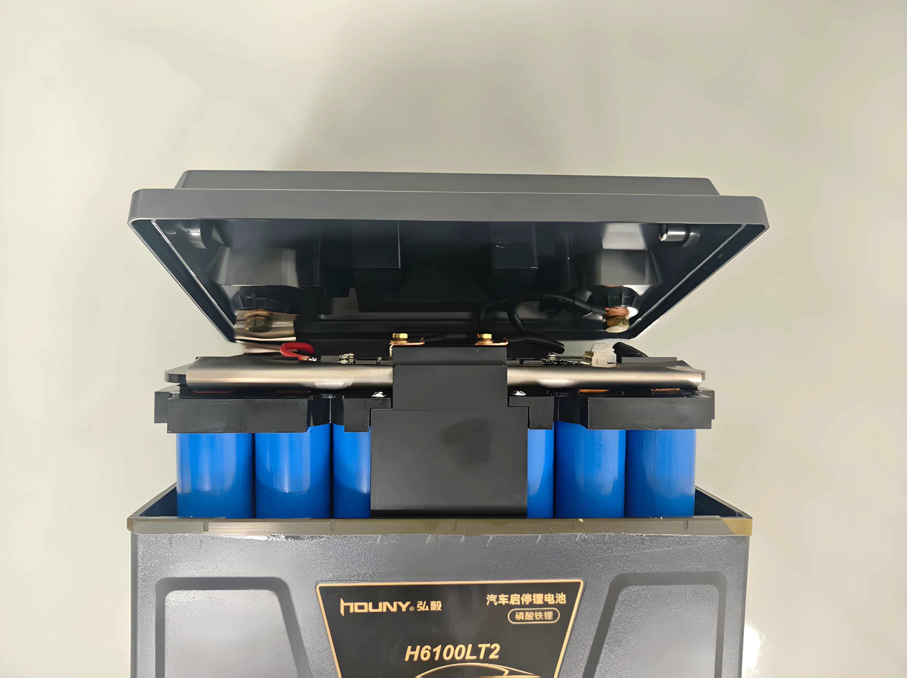](/images/hongyStruct0.webp)  
*بنية الخلايا الداخلية المحكمة وغلاف البوليمر السميك والمقاوم للحرارة*

[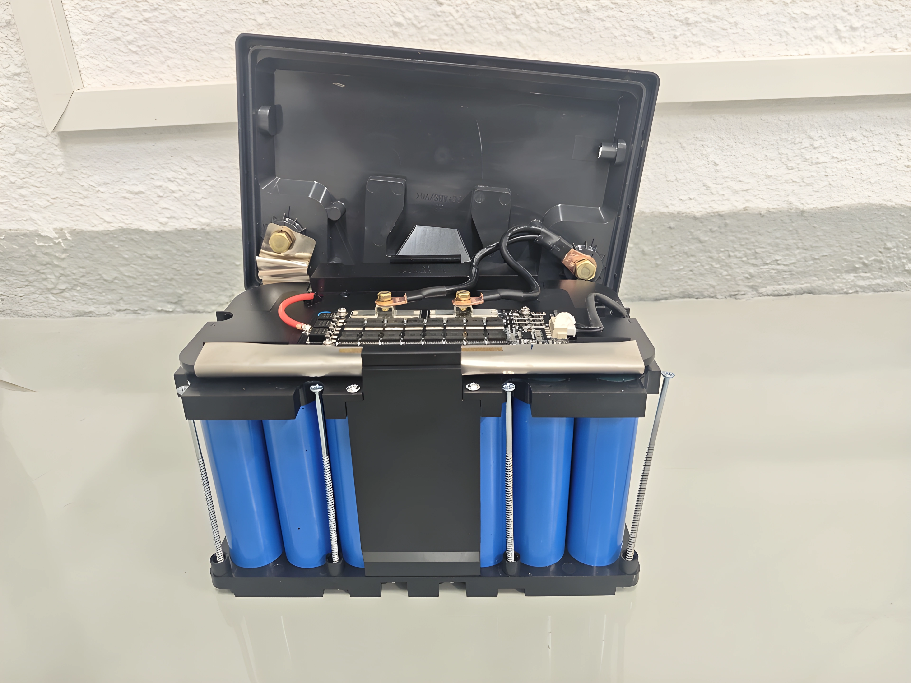](/images/hongyStruct2.webp)  
*هيكل تثبيت داخلي مشدود بمسامير مسبقة الإجهاد لمقاومة الاهتزازات القاسية*

## خطوات التركيب اليدوي (DIY)

### الأدوات المطلوبة

| الأداة | الغرض والملاحظات |
| :--- | :--- |
| **مفتاح حبة بحرف L مقاس 10 ملم [/images/L-socket.webp](/images/L-socket.webp)** | ضروري لفك مسامير قاعدة تثبيت البطارية ومسامير الأقطاب الموجبة والسالبة. |
| **[جهاز حفظ الذاكرة OBD](/ar/2025/memory-saving-battery.html)** | لتوفير طاقة مستمرة وتجنب مسح برمجة الكمبيوتر وإعدادات النوافذ والصوت. |
| **بطارية مساعدة 12V** | لتغذية جهاز حفظ الذاكرة الموصول بمنفذ الفحص OBD. |
| **[حزام حمل البطارية](/images/battery_handle.webp)** | لتسهيل استخراج البطارية (بطارية الوكالة لا تحتوي على مقبض حمل). |

### جدول خطوات التركيب بالتفصيل
> توثيق الخطوات العملية الميدانية؛ وقد انتهت العملية دون أي رموز أعطال في لوحة العدادات.

[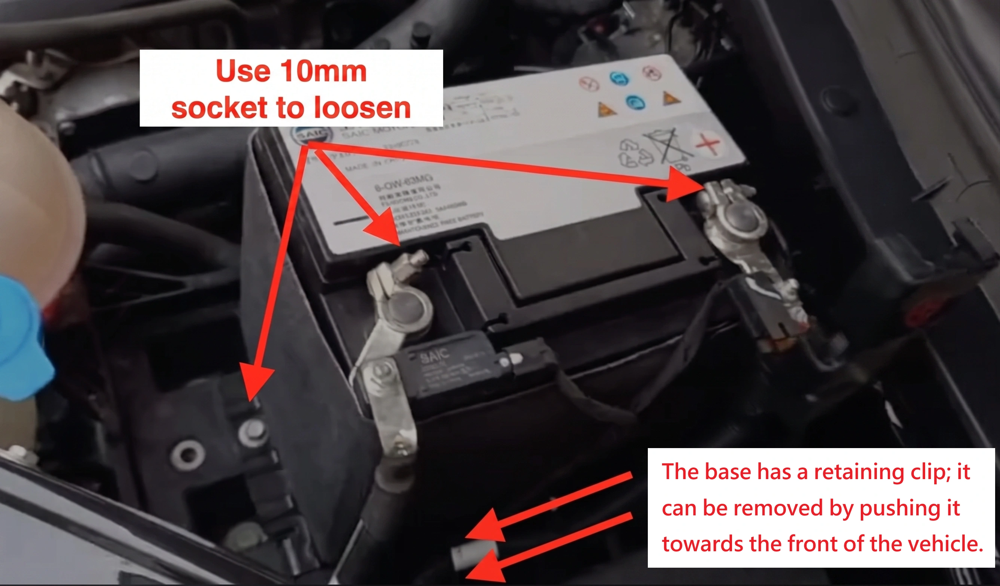](/images/en_LN2-instruction.webp)

| الخطوة | الإجراء العملي | الإرشادات والتفاصيل |
| :---: | :--- | :--- |
| **1** | **توصيل جهاز حفظ الذاكرة** | اربط البطارية المساعدة بجهاز حفظ الذاكرة وأوصل القابس بمنفذ OBD داخل مقصورة السيارة. |
| **2** | **انتظار سكون الحواسيب** | أغلق الأبواب وانتظر 5 دقائق حتى يدخل كمبيوتر السيارة في حالة السكون التام. |
| **3** | **فك براغي تثبيت القاعدة** | استخدم مفتاح 10 ملم لفك مسمار صفيحة التثبيت السفلية عند قاعدة البطارية وإزالتها. |
| **4** | **إفساح مساحة عمل حرة** | ادفع البطارية القديمة **باتجاه مقدمة السيارة** لتحريرها من مشابك التثبيت الخلفية، مما يوفر مساحة مريحة لفك القطب الموجب. |
| **5** | **فك كابلات الأقطاب** | فك القطب **السالب (-)** أولاً، ثم القطب **الموجب (+)** (مع عزله فوراً بقفاز مطاطي سميك). |
| **6** | **تبديل البطاريتين** | اسحب البطارية القديمة باستخدام الحزام وضع بطارية الليثيوم الجديدة مع تلبيس الجراب العازل الحراري. |
| **7** | **ربط الأقطاب مجدداً** | اربط وأحكم تثبيت القطب **الموجب (+)** أولاً، ثم القطب **السالب (-)**. |
| **8** | **تثبيت البطارية في القاعدة** | ادفع البطارية الجديدة **باتجاه جانب السائق** لضمان استقرار شفة القاعدة داخل أسنان التثبيت الخلفية. |
| **9** | **إحكام صفيحة القاعدة** | أعد تركيب صفيحة التثبيت السفلية واربط مسمار مقاس 10 ملم بإحكام. |
| **10** | **اكتمال المهمة** | افصل جهاز الـ OBD وشغل السيارة للتأكد من سلامة التشغيل وغياب أي لمبات تحذيرية. |

## الخلاصة وتقييم النتائج

استغرقت المهمة ربع ساعة فقط، نظراً لأن حوض محرك سيارة MG HS 1.5T فسيح للغاية ويتيح حرية حركة ممتازة.

[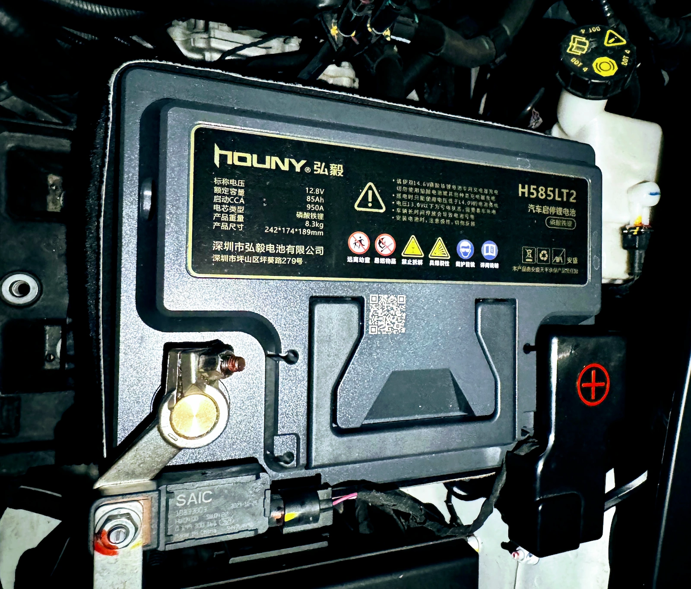](/images/LN2_HY_Install1.webp)

أبرز المكاسب التي تبرر الترقية إلى بطارية فوسفات حديد الليثيوم:

| جانب التفوق | التفسير الهندسي | الفائدة العملية للمستهلك |
| :--- | :--- | :--- |
| **أداء الشحن والتفريغ** | [كفاءة شحن فائقة السرعة](/images/lifepo4-vs-lead-acid-recharge-speed-thesis-comparison.webp) تخفف الجهد عن المحرك؛ و[تفريغ لحظي فوري](/ar/2025/lithium-vs-lead-analysis.html) يحافظ على استقرار كهرباء السيارة. | يطيل عمر دينامو السيارة ويمنح دوران خمول أكثر سلاسة للمحرك. |
| **تحمل الظروف البيئية** | [استقرار كهروكيميائي عالي](/images/delta-lifepo4-vs-lead-acid-specs-comparison.webp) وبنية أوليفين آمنة تمنع الانفلات الحراري أو الاحتراق. | أمان مطلق داخل حوض المحرك حتى في أجواء الصيف اللاهبة. |
| **خفة الوزن وانعدام التفريغ الذاتي** | انخفاض الوزن بنسبة 50% (من ~17 كجم للرصاص إلى 8 كجم فقط) وتفريغ ذاتي بطيء جداً. | يخفف الحمل عن نظام التعليق الأمامي؛ و**مثالي للسيارات التي تُقاد في عطلات نهاية الأسبوع فقط**. |
| **توفير استهلاك الوقود** | [سرعة امتصاص الشحن تختصر وقت دوران الدينامو تحت الحمل المغناطيسي](/ar/2025/car-bms.html). | [تثبت الأبحاث العلمية](/images/startup-lifepo4-battery-engine-performance-thesis.webp) تحقيق تحسن حقيقي وملموس في اقتصادية استهلاك البنزين. |
