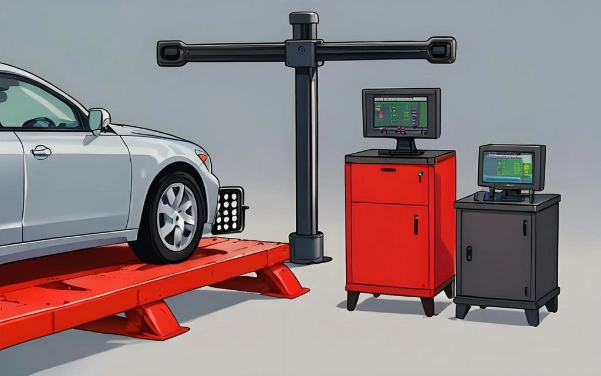

بعد تغيير الإطارات أو صيانة أذرعة التعليق والمساعدات، يوصي الفنيون عادة بإجراء "ميزان عجلات ثلاثي الأبعاد (3D)". ومقارنة بالطرق التقليدية القديمة المعتمدة على أشعة الليزر أو الحبال، يتميز نظام الـ 3D بالسرعة الفائقة والدقة الحسابية المتناهية. يقدم هذا المقال شرحاً هندسياً معمقاً للمبادئ البصرية والرياضية التي تقف خلف هذه التقنية.

## 1. الاستشعار البصري الأساسي: كاميرات صناعية وأهداف عاكسة

يتكون الهيكل الفيزيائي لجهاز الميزان ثلاثي الأبعاد من عارضة أفقية علوية مزودة بكاميرتين صناعيتين (أو أربع) عالية الدقة تعملان بمستشعرات CMOS/CCD السريعة.

* **الأهداف العاكسة الخاملة (Passive Targets):** اللوحات الأربع المثبتة على جنوط السيارة لا تحتوي على أي أسلاك أو بطاريات أو دوائر إلكترونية؛ بل هي لوحات خاملة مطبوعة بمصفوفة دقيقة من النقاط العاكسة للضوء.
* **الإسقاط الهندسي المنظوري:** عندما تلتقط الكاميرات هذه اللوحات من زوايا مائلة في الفراغ، تظهر النقاط الدائرية على شكل "أشكال بيضاوية (Ellipses)" في الصورة الرقمية.
* **خوارزميات تقدير الوضع المكاني:** بمقارنة التشوّه البيضاوي للأشكال المرصودة مع الأبعاد الهندسية الحقيقية المخزنة في النظام، يعيد الحاسوب في أجزاء من الثانية رسم **إحداثيات X و Y و Z** والاتجاه الزاوي لكل عجلة في الفضاء ثلاثي الأبعاد.

## 2. الإجراء الجوهري الأهم: تعويض التشوّه بالدحرجة

هنا تكمن عبقرية أنظمة الـ 3D: **لا يُشترط تثبيت اللوحة العاكسة في مركز الجنط بدقة ميكانيكية مطلقة.**

لماذا؟ لأن جنط السيارة قد يحتوي على طعجات طفيفة ناتجة عن المطبات أو عدم استواء في مخالب التثبيت؛ والقياس الساكن دون حركة سيحتسب هذه العيوب ضمن زوايا السيارة زوراً.

* **إعادة بناء محور الدوران الحقيقي:** يقوم الفني بدحرجة السيارة يدوياً للأمام والخلف لبضعة سنتيمترات على الرافعة. وأثناء دوران العجلات، ترسم النقاط العاكسة "مسارات دائرية مقوسة في الفراغ".
* **التوفيق الرياضي المنحني:** يلتقط النظام مئات الإحداثيات المتتالية ويستخدم معادلات التحليل الرياضي (مثل **طريقة المربعات الصغرى Least Squares**) لحساب المركز المشترك واستنتاج **محور دوران العجلة الحقيقي (Spindle Axis)**.
* **إلغاء الضوضاء الميكانيكية:** يمثل هذا المحور خط الدوران الفعلي لمجموعة الرمان والسرة؛ وبذلك تلغي خطوة التعويض كل الانحرافات الناتجة عن التواء الجنط أو خطأ التثبيت.

## 3. المعايرة والتعويضات البيئية الدقيقة

لضمان دقة قياس تصل إلى 0.01 من الدرجة، يتغلب النظام على مختلف المؤثرات الخارجية:

* **الحدود الفيزيائية مقابل الواقع الميكانيكي:** إذا كان الجنط مشوهاً بشدة أو بيضاوياً، سيتمكن النظام من حساب محوره الرياضي، لكن السيارة ستهتز على الطريق. فالأرقام ستكون "صحيحة هندسياً على الشاشة"، ولكن الجنط بحاجة للاستعدال أو الاستبدال لإزالة الرجة.
* **التعويض الحراري وتمدد المعادن:**
    * **تمدد الهيكل:** تتمدد العارضة المعدنية الحاملة للكاميرات وتنكمش مع تقلبات حرارة الورشة؛ وتقوم حساسات حرارية بتصحيح **المسافة البينية الفاصلة** بين الكاميرات آنياً.
    * **تعويض رقائق الكاميرا:** تقوم الكاميرات المتطورة بموازنة انزياح البكسلات الناتج عن حرارة معالجات الصور الداخلية.
* **المعايرة الدورية:** يضمن استخدام هيكل معايرة معتمد وفق معايير ISO الحفاظ على التطابق الدقيق بين إحداثيات الكاميرات في اليمين واليسار.

## 4. التكامل البرمجي ومعايرة أنظمة الأمان الذكية ADAS

جهاز الميزان 3D يتجاوز كونه أداة قياس ميكانيكية، ليصبح حلقة وصل رئيسية لحواسيب القيادة الذكية:

* **قاعدة بيانات المصنعين الأصلية (OEM):**
    يقارن البرنامج الزوايا المقاسة حياً (الكامبر، الكاستر، التو) مع التفاوتات الرسمية المحددة من الشركة الصانعة لنفس الشاسيه والموديل.
* **المعايرة الحيوية لرادارات وكاميرات ADAS:**
    تعد هذه الوظيفة الأهم في السيارات الحديثة:
    * يجب معايرة رادار التثبيت التكيفي (ACC) وكاميرات الحفاظ على المسار بدقة متناهية بناءً على **"خط الدفع الهندسي الفعلي (Thrust Line)"** الصادر من العجلات الخلفية.
    * يحسب جهاز الـ 3D زاوية خط الدفع المركزية ويرسل هذه الإحداثيات للوحات معايرة أنظمة ADAS لضمان أن تقرأ حساسات السيارة الإلكترونية الطريق في نفس اتجاه حركة الإطارات الفعلي تماماً.

## الخلاصة

يجمع ميزان العجلات ثلاثي الأبعاد بين **الرؤية الحاسوبية الصناعية** و**الرياضيات الفراغية** لأتمتة فحص زوايا السيارة بأقصى دقة ممكنة. ويوضح فهم هذه المبادئ الفيزيائية سبب كون حركة "دحرجة السيارة على الرافعة" بمثابة الروح الحقيقية لعملية الميزان، لضمان قياس واقعي يعبر عن حركة الإطارات الحقيقية وبعيداً عن الأخطاء الميكانيكية للأدوات.
