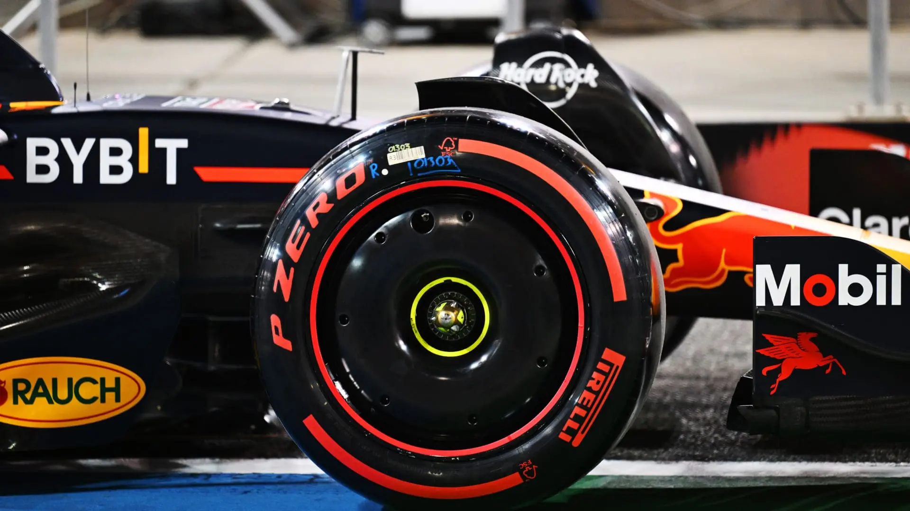
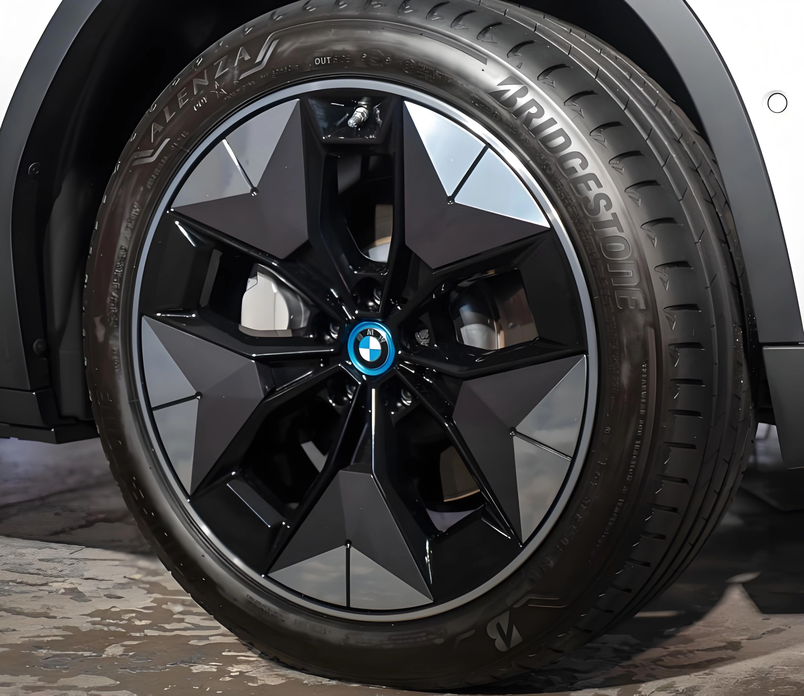

في أوساط تعديل وتزويد السيارات، تسود مقولة شهيرة: "إنقاص كيلوغرام واحد من الوزن غير المعلق (تحت المساعدات) يعادل إنقاص 10 كيلوغرامات من وزن شاسيه السيارة". وسعياً وراء تحسين التسارع وتوفير الوقود، يدفع الكثيرون مبالغ طائلة لتركيب جنوط ألمنيوم مطروقة (Forged) فائقة الخفة، وغالباً ما يرافق ذلك زيادة قطر الجنط بمقاس أو مقاسين.

لكن الواقع الفيزيائي يخالف تلك الرواية الوردية: **إن تعديل السيارة بجنوط مفرغة بالغة النحافة، أو المبالغة في تكبير مقاس الجنط وعرضه، يؤدي غالباً إلى ثقل في الانطلاق، وارتفاع استهلاك الوقود على الطرق السريعة، وهبوط السرعة القصوى.** ومع انتشار السيارات الكهربائية، نشهد اليوم عودة كبرى شركات السيارات لتصاميم الجنوط شبه المغلقة والانسيابية.

## 1. القاعدة الهندسية: السرعات المنخفضة تحكمها الكتلة، والسرعات العالية يحكمها الهواء

لفهم الأثر الحقيقي لتعديل الجنوط، يجب تقسيم سيناريوهات القيادة لمرحلتين:
* **القيادة داخل المدينة (السرعات المنخفضة):** في القيادة اليومية المتكررة بين إشارات المرور، تقاوم السيارة بشكل أساسي وزنها وعزم قصورها الذاتي. وهنا فإن استبدال الجنوط بأخرى أخف وزناً **مع الحفاظ على نفس المقاس الأصلي تماماً** يخفف العبء عن المحرك ويجعل استجابة الدعسة أكثر رشاقة.
* **القيادة على الطرق السريعة (السرعات العالية):** بمجرد تجاوز سرعة 100 إلى 130 كم/ساعة، يصبح جدار الهواء هو العائق الأكبر لحركة السيارة. وفي هذه الحالة، تتفوق الانسيابية الهوائية تماماً على فارق الوزن الصافي للجنط.

## 2. فخ القصور الذاتي الدوراني: تخفيف الوزن لا يعوض ابتعاد الكتلة عن المركز

لماذا يشعر العديد من السائقين بثقل السيارة وبطء استجابتها بعد دفع مبالغ باهظة في جنوط جديدة؟ الخطأ الشائع يكمن في الاكتفاء بقراءة وزن الجنط على الميزان وتجاهل الآثار الفيزيائية لـ **تكبير القطر وزيادة العرض (J)**.

* **ابتعاد مركز الثقل وزيادة العرض:** الترقية من مقاس 17 إلى 19 بوصة أو زيادة عرض الجنط من 7J إلى 8.5J يدفع بكتلة المعدن نحو المحيط الخارجي. كما أن زيادة العرض تفرض تركيب **إطارات أوسع وأعرض**.
* **الإطار هو الجزء الأثقل في المنظومة:** يزن الإطار المطاطي في العادة أكثر من الجنط نفسه، ويقع مداسه في أقصى نقطة خارجية لنصف قطر الدوران.
* **قانون عزم القصور الذاتي الصارم ($$I = m r^2$$):** يتناسب عزم القصور الذاتي ($$I$$) طردياً مع الكتلة ومضروباً في **مربع نصف القطر ($$r^2$$)**. وكلما ابتعدت الكتلة عن مركز المحور، تضاعفت الطاقة اللازمة لتدويرها. والنتيجة هي أن ما ظننته "تخفيفاً للوزن" تحول حسابياً إلى **أقصى درجات المقاومة الدورانية**.
* **النتائج الحقيقية المترتبة على ذلك:**
    * **ثقل التسارع الابتدائي:** يضطر المحرك لبذل عزم إضافي لمجرد بدء تدوير العجلات الثقيلة دورياً.
    * **ثقل المقود وبطء المناورة:** يولد التأثير الجيروسكوبي مقاومة تدليكية لالتفاف المقود تجعل استجابة السيارة بليدة.
    * **إجهاد الفرامل:** تفرض الطاقة الحركية الدورانية المرتفعة جهداً أكبر على الفرامل مما يطيل مسافة التوقف.

## 3. جدار الهواء على الطرق السريعة: قانون مربع السرعة

عند بلوغ سرعات السفر على الطرق السريعة، نخضع لقانون قوة الإعاقة ومقاومة الهواء:

$$F_D = \frac{1}{2} \rho v^2 C_D A$$

المتغير الأخطر في هذه المعادلة هو **مربع السرعة ($$v^2$$)**. فعندما تزيد سرعتك من 70 كم/ساعة إلى 140 كم/ساعة، تتضاعف السرعة مرتين لكن مقاومة الهواء تتفجر إلى **أربعة أضعاف (x4)**! وعلى سرعة 140 كم/ساعة، تشكل مقاومة الهواء أكثر من **75%** من كامل القوى المقاومة لحركة سيارتك.

وفي ظل هذه المقاومة الكاسحة، لا قيمة لتوفير بضع مئات من الغرامات في وزن الجنط؛ بل يصبح معامل الانسيابية ($$C_D$$) هو المفتاح الوحيد **لتوفير الوقود وحفظ عزم السيارة**.

## 4. دروس الفورمولا 1 ومفهوم «مقاومة تهوية الجنوط»

هل تولد العجلات مقاومة هواء ملحوظة؟ الإجابة: نعم، وبنسبة صادمة.

فرضت لوائح بطولة العالم للفورمولا 1 منذ عام 2022 تركيب **أغطية عجلات مغلقة بالكامل (Wheel Covers)**.

* **العجلات مولدات للدوامات الهوائية:** الجنوط الرياضية المفتوحة ذات الأذرع النحيفة تعمل عند الدوران السريع مثل مراوح الشفط العملاقة؛ فهي تشفط الهواء بعنف وتفتته صانعة دوامات هوائية مضطربة بمحاذاة جانبي السيارة.
* **مقاومة التهوية (Ventilation Drag):** تؤكد اختبارات أنفاق الرياح أن الاضطراب الهوائي حول الإطارات والجنوط مسؤول عن **25% إلى 30%** من كامل مقاومة الهواء للسيارة. واختيار فرق الفورمولا 1 إضافة وزن أغطية بلاستيكية على العجلات لكبح هذه الدوامات يثبت أن الانسيابية تتفوق على الوزن في السرعات العالية.

## 5. عصر السيارات الكهربائية وعودة الجنوط الإيروديناميكية المغلقة

في سيارات البنزين، قد تعني زيادة مقاومة الهواء هدر بعض الوقود، أما في السيارات الكهربائية فالهواء يحدد مصيرها الأهم: "مدى البطارية".

لذلك تزود تيسلا وبورش (تايكان) وهيونداي (أيونك) سياراتها قياسياً بـ **جنوط شبه مغلقة ومسطحة تسمى Aero Wheels**.

* **انسياب سلس لتدفق الهواء:** تمنع الواجهة المغلقة دخول الهواء لبطانات الرفارف وتجبره على الانزلاق بنعومة بمحاذاة الأبواب.
* **فارق المدى على أرض الواقع:** تثبت التجارب الواقعية أن نزع الأغطية الانسيابية من سيارات تيسلا يتسبب في فقدان ما بين **3% إلى 5%** من مدى الشحنة على الطرق السريعة.

## 6. خلاصة وتوجيهات عملية قبل تعديل الجنوط

* **للقيادة الحضرية واليومية:** لا مانع من شراء جنوط خفيفة الوزن بشرط الالتزام بنفس مقاس القطر والعرض الأصليين للاستمتاع بانطلاق رشيق. وتجنب تكبير القطر تفادياً لمضاعفة القصور الذاتي.
* **لمحبي القيادة السريعة وملاك السيارات الكهربائية:** ابتعد عن هوس الجنوط المفرغة شديدة النحافة، واحرص على اختيار **تصاميم ذات أسطح شبه مغلقة وأذرع عريضة** للحفاظ على هدوء الهواء وسرعة السيارة ومدى البطارية.
