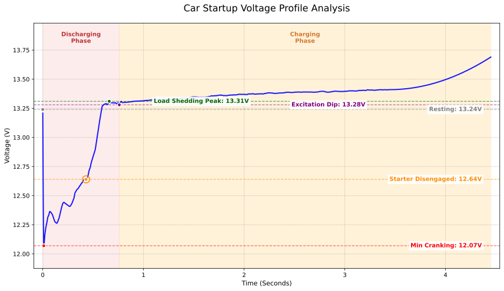

تعد لحظة تشغيل المحرك المرحلة الأكثر قسوة وتغيراً في الحمل داخل المنظومة الكهربائية للسيارة. ومن خلال أخذ عينات جهد فائقة الدقة بتردد 100 هرتز على مستوى الأجزاء من الألف من الثانية، يمكننا رصد التفاعل الفيزيائي المباشر بين البطارية والمولد الكهربائي (الدينامو). تعتمد هذه التجربة على سيارة بمحرك 4 أسطوانات سعة 2.3 لتر تنفس طبيعي مزودة ببطارية LiFePO4 سعة 50 أمبير-ساعة من GreenRun2 لدراسة سلوك منحنى جهد بدء التشغيل.

## أولاً: التحليل اللحظي لجهد بدء التشغيل

يمكن تقسيم عملية بدء التشغيل إلى أربع نقاط تحول فيزيائية رئيسية تعكس تبادل الأدوار بين الحمل الميكانيكي والإمداد الكهربائي:

### 1. هبوط الجهد الأولي الناتج عن تيار الاندفاع
في اللحظة التي يُغلق فيها مرحل بادئ الحركة (السلف) ويبدأ المحرك الكهربائي بالدوران من حالة السكون، يتولد تيار اندفاع هائل (**Inrush Current**).
* **القراءات العملية:** هبط الجهد فوراً من حالة السكون عند **13.24 فولت** إلى **12.07 فولت**.
* **التفسير الهندسي:** يعتمد مقدار هذا الهبوط على المقاومة الداخلية للبطارية $R$ والممانعة الابتدائية لبادئ الحركة. ووفقاً للمعادلة:
$$V_{terminal} = V_{ocv} - (I_{start} \times R_{internal})$$
* **التحليل:** بفضل الخصائص الكهروكيميائية لبطاريات ليثيوم فوسفات الحديد (LiFePO4)، تتمتع البطارية بمقاومة داخلية متناهية الصغر. وبالتالي، وتحت نفس شدة تيار التشغيل $I$، يكون هبوط الجهد أقل بكثير مقارنة ببطاريات الرصاص الحمضية التقليدية؛ حيث بلغ الفقد هنا حوالي **1.17 فولت** فقط، مما يعكس معدل تفريغ فائق الكفاءة.

### 2. تموجات الجهد الناتجة عن أشواط الانضغاط
أثناء استمرار دوران بادئ الحركة، يتذبذب الجهد بانتظام بين **12.07 فولت و 12.5 فولت**.

* **التفسير التقني:** هذه الاستجابة تمثل مقاومة دوران المحرك في **أشواط الانضغاط**.
    * **القاع:** عندما يتحرك المكبس في شوط الانضغاط مع إغلاق الصمامات، تبلغ المقاومة ذروتها، ويزداد استهلاك التيار فيهبط الجهد.
    * **القمة:** بعد تجاوز المكبس للنقطة الميتة العليا وبدء شوط التمدد أو السحب، تنخفض المقاومة ويقل سحب التيار فيرتد الجهد لأعلى.
* **الدلالة الفيزيائية:** تعكس سرعة ومدة هذه التموجات كفاءة وسرعة بادئ الحركة. وفي هذه الحالة تم إتمام عملية الإشعال في غضون **0.55 ثانية** تقريباً، مما يشير إلى منظومة تشغيل عالية الكفاءة.

### 3. تفريغ الحمل والقفزة الحثية
عندما يبدأ المحرك بالدوران الذاتي وتتجاوز سرعة دورانه الحد المصمم لبادئ الحركة، تنفصل القابض أحادي الاتجاه (Bendix) وتنقطع الدائرة الكهربائية لبادئ الحركة.
* **القراءات العملية:** يقفز الجهد سريعاً من **12.64 فولت** إلى **13.31 فولت** ثم يستقر حول **13.30 فولت**.
* **المبدأ الفيزيائي:** هذه ظاهرة تفريغ الحمل الحثي (**Load Dump**). كمكون حثي كبير، يحرر محرك بادئ الحركة الطاقة المغناطيسية المتبقية لحظة فتح الدائرة. وفي الوقت نفسه تتخلص البطارية فجأة من حمل سحب مئات الأمبيرات، مما يعيد جهد الأطراف مباشرة إلى منصته الكهروكيميائية المستقرة.

### 4. بناء تيار الإثارة واستلام الدينامو للتوليد
بعد دوران المحرك، لا يرتفع جهد المنظومة فوراً إلى أقصى حد، بل يستقر مؤقتاً بين **13.28 فولت و 13.41 فولت** قبل أن يرتفع تدريجياً وبوضوح نحو **13.69 فولت**.

* **بناء مجال الإثارة**: مع دوران الدينامو مع عمود المحرك، يحتاج منظم الجهد الداخلي إلى جزء يسير من الوقت لإثارة ملفات العضو الدوار وبناء المجال المغناطيسي. وخلال هذه الفترة يظل خرج الدينامو أقل من جهد البطارية، فتستمر البطارية بتغذية النظام بمفردها.
* **استلام الدينامو للحمل**: بمجرد استقرار المجال المغناطيسي، يتجاوز خرج الدينامو جهد البطارية. وبسبب المقاومة الداخلية المنخفضة لبطارية LiFePO4، تسحب البطارية تيار شحن مرتفع يقيد جهد النظام مؤقتاً عند 13.3–13.4 فولت. ولأن عملية التشغيل لم تستغرق سوى 0.55 ثانية وكانت البطارية شبه ممتلئة، يتم تعويض الطاقة في ثوانٍ معدودة. ثم ينخفض تيار الشحن سريعاً ويزول تقييد الجهد ليرتفع بسلاسة إلى نطاق الشحن المستمر فوق 13.69 فولت.

## ثانياً: مراقبة توازن الجهد أثناء التشغيل المستمر

أظهرت المراقبة المستمرة بعد استقرار دوران المحرك استقراراً كهربائياً فائقاً:

| مرحلة المراقبة | الجهد (فولت) | وصف الحالة التقنية |
| :--- | :--- | :--- |
| **قبل التشغيل** | 13.24 | جهد الدائرة المفتوحة (OCV) عند منصة مرتفعة، حالة ممتازة للبطارية. |
| **بدء التوليد** | 13.69 | بدء خرج الدينامو، مع كبح الجهد بفعل تيار شحن LiFePO4 العالي. |
| **الحالة المستقرة** | 13.80 - 13.90 | الدخول في نطاق التنظيم الثابت للمنظم، مع فقد يكاد ينعدم في الأسلاك. |

### الخلاصة الفنية
1. **منطق تنظيم الجهد:** استقر جهد المنظومة في نطاق **13.80 فولت إلى 13.90 فولت**. بالنسبة لبطاريات LiFePO4، يمنع هذا النطاق إجهاد الخلايا فوق 14.6 فولت، مما يضمن تعويض الطاقة بأمان مع إطالة عمر الخلايا الافتراضي لأقصى حد.
2. **تقييم التقادم:** بعد 3 سنوات و 52,000 كم من القيادة، تحافظ بطارية السيارة على جهد يتجاوز 12 فولت أثناء لحظة بدء التشغيل القاسية. كما أن احتفاظها بجهد 13.24 فولت بعد توقف لمدة أسبوع كامل يثبت عدم حدوث أي ارتفاع في المقاومة الداخلية، مما يؤكد بقاء صحة البطارية (SOH) عند مستويات ممتازة.

## ثالثاً: كثافة الطاقة ومعدل التفريغ

فهم كيف تسهم الخصائص الفيزيائية لبطاريات LiFePO4 في ترقية أداء بدء التشغيل:

1. **كثافة طاقة عالية**
   تبلغ كثافة طاقة ليثيوم فوسفات الحديد حوالي 3 إلى 5 أضعاف بطاريات الرصاص. وهي توفر وزناً أقل بكثير ومواد أقطاب أكثر نشاطاً ضمن نفس الحجم. كما يستقر جهدها الساكن بين **13.2 فولت و 13.3 فولت**، مما يوفر طاقة جهد أولية أعلى عند بدء الدوران.

2. **معدل تفريغ فائق (C-Rate)**
   تتمتع بطاريات LiFePO4 بمقاومة داخلية منخفضة للغاية وتتحمل معدلات تفريغ عالية جداً. ومع توفر الكثافة العالية والسعة الكافية، يمكنها تفريغ تيارات هائلة لحظية مع تلاشي شبه تام لهبوط الجهد، متفوقة بوضوح على بطاريات الرصاص التي تعتمد على الانتشار الكيميائي البطيء.

---

*تم جمع هذه البيانات من سيارة حقيقية باستخدام حساس بدقة 0.01 فولت ومعدل أخذ عينات بتردد 100 هرتز.*
