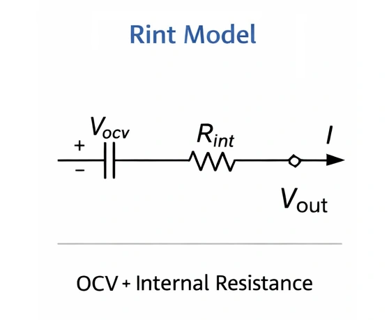

سواء كانت بطارية ليثيوم أيون أو بطارية رصاص حمضية، فإن السمة الأبرز لتقادمها تتمثل في: **«تشحن بسرعة البرق وتفرغ في غمضة عين»**، مصحوبة بارتفاع حاد في درجة الحرارة. ولفهم هذه الظواهر، يجب أن نبدأ بدراسة **المقاومة الداخلية** ونموذج الدائرة المكافئة.

## 1. نموذج الدائرة المكافئة للبطارية

في الفيزياء، لا تعتبر البطارية وحدة تخزين طاقة مثالية. تتكون دائرتها المكافئة من عنصرين أساسيين متصلين على التوالي:

* **القوة الدافعة الكهربائية الكيميائية ($$V_{ocv}$$)**: الجهد المقاس عند أطراف البطارية في حالة الدائرة المفتوحة بدون أي حمل أو تدفق للتيار.
* **المقاومة الداخلية ($$R$$)**: الإعاقة الفيزيائية التي تنشأ أثناء مرور التيار عبر الألواح والمحلول الكهرلي والفاصل.

---

إن إضافة مفهوم **«توزيع القدرة»** يوضح للقارئ مباشرة سبب شحن البطاريات التالفة ببطء: لأن معظم الكهرباء تتبدد على شكل «حرارة» ضائعة.

## 2. ظاهرة الشحن بعد التقادم: لماذا ترتفع حرارتها كلما شُحنت؟

عندما نستخدم شاحناً لشحن البطارية، فإن إجمالي القدرة الكهربائية الصادرة ($$P_{total}$$) تنقسم إلى مسارين:
$$P_{total} (V \times I) = P_{\text{حرارة}} (\text{فقد حراري مهدور}) + P_{\text{شحن}} (\text{طاقة مخزنة فعلياً})$$

### 2.1 الانهيار الحاد في كفاءة الطاقة
لنفترض أننا نستخدم شاحناً بقدرة 5 فولت / 2 أمبير (قدرة إجمالية 10 واط). لنقارن تحويل الطاقة بين بطارية جديدة وأخرى قديمة:

| حالة البطارية | المقاومة الداخلية ($$R$$) | قدرة التسخين ($$I^2 R$$) | قدرة الشحن الفعلية المخزنة | كفاءة التحويل |
| :--- | :--- | :--- | :--- | :--- |
| **بطارية جديدة** | $$0.1 \Omega$$ | $$2^2 \times 0.1 = \mathbf{0.4W}$$ | $$10 - 0.4 = \mathbf{9.6W}$$ | **96%** (ممتازة جداً) |
| **بطارية قديمة** | $$1.5 \Omega$$ | $$2^2 \times 1.5 = \mathbf{6.0W}$$ | $$10 - 6.0 = \mathbf{4.0W}$$ | **40%** (متدنية للغاية) |

**فكر في الأمر:** في البطارية القديمة، يتم استهلاك أكثر من نصف القدرة الكهربائية بواسطة المقاومة الداخلية $$R$$ وتتحول إلى حرارة ضائعة. ولهذا السبب تشعر أن البطارية القديمة تشبه «مدفأة اليد» عند شحنها، ولهذا أيضاً تشعر ببطء الشحن؛ لأن القدرة المخزنة كيميائياً في الواقع تقل عن 40%.

### 2.2 خداع الجهد: لغز الامتلاء الوهمي
يقوم الشاحن بمراقبة **جهد الأطراف الخارجي**:
$$V_{\text{المقاس}} = V_{ocv} + (I \times R)$$

* **وهم البطارية القديمة**: بسبب كبر قيمة $$R$$، عند تدفق تيار 2 أمبير، فإن حاصل الارتفاع الطفيلي في الجهد $$(I \times R)$$ قد يصل إلى 2 فولت أو أكثر.
* **النتيجة**: بمجرد توصيل الشاحن، يرتفع جهد الأطراف فوراً إلى 4.2 فولت (عتبة الامتلاء). يعتبر الشاحن أن البطارية «ممتلئة بالكامل»، فيضيء باللون الأخضر أو يقلل التيار، بينما القوة الدافعة الحقيقية المخزنة $$V_{ocv}$$ لا تزال في مستوى منخفض جداً.

وهذا يفسر تماماً سبب **«امتلاء البطارية المتقادمة في دقائق»**؛ إنه مجرد وهم ناتج عن الرفع الاصطناعي للجهد بفعل المقاومة الداخلية.

## 3. انهيار الجهد أثناء التفريغ: سبب الانطفاء المفاجئ

عندما يسحب الجهاز تياراً، تنعكس المعادلة:
$$V_{\text{المقاس}} = V_{ocv} - (I \times R)$$

**مثال واقعي:**
يكتشف هاتفك أنه إذا انخفض الجهد إلى ما دون 3.3 فولت، فيجب عليه إيقاف التشغيل تلقائياً للحماية. لنفترض أن البطارية تحتوي على جهد متبقٍ يبلغ 3.7 فولت:

* **بطارية جديدة ($$R=0.1\Omega$$)**: عند تشغيل لعبة تسحب تياراً كبيراً قدره 2 أمبير، ينخفض الجهد إلى $$3.7 - 0.2 = \mathbf{3.5V}$$ → **يستمر الجهاز في العمل بسلاسة**.
* **بطارية قديمة ($$R=0.5\Omega$$)**: عند سحب نفس التيار 2 أمبير، ينهار الجهد إلى $$3.7 - 1.0 = \mathbf{2.7V}$$ → **يهبط إلى ما دون عتبة الحماية وينطفئ الهاتف فوراً**.

وهذا يفسر سبب ظهور نسبة 20% في هاتفك، ولكن بمجرد فتح الكاميرا أو تشغيل لعبة، يتعطل الهاتف وينطفئ بسبب هبوط الجهد الفجائي.

## الخلاصة: التقادم انسداد فيزيائي لا رجعة فيه

إذا شبهنا البطارية بـ **خزان مياه**، فإن المقاومة الداخلية تشبه **انسداد ماسورة الخروج بالصدأ والرواسب**:
* **عند الملء**: الأنبوب المسدود يولد ضغطاً عكسياً كبيراً يجعل المقاييس تفيض معتقدة أن الخزان امتلأ، بينما الماء لا يدخل في الواقع.
* **عند الاستخدام**: ينزل الماء على شكل قطرات ضعيفة تعجز عن تلبية تدفق الصنابير المطلوبة.

ونظراً لأن هذه الزيادة في المقاومة ناتجة عن تغيرات فيزيائية لا رجعة فيها في المواد (تبلور الألواح وتفكك المحلول الكهرلي)، فإن استبدال البطارية في الوقت المناسب هو الحل العلمي الوحيد لضمان استقرار وسلامة المعدات.

> **💡 مفهوم متقدم: هل تعلم أن المقاومة الداخلية تنقسم إلى قياس متردد (AC) وقياس مستمر (DC)؟**
>
> في بطاقات المواصفات التقنية، تظهر غالباً قيمتان للمقاومة الداخلية:
> 
> * **المقاومة الداخلية للتيار المتردد (ACIR):** تقيسها الأجهزة بحقن تيار متردد ضعيف بتردد 1 كيلوهرتز. تلتقط المقاومة الأومية البحتة للتوصيلات والمحلول الكهرلي فقط دون تحفيز التفاعلات الكيميائية، وتكون قيمتها منخفضة ومغرية. جميع أجهزة الفحص المحمولة تقريباً في السوق تقيس ACIR.
> 
> * **المقاومة الداخلية للتيار المستمر (DCIR):** تُقاس بتوصيل حمل وتفريغ تيار مستمر فعلي كبير. تدمج المقاومة الأومية مع مقاومة الاستقطاب الكيميائي. وتكون قيمتها أعلى بكثير، وتمثل **المقاومة الواقعية الفعلية** التي يواجهها محرك سيارتك أو هاتفك.
> 
> *ملاحظة: معادلات هبوط الجهد والتسخين المذكورة في المقال تستند بالكامل إلى المقاومة بالتيار المستمر (DCIR).*
