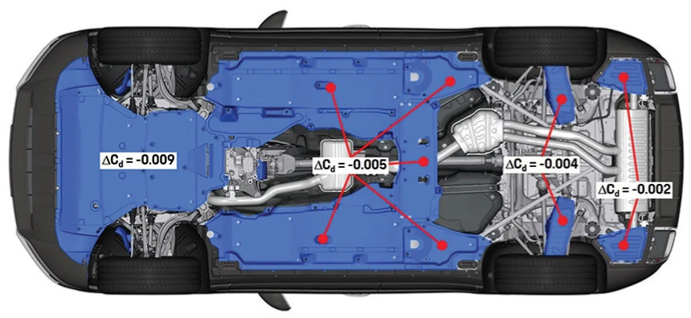

تركز الديناميكا الهوائية للسيارات في الغالب على السقف أو الجناح الخلفي أو المصد الأمامي، إلا أن لأسفل الشاسيه التأثير الأكبر على أرض الواقع. يتيح تركيب «صفيحة حماية أسفل المحرك» مصممة بإتقان تسطيح أسفل الهيكل، وتحسين الثبات على السرعات العالية، وتوفير استهلاك الوقود. ورغم أن العديد من السيارات الفاخرة المستوردة تأتي مجهزة بأغطية سفلية كاملة من المصنع، إلا أن بعض الطرازات الاقتصادية تفتقر إليها.

## المزايا الديناميكية الثلاث الكبرى لتسطيح أسفل الهيكل

يمتلئ أسفل الهيكل التقليدي غير المسطح بقطع بارزة: خزان زيت المحرك (الكارتير)، علبة التروس، أنابيب العادم، وأذرع التعليق. وعند القيادة بسرعات عالية، تولد هذه البروزات دوامات هوائية عنيفة تعيق انسيابية السيارة وترفع استهلاك الطاقة.

دعنا نطلع على البيانات الهندسية الدقيقة:

*(مصدر الصورة: دراسة بورش للديناميكا الهوائية)*

### 1. تقليل السحب: وفر وقود يفوق فائدة «الجنوط المخففة»
وفقاً لأبحاث شركة بورش، فإن الفوائد الديناميكية الهوائية لتسطيح أسفل السيارة تتدرج من المقدمة إلى الخلف، مما يجعل صفيحة حماية المحرك الأمامية حجر الزاوية في اختراق تيار الهواء. مجرد إغلاق وتسطيح أسفل غرفة المحرك يقلل معامل السحب (Cd) بمقدار 0.009، بينما يحقق التسطيح الكامل للهيكل خفضاً بنسبة 6% في إجمالي مقاومة الهواء.

أهمية خفض معامل السحب بالأرقام:  
- **استهلاك القدرة**: كل زيادة قدرها 0.01 في معامل السحب تتطلب حصاناً إضافياً من قدرة المحرك عند سرعة 100 كم/ساعة.
- **زيادة مدى السير**: كل انخفاض قدره 0.001 في معامل السحب يرفع مدى المسافة بمقدار 1 كم. وخفض المعامل من 0.35 إلى 0.30 يزيد المدى بمقدار 50 كم.

مقارنة بالجنوط الخفيفة باهظة الثمن، تقدم صفائح أسفل المحرك جدوى اقتصادية أعلى بكثير من حيث «توفير الوقود، الحفاظ على القصور الذاتي، وعزل ضجيج الرياح».

### 2. كبح قوى الرفع والتخلص من شعور الطفو على السرعات العالية
إلى جانب خفض السحب، يكمن السر الأهم لتسطيح الشاسيه في التحكم بقوى الرفع ($$C_l$$). إن شعور عدم الاستقرار أو «الطفو المزعج» عند تغيير المسار على الطرق السريعة ينتج عن دوامات الهواء تحت الشاسيه المفتوح.

* **مقاومة الرياح العرضية**: تظهر القياسات أنه عند التعرض لرياح جانبية، تكون قوى الرفع المتولدة تحت الشاسيه المسطح أقل بكثير مقارنة بالشاسيه المكشوف.
* **التأثير الأرضي (Ground Effect)**: وفقاً لمبدأ برنولي، يسمح السطح الأملس بمرور الهواء بسرعة فائقة، صانعاً منطقة سحب منخفضة الضغط تشد قاع السيارة نحو الطريق، مما يزيد من تماسك الإطارات وثبات الانعطاف دون زيادة الوزن.

### 3. تحسين كفاءة تبريد غرفة المحرك
يعتقد الكثيرون بالخطأ أن إغلاق أسفل غرفة المحرك بدرع حماية يحبس الحرارة. هذا تصور غير دقيق؛ فالتبادل الحراري الناجح لا يعتمد على المساحات المفتوحة العشوائية، بل على «توجيه مسارات الهواء»:

* **تأثير الشفط على السرعات العالية**: يعمل تسارع الهواء أسفل السيارة على توليد ضغط منخفض يسحب الهواء الساخن بقوة من داخل غرفة المحرك عبر فتحات التوجيه الخلفية، مما يوفر تبريداً يفوق بكثير الشاسيه المفتوح المضطرب.
* **التوجيه الإيجابي في الازدحام**: أثناء التوقف والسرعات البطيئة، يعتمد التبريد على مراوح الرادياتير. ويعمل الدرع السفلي كموجه لضغط الهواء الإيجابي، طارداً الهواء الساخن نحو مؤخرة السيارة ويمنع ارتداده لأعلى عند الاصطدام بالأرض.

## البلاستيك الفولاذي المقوى مقابل المعدن: كيف تختار؟

تنقسم الخامات المتوفرة في السوق إلى فئتين رئيسيتين: «البلاستيك الفولاذي المركب (PP/PE/ABS)» و «المعادن (سبائك الألومنيوم أو صلب المنغنيز)»:

| الخاصية | بلاستيك فولاذي (Polymer Steel) | معدن (ألومنيوم / صلب منغنيز) |
| :--- | :--- | :--- |
| **الوزن** | **خفيف جداً**. لا يضيف أي عبء وزني على الهيكل. | **أثقل وزناً**. صلب المنغنيز هو الأثقل ثم الألومنيوم. |
| **مستوى الحماية** | **متوسط**. يحمي بامتياز من الطين والماء والحصى المتطاير والاحتكاكات الخفيفة. | **فائق القوة**. يتحمل ضربات الصخور الشديدة والاحتكاك بالأرصفة. |
| **المرونة والتشوه** | **مرن**. يمتص الضغط الخفيف ويعود لشكله، لكنه قد ينكسر في الصدمات العنيفة. | **غير مرن**. يتشوه وينثني بصورة دائمة عند التعرض لضربات قاسية. |
| **العزل والهدوء (NVH)** | **ممتاز**. يمتص ضجيج المحرك ولا يصدر رنيناً صوتياً. | **أقل هدوءاً**. قد يعكس الضوضاء ويصدر أصوات رنين معدنية إذا لم يثبت بإحكام. |
| **الاستخدام الملائم** | **90% من السائقين للتنقل اليومي** والخطوط السريعة. | **القيادة في الطرق الوعرة (Off-Road)**، والسيارات المنخفضة المعرضة للاحتكاك. |

**الخلاصة والتوصية:**
إذا كان نمط قيادتك يعتمد على **التنقل اليومي والسفر على الطرق الممهدة، وأولويتك هي التسطيح الديناميكي وخفض استهلاك الوقود وهدوء المقصورة**، فإن **البلاستيك الفولاذي** هو الخيار الأول بلا منازع لخفته وانعدام ضجيجه. أما إذا كنت من عشاق المغامرات الصحراوية والطرق الصخرية، فعليك بـ **الألومنيوم أو الصلب** لتأمين حماية حديدية لمكونات سيارتك السفلية.

## معلومة هامة: هل يعيق الدرع الصلب آلية «سقوط المحرك لأسفل» في الحوادث؟

عند الرغبة في تركيب درع معدني قوي، يتردد تساؤل أمني شهير: *«عند الحوادث الأمامية العنيفة، صُمم المحرك ليسقط نحو الأسفل لحماية الركاب (Engine Dropping Design)، فهل ستمنعه صفيحة الحماية من السقوط وتدفعه لاختراق المقصورة؟»*

يبدو هذا التخوف منطقياً نظرياً، ولكنه يتلاشى تماماً عند دراسة الأرقام الفيزيائية:

* **فارق القوة الهائل:** تتجاوز قوة القصور الذاتي الصدمية اللازمة لتحرير كراسي المحرك وإسقاطه في الحوادث العنيفة **10 أطنان**. في المقابل، تُثبت صفائح الحماية ببراغي صغيرة قياس M6 أو M8 على حواف الشاسيه.
* **مقاومة لا تذكر:** عندما تهبط طاقة كتلة هائلة بقوة 10 أطنان، تقتلع هذه البراغي وتتمزق الصفيحة في أجزاء من الثانية تماماً كتمزق ورق الألمنيوم. فالمقاومة التي تقدمها معدومة تماماً أمام طاقة الاصطدام المهولة.

باختصار، توفر الصفيحة صلابة ممتازة ضد الحصى والاحتكاك اليومي، لكنها أعجز من أن توقف المسار الفيزيائي لسقوط المحرك في حوادث الاصطدام الكبرى.

## خاتمة

صفيحة حماية أسفل المحرك ليست مجرد غطاء واقٍ، بل هي إضافة ديناميكية هوائية جوهرية لترشيد استهلاك الوقود وتعزيز ثبات واستقرار القيادة. فاختر الخامة التي تلائم طبيعة طرقك واستمتع بقيادة سلسة وآمنة!
