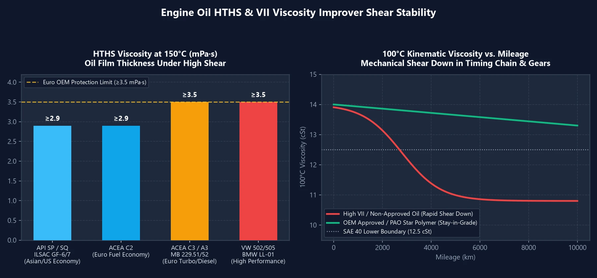

أوضحنا في مقالاتنا السابقة حول خصائص الزيوت أن **معيار HTHS يحدد بدقة التوازن بين توفير الوقود والحماية عند السرعات العالية**، وأن **معامل اللزوجة (VI) منفرداً لا يمثل مقياساً لجودة الزيت**.

ولا يزال العديد من ملاك السيارات يتساءلون: لماذا تختلف تجربة القيادة تماماً بين عبوتين تحملا نفس الرمز **`5W-30`**؟ ولماذا تشعر بسلاسة فائقة مع زيت معين في أول $$2000$$ كم، ليفاجئك بخشونة وصوت مرتفع وثقل بالدعسة بمجرد بلوغ $$3000$$ كم؟ يكمن السر الحقيقي في مؤشرين رئيسيين: **HTHS** و **VII**.

---

## 1. لزوجة HTHS: المقياس الحقيقي لصلابة غشاء الزيت

يصف تصنيف `5W-30` المدون على العلبة اللزوجة الحركية عند درجة حرارة $$100^\circ\text{C}$$ فقط. ولكن أثناء القيادة الشاقة، تقفز درجات الحرارة بين حلقات المكابس وجدار الأسطوانة إلى **$$150^\circ\text{C}$$**، حيث يتعرض الزيت لملايين دورات القص الفائقة في كل ثانية.

يقيس **HTHS (High Temperature High Shear)** سماكة غشاء الزيت الديناميكي عند **$$150^\circ\text{C}$$ تحت إجهاد القص العالي** (ويُقاس بوحدة $$\text{mPa}\cdot\text{s}$$ أو $$\text{cP}$$). وهذا المعيار الفردي يقسم زيوت `5W-30` إلى فئتين متباعدتين كلياً:

| فئة زيوت 5W-30 | مواصفة HTHS | الاعتمادات النموذجية | الخصائص والسيارات الملائمة |
| :---: | :---: | :--- | :--- |
| **HTHS منخفض** **(غشاء رقيق・توفير الوقود)** | **$$2.9 \sim 3.1$$** | API SP / SQ, ILSAC GF-6 / GF-7 ACEA A5/B5, **ACEA C2** | استجابة فائقة للدواسة، دوران حر للمحرك، أعلى توفير للوقود. مثالي للسيارات **الآسيوية والأمريكية ومنظومات الهايبرد**. |
| **HTHS مرتفع** **(غشاء سميك・حماية قصوى)** | **$$\ge 3.5$$** | ACEA A3/B4, **ACEA C3** MB 229.5 / 229.51 / 229.52 BMW LL-01 / LL-04, VW 504/507 | وسادة هيدروديناميكية صلبة، حماية استثنائية ضد التآكل. ضروري لـ **محركات التوربو الأوروبية، محركات الديزل، والسيارات الرياضية**. |

> **قاعدة تطبيقية هامة**:  
> استخدام زيت `ACEA C3` ($$\text{HTHS} \ge 3.5$$) في سيارة آسيوية اقتصادية تنفس طبيعي لن يدمر المحرك، لكنك ستلاحظ **ثقلاً في استجابة الدعسة وارتفاعاً طفيفاً في استهلاك البنزين**. وفي المقابل، استخدام زيت `API SP / ILSAC GF-6` ($$\text{HTHS} \approx 2.9$$) في محرك توربو أوروبي يشترط $$\text{HTHS} \ge 3.5$$ سيؤدي إلى تسريع **تآكل عمود الكامات وجدران الأسطوانات** عند القيادة المتواصلة على الطرق السريعة!

---

## 2. بوليمرات VII: لماذا تنهار الزيوت عند حاجز 3000 كم؟

لتركيب زيوت متعددة الدرجات مثل `5W-30` أو `0W-40`، تبدأ مصانع الزيوت بـ **زيت أساس خفيف** (لتأمين السيولة في بدء التشغيل البارد) ويُضاف إليه **بوليمرات VII** (وهي سلاسل جزيئية لولبية مرنة تشبه النوابض):
- **في البرودة**: تنكمش سلاسل البوليمر على شكل كرات مجهرية صغيرة، مما يسمح للزيت الخفيف بالتدفق بسهولة.
- **في الحرارة**: تتمدد السلاسل وتتشابك معاً لتشكل شبكة لزجة تزيد من سماكة الزيت الأساسي وتمنحه لزوجة الدرجة 30 أو 40.

### ما هو «انهيار القص الميكانيكي»؟

مع دوران الزيت وتدفقه عبر **جنزير التايمن، وتروس مضخة الزيت، وأذرع الصمامات، وحلقات المكابس**، تتعرض هذه السلاسل البوليمرية المتمددة للقص والتقطيع ميكانيكياً تماماً كما تقص بالمقص!

- **الزيوت الاقتصادية أو المضخمة (زيت أساس متواضع + فائض بوليمرات VII رخيصة)**: لتحقيق أرقام VI خيالية ($$\text{VI} > 190$$)، يُشحن الزيت ببوليمرات خطية رخيصة. يكون المحرك هادئاً للغاية في البداية، ولكن خلال مسافة $$3000\sim 5000$$ كم تتمزق هذه البوليمرات كلياً. فيهبط الزيت فجأة إلى لزوجة الأساس الخفيف الرديء، مما يسبب **انهياراً كارثياً في HTHS واللزوجة**، وهو السبب المباشر لسماع أصوات طقطقة وخشونة المحرك.
- **الزيوت التخليقية المعتمدة من المصنعين (قواعد PAO/GTL + بوليمرات نجمية)**: تعتمد الزيوت المعتمدة على قواعد تخليقية نقية (**PAO / GTL**) تحتفظ بلزوجتها طبيعياً بأقل اعتماد على VII، وتستخدم بوليمرات نجمية («Star Polymers») فائقة المتانة تحافظ على ترابطها لما بعد $$10000$$ كم.

---

## 3. ثلاث قواعد ذهبية لاختيار زيت المحرك

1. **حدد معسكر HTHS الخاص بسيارتك أولاً**:
   - **السيارات الآسيوية والأمريكية والهايبرد**: اختر الزيوت الموفرة للوقود ذات السحب المنخفض `API SQ / SP` أو `ILSAC GF-7 / GF-6` أو `ACEA C2` ($$\text{HTHS} \approx 2.9$$).
   - **محركات التوربو والديزل الأوروبية**: اشترط حماية متينة تطابق `ACEA C3` أو `A3/B4` ($$\text{HTHS} \ge 3.5$$).
2. **تمسك بالاعتمادات الأصلية الصريحة للمصنعين (OEM Approvals)**:
   الزيوت المعتمدة رسمياً بشهادات مثل `MB 229.5 / 229.51 / 229.52` أو `VW 504/507` أو `BMW LL-04` أو `Porsche A40` تجتاز اختبارات قص حاقن الضغط العالي شديدة القسوة (Stay-in-Grade)، مما يضمن عدم انهيار اللزوجة طوال فترة الخدمة.
3. **لا تنخدع بمعامل اللزوجة (VI) المرتفع بصورة مبالغ فيها**:
   تتراوح قيمة VI للزيوت التخليقية الممتازة `5W-30` بين $$160 \sim 175$$. وأي علامة تجارية غير معتمدة تعلن عن $$\text{VI} > 190$$ أو $$200+$$ تعتمد في الغالب على مغلظات رديئة سرعان ما تتفتت داخل المحرك.
