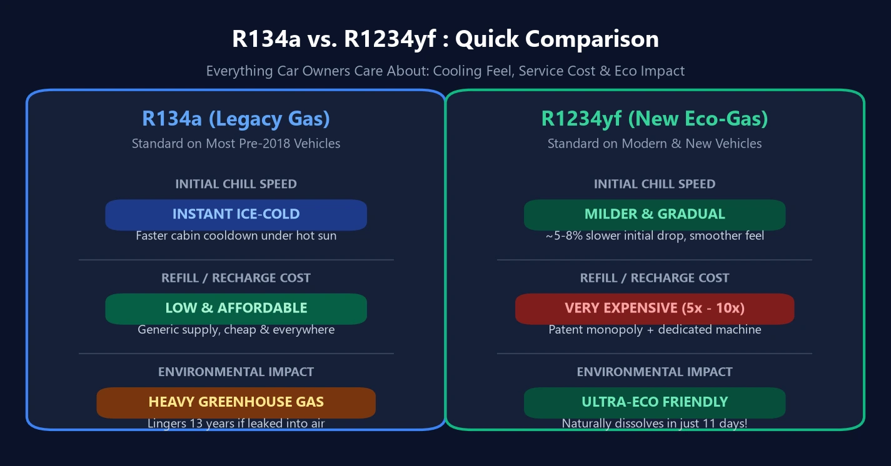

عند إدخال سيارة حديثة إلى مركز الصيانة لخدمة دورة التكييف، يصدم العديد من الملاك بفاتورة التكلفة: فبينما كان شحن فريون **`R134a`** في السيارات السابقة رخيص التكلفة، فإن تعبئة غاز **`R1234yf`** المتطور في السيارات الحديثة تكلف مبالغ باهظة تصل إلى أضعاف مضاعفة!

والأمر الأكثر إثارة للحيرة: بعد دفع هذه المبالغ الكبيرة مقابل هذا الغاز البيئي فائق التطور، يشعر بعض السائقين بأن هواء المكيف لا يتحول إلى برودة ثلجية فورية بنفس سرعة السيارات القديمة في ظهيرة الصيف القائظة. فهل هذا مجرد انطباع وهمي أم حقيقة فيزيائية؟ إليك الحقيقة الكاملة.

---

## 1. مقارنة المعايير الجوهرية: لماذا كان التحول إلزامياً؟

يرتبط تاريخ غازات تبريد السيارات ارتباطاً وثيقاً بالقوانين البيئية الدولية:
- **الجيل الأول R12 (مركبات CFC)**: قدرة تبريد أسطورية، لكنه دمّر طبقة الأوزون؛ وحُظر عالمياً في تسعينيات القرن الماضي.
- **الجيل الثاني R134a (مركبات HFC)**: صديق للأوزون ($$\text{ODP} = 0$$)، لكنه **غاز احتباس حراري قوي للغاية**.
- **الجيل الثالث R1234yf (مركبات HFO)**: المعيار الإجباري الحالي في كافة السيارات الجديدة في أوروبا وأمريكا واليابان.

| معيار المقارنة | القديم: R134a | الحديث: R1234yf | الأثر العملي على السائق |
| :---: | :---: | :---: | :--- |
| **الإحساس الأولي بالبرودة** | **برودة صاعقة وسريعة فور التشغيل** | **أهدأ وأكثر تدرجاً (أبطأ بنحو $$5\% \sim 8\%$$ في البداية)** | الغاز القديم يمتص الحرارة بمعدل أسرع؛ والمنظومات الحديثة تستخدم مكثفات أكبر للتعويض ولكن الدفعة الأولى تبدو أقل حدة. |
| **الأثر البيئي (سبب الإلزام)** | غاز احتباس حراري خطير (يبقى $$13\text{ سنة}$$ في الجو) | **فائق الصداقة للبيئة (يتحلل خلال $$11\text{ يوماً}$$ فقط)** | محظور بالقوانين البيئية؛ الغاز الجديد أقل ضرراً بالمناخ حتى من ثاني أكسيد الكربون ($$\text{CO}_2$$). |
| **تكلفة الشحن** | **اقتصادي ومتوفر في كل مكان** | **باهظ جداً (أغلى بنحو $$5 \sim 10$$ أضعاف)** | احتكار براءات الاختراع لكبرى شركات الكيمياء وصعوبة التصنيع ترفع أسعار التعبئة. |
| **معدات وأجهزة الورش** | أجهزة ومقاييس شحن تقليدية | محطات شحن أوتوماتيكية معزولة ضد الشرر | تصنيف الغاز كطفيف الاشتعال وقيمته العالية يتطلبان أجهزة استرجاع وشحن معقدة وغالية. |

---

## 2. لماذا يشتكي السائقون من أنه «يبرد ببطء أكبر»؟

إن شعور البعض بأن السيارات الحديثة لا تطلق فوراً ذلك الهواء الثلجي القارس ليس وهماً نفسياً، بل يستند إلى حقيقتين هندسيتين:

1. **عائق الديناميكا الحرارية: حرارة كامنة أقل**  
   يعتمد تبريد مكيف السيارة على غليان سائل التبريد داخل المبخر (الثلاجة) لامتصاص حرارة المقصورة. ويمتلك غاز R1234yf **حرارة تبخر كامنة أقل بنسبة $$5\% \sim 8\%$$** مقارنة بـ R134a. وبالتالي وتحت نفس سعة وسرعة ضخ الكمبروسر، فإنه يمتص كمية حرارة أقل في الثانية الواحدة.
2. **إجراءات التعويض الهندسية للمصنعين**  
   لتعويض هذا الفارق الحراري، زودت شركات السيارات المركبات الحديثة بـ **مكثفات أمامية (راديتر مكيف) بمساحات أكبر**، و**مبادلات حرارية داخلية (IHX)**، وكمبروسرات إلكترونية متغيرة الإزاحة. وتصل المقصورة في النهاية إلى نفس درجة البرودة المستقرة، إلا أن دفعة التجميد الأولى في الدقائق الخمس الأولى تبدو أقل شراسة من منظومات R134a القديمة.

---

## 3. لماذا يعتبر هذا الغاز باهظ الثمن بصورة جنونية؟

يعود هذا الارتفاع القياسي في الأسعار إلى سببين تجاريين وهندسيين:

1. **احتكار براءات الاختراع الدولية**  
   تم تطوير وتصنيع R1234yf كبراءة اختراع مشتركة بين عملاقي الصناعات الكيميائية الأمريكية **هانيويل (Honeywell)** و**شيمورز (Chemours - دوبونت سابقاً)**. وتمنع هذه البراءات الشركات الأخرى من إنتاج بدائل تجارية رخيصة لخفض الأسعار في السوق.
2. **معايير السلامة ومحطات الشحن المقاومة للشرر**  
   نظراً لتصنيف R1234yf ضمن فئة **A2L (طفيف الاشتعال)**، تشترط القوانين استخدام أجهزة استرجاع وشحن آلية بالكامل ومحكمة الإغلاق ومجهزة بمراوح ومحركات كهربائية مضادة للشرر والانفجار، وتقوم الورش بتحميل قيمة هذه المعدات الباهظة على فاتورة الخدمة.

---

## 4. ثلاث نصائح جوهرية لصيانة مكيف سيارتك

1. **افحص ملصق غرفة المحرك: إياك والخلط بين الغازات!**  
   يوجد ملصق بيانات رسمي على عارضة الرادياتير يوضح نوع الغاز. **لا تسمح لأي ورشة أبداً بشحن مكيف R1234yf بغاز R134a الرخيص**. فصمامات التمدد والضغوط ونوع زيت الكمبروسر غير متوافقة كيميائياً (دينسو تستخدم زيت ND-OIL 8 لـ R134a وتلزم بزيت ND-OIL 12 المخصص لـ R1234yf). وخلطهما يفسد الزيت ويتسبب في قفل واحتراق الكمبروسر تماماً!
2. **اشترط الشحن الدقيق بالجرام عبر الميزان الإلكتروني**  
   تعمل منظومات التكييف الحديثة بحساسية بالغة لكمية الغاز؛ فانحراف الشحن بمقدار $$30\text{ جراماً}$$ فقط يضعف كفاءة التبريد ويرفع حرارة الضاغط. ارفض الشحن اليدوي العشوائي القائم على قراءة ضغط الساعة، واشترط الشحن بمحطات أوتوماتيكية مبرمجة على وزن الجرامات الموصى به من الصانع.
3. **غاز التكييف لا ينفد من تلقاء نفسه!**  
   دورة مكيف السيارة هي حلقة مغلقة تماماً ومحكمة العزل. فإذا تراجعت البرودة فجأة بعد سنوات، فهذا يعني وجود **تسريب مجهري** في صوف الكباس، أو المكثف الأمامي بفعل ضربة حصى، أو ربلات المواسير. وتعبئة غاز R1234yf المكلف دون فحص وتحديد مكان التسريب وإصلاحه هو هدر صريح للمال في الهواء.
