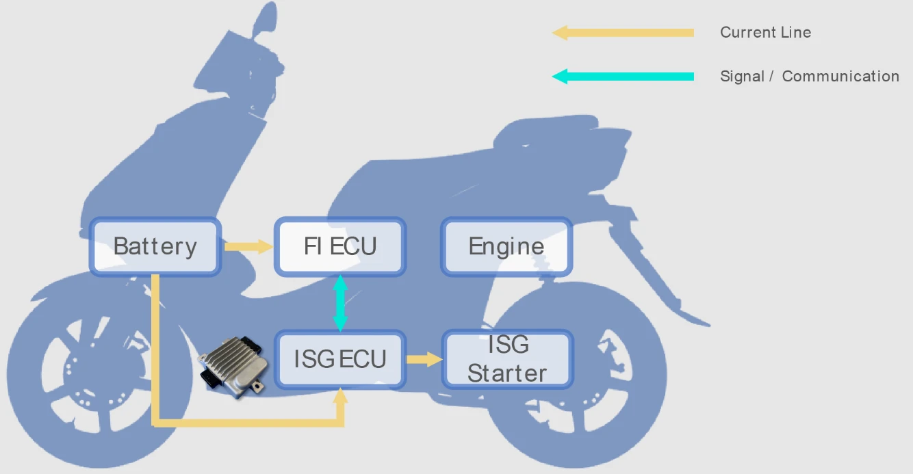

بدأت كبرى شركات تصنيع الدراجات النارية والسكوترات (مثل SYM و Kymco و Yamaha) في تزويد موديلاتها الحديثة بتقنية **ISG (Integrated Starter Generator - بادئ الحركة والمولد المدمج)**. وإلى جانب توفير خاصية «التشغيل الصامت» بدون اهتزازات ونظام التوقف المؤقت عند الإشارات، أصبح **«الدعم الكهربائي اللحظي (Motor Assist / الهجين الخفيف)»** ميزة تسويقية بارزة لتحسين تجربة القيادة.

ومع ذلك، يلاحظ العديد من السائقين أن الدعم الكهربائي يبدو خافتاً ومتواضعاً مع بطارية الرصاص الأصلية، بينما يتحول إلى دفعة انطلاق قوية عند استبدالها بـ **بطارية ليثيوم فوسفات الحديد (LiFePO4)**. فما هو التفسير العلمي لهذه الظاهرة؟ وما هي الحدود الهندسية الثابتة التي تعجز أي بطارية عن تخطيها؟ نستعرض ذلك بالتحليل الدقيق.

---


*مصدر الصورة: [Shindengen](https://www.shindengen.com/products/electro/exhibition/private_exhibition/isg_ecu/)*

## ما هو نظام ISG؟ مبدأ العمل والأدوار المزدوجة

في المنظومات التقليدية، يكون محرك السلف والدينامو قطعتين منفصلتين. وعند بدء التشغيل، يقوم السلف بتدوير عمود الكرنك عبر تروس ميكانيكية تصدر صوتاً خشناً واهتزازات واضحة.

أما **منظومة ISG فتدمج الوظيفتين في وحدة واحدة عديمة المسفرات (Brushless)** تثبت أجزاؤها الثابتة والدوارة مباشرة على محور عمود الكرنك للمحرك. وتعمل في ثلاثة أوضاع:

1. **وضع التشغيل الصامت (محرك كهربائي)**: تسحب الوحدة طاقة البطارية لتدوير الكرنك مباشرة دون أي تروس، محققة تشغيلاً سريعاً وخالياً تماماً من الضجيج والاهتزاز.
2. **وضع الدعم الكهربائي اللحظي (عزم مساعد)**: عند الانطلاق أو فتح مقبض الوقود فجأة، يضخ المتحكم تياراً يولد عزماً إضافياً يدفع الكرنك مباشرة، لتعويض نقص عزم المحرك أحادي الأسطوانة في الدورات المنخفضة.
3. **وضع التوليد واستعادة الطاقة (دينامو)**: أثناء القيادة المستقرة أو عند التباطؤ، تعود المنظومة للعمل كمولد تقليدي لشحن بطارية الدراجة.

## الحدود الفيزيائية الحتمية لمنظومة الدعم الكهربائي ISG

رغم أن ISG يوفر استجابة فورية، إلا أنه يختلف جوهرياً عن أنظمة الهايبرد 48V أو المركبات الكهربائية الخالصة للأسباب التالية:

* **عائق القدرة في منظومة 12 فولت المنخفضة**: بناءً على قانون القدرة الكهربائية $$P = V \times I$$، لتوليد 1 كيلوواط (حوالي 1.35 حصان) من العزم الكهربائي في شبكة 12 فولت، فإن التيار المسحوب من البطارية يتجاوز **90 إلى 100 أمبير** بعد احتساب فواقد المحول والمحرك. وتوليد قدرات أعلى يتطلب تيارات هائلة ستتسبب في احتراق الضفيرة والأسلاك.
* **المساحة الضيقة والحرارة الشديدة**: يقع محرك ISG ملاصقاً لكتلة المحرك وعلبة الزيت في بيئة خانقة تتجاوز 90 درجة مئوية. فإذا استمر الدعم الكهربائي لفترة أطول، ستتراكم حرارة هائلة في ملفات النحاس، مما قد يحرق عوازلها أو يزيل مغنطة المغانط الدائمة.
* **قصر مدة الدعم اللحظي**: لحماية البطارية وتفادي تسخين المحرك، تبرمج وحدة ECU الأصلية الدعم الكهربائي ليعمل خلال أول 10 إلى 20 ثانية فقط من التسارع.

## بطاريات الرصاص مقابل LiFePO4: سر الفارق الحركي الملحوظ

إذا كانت المنظومة محكومة بهذه القيود، فلماذا يعطي الترقية إلى **بطارية LiFePO4** شعوراً بدفعة انطلاق تفوق بطارية الرصاص بمراحل؟ يكمن السر في **الخصائص الكهروكيميائية للبطارية التي تحرر العزم الكامن للمحرك والذي كانت بطارية الرصاص تخنقه**.

```
【سلوك الجهد تحت تيارات التفريغ العالية】
بطارية الرصاص: 12.8 فولت ──► [تفريغ تيار لحظي هائل] ──► هبوط الجهد IR إلى 10.0~10.5 فولت (عزم كهربائي ضعيف)
بطارية LiFePO4: 13.2 فولت ──► [تفريغ تيار لحظي هائل] ──► ثبات الجهد عند 12.5~12.8 فولت (إطلاق كامل العزم المصمم)
```

### 1. المقاومة الداخلية وهبوط الجهد الأومي (هبوط IR)
* **بطاريات الرصاص**: تمتلك مقاومة داخلية مرتفعة. فعندما يطلب نظام ISG تياراً يبلغ 60 إلى 80 أمبير في لحظة الانطلاق، يفرض قانون أوم ($$\Delta V = I \times R_{\text{الداخلية}}$$) **هبوطاً حاداً في الجهد (IR Drop)**. فينهار جهد أطراف البطارية من 12.8 فولت إلى 10.5 فولت أو أقل فوراً، مما يقلص القدرة الكهربائية الفعلية الواصلة للمحرك ($$P = V \times I$$) ويجعل الدعم يبدو ضعيفاً.
* **بطاريات LiFePO4**: مقاومتها الداخلية شبه معدومة (أقل من خمس بطارية الرصاص) وتتحمل معدلات تفريغ خارقة. وحتى تحت سحب يتجاوز 100 أمبير، يظل الجهد مستقراً فوق 12.5 فولت. فيحصل محرك ISG على الطاقة الكهربائية الكاملة ليطلق كامل عزمه المصمم من المصنع.

### 2. سرعة تقبل الشحن وكفاءة استعادة طاقة الفرملة
عند التباطؤ، يولد ISG نبضات شحن سريعة بتيار عالٍ. وتعجز بطاريات الرصاص عن استيعاب هذه النبضات السريعة بسبب بطء تفاعلاتها الكيميائية. في المقابل، تتقبل خلايا LiFePO4 تيار الشحن اللحظي العالي بسرعة فائقة، فتستعيد طاقة الحركة المهدورة وتشحن نفسها فوراً لتأمين الانطلاقة التالية.

| الخاصية التقنية | بطارية الرصاص التقليدية | ليثيوم فوسفات الحديد (LiFePO4) |
| :--- | :--- | :--- |
| **المقاومة الداخلية** | مرتفعة؛ تسبب انهياراً شديداً في الجهد مع الأحمال العالية | ضئيلة جداً؛ استقرار فائق للجهد حتى تحت التيارات العالية |
| **معدل التفريغ (C-Rate)** | متوسط؛ التفريغ الشديد يقصر عمرها الافتراضي | فائق؛ تتحمل نبضات لحظية بين 20C إلى 40C بكل أمان |
| **قوة انطلاق ISG اللحظية** | مقيدة بهبوط الجهد؛ عزم المحرك يخرج ناقصاً | إطلاق كامل عزم المحرك المصمم هندسياً |
| **كفاءة شحن التباطؤ** | شحن بطيء؛ ضياع جزء من طاقة الحركة المستعادة | تقبل شحن فائق السرعة واستعادة ممتازة للطاقة |
| **الوزن الإجمالي** | ثقيلة (حوالي 3 إلى 4 كجم) | خفيفة الوزن للغاية (حوالي 0.8 إلى 1.2 كجم) |

## الحدود التقنية التي لا يمكن تجاوزها

يعتقد بعض السائقين خطأً أن «بطارية LiFePO4 رفعت أحصنة الدراجة». ومن منظور هندسي بحت، **فإن بطارية LiFePO4 تزيل فقط عائق هبوط الجهد لتسمح لنظام ISG بالوصول لأدائه الأصلي المصمم، دون أن تزيد من قدرة المحرك ذاته**. حيث تصطدم الترقية بحواجز عتادية ثابتة:

### 1. سقف التيار في وحدة التحكم (MCU/ECU)
يتم تحديد التيار الأقصى بواسطة شرائح الترانزستور (MOSFET) وبرمجة وحدة التحكم. حتى لو استطاعت بطارية LiFePO4 تفريغ 200 أمبير، فإذا كان المتحكم مبرمجاً على 60 أمبير كحد أقصى، فلن يمر للمحرك سوى 60 أمبير فقط.

### 2. حدود الإشباع المغناطيسي للمحرك
محرك ISG محكوم بكثافة الفيض المغناطيسي لرقائق الحديد والمغانط الدائمة. وبمجرد وصول المحرك لنقطة الإشباع المغناطيسي، فإن ضخ المزيد من التيار لن يولد أي عزم دوران إضافي، بل يتحول بالكامل إلى حرارة زائدة قد تتلف المحرك.

### 3. خصائص ناقل الحركة CVT والسرعات العالية
يعمل دعم ISG على عمود الكرنك مباشرة. وفي بداية الانطلاق، يكون ناقل الحركة CVT في أصغر نسبة تروس، مما يضاعف العزم ميكانيكياً ويمنح السائق ذلك الشعور القوي بالدفع. ولكن في السرعات المتوسطة والعالية، تطغى قوة احتراق البنزين بالكامل، ويصبح عزم ISG الإضافي ضئيلاً جداً مقارنة بها.

## الخلاصة

تعد منظومة الدعم الكهربائي ISG تصميماً هندسياً ذكياً يرتقي بكفاءة استهلاك الوقود وسلاسة القيادة في الدراجات النارية الحديثة.

ويسهم استبدال بطارية الرصاص ببطارية LiFePO4 في القضاء التام على هبوط الجهد عند التفريغ اللحظي، مما يتيح لمحرك ISG **تقديم 100% من قدرته التصميمية الأصلية**. ومع ذلك، تذكرنا قيود شبكة 12 فولت ووحدات التحكم بأن وظيفة ISG ستبقى دائماً مساعدة ومكملة. وفهم هذه الحقائق يضمن لك الاستمتاع بانطلاقة نشطة مع الحفاظ على سلامة وكفاءة دراجتك على المدى الطويل.
