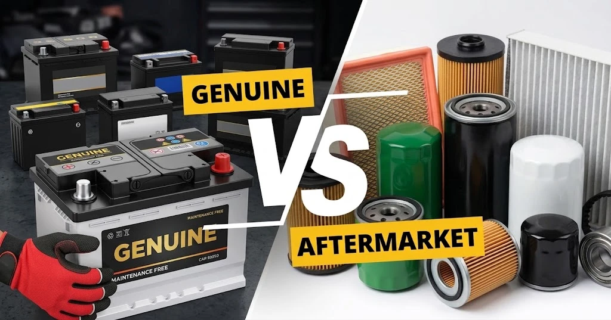

يمر العديد من ملاك السيارات بهذا الموقف: بعد تغيير بطارية أو فحمات فرامل في ورشة خارجية مستقلة، يذهبون بالسيارة إلى مركز الوكالة الرسمي للصيانة الدورية فيخبرهم مسؤول الاستقبال: **«هذه القطعة ليست أصلية، إنها قطعة تجارية.»** مما يثير الشكوك حول أمانة الورشة الخارجية.

فما الذي يحدد «القطعة الأصلية» تحديداً؟ وهل غياب شعار ماركة السيارة يعني دائماً أنها قطعة تجارية رديئة؟ ولماذا لا نسمع إطلاقاً بمصطلح «إطار تجاري» عند شراء إطارات جديدة؟ نكشف الحقائق الهندسية والتجارية لسلاسل توريد قطع الغيار والإطارات.

## 1. قطع غيار السيارات: العلامات التجارية، وقنوات التوزيع، والحقائق

لفهم تصنيفات قطع الغيار، يجب أولاً إدراك حقيقة صناعية بارزة: **شركات تصنيع السيارات لا تصنع معظم مكونات سياراتها بأنفسها**.

إن نحو 70% إلى 80% من مكونات السيارة الحديثة (مثل شمعات الاحتراق البواجي، والدينامو، والمساعدين، وأنظمة الفرامل، والبطاريات) تُهندس وتُصنع بواسطة شركات توريد عالمية كبرى من الفئة الأولى (Tier-1) مثل Bosch و Continental و ZF Sachs و VARTA.

وفي سوق خدمات ما بعد البيع، تنقسم قطع الغيار إلى ثلاثة مستويات رئيسية:

### 1. القطع الأصلية للوكالة (Genuine Parts)
* **التعريف**: تُصنع بواسطة المورد العالمي للوكالة، وتخضع لمعايير صانع السيارة، وتُختم بـ **شعار ماركة السيارة** ورقم القطعة الرسمي، وتُغلف في علب الشركة الصانعة.
* **الخصائص**: تتوفر حصرياً في شبكات الوكلاء والموزعين المعتمدين. وتحمل السعر الأعلى في السوق (بسبب رسوم ترخيص العلامة وهوامش ربح شبكة الوكالة) وتتمتع بضمان الصانع الرسمي.

### 2. قطع صانع المعدات الأصلية (OEM Parts)
* **التعريف**: تُنتج بواسطة **نفس المورد العالمي** الذي يصنع للوكالة على خطوط الإنتاج ذاتها وبنفس الجودة والمواصفات، ولكنها تُغلف داخل **علبة المورد الخاصة** (دون ختم شعار ماركة السيارة).
* **الخصائص**: تُوزع في محلات قطع الغيار الكبرى والورش المستقلة بأسعار تقل بنسبة 30% إلى 50% مقارنة بقطع الوكالة، مع تقديم نفس الأداء والمتانة.

### 3. القطع التجارية البديلة (Aftermarket Parts)
* **التعريف**: قطع تصنعها **مصانع وشركات أخرى مستقلة** ليست موردة لمصنع السيارة، وتُصنع كبدائل متوافقة من حيث الأبعاد والتركيب.
* **الخصائص**: الأرخص سعراً في السوق، لكن جودتها ودقة تصنيعها وعمرها الافتراضي يتفاوت بشدة بحسب سمعة الشركة الصانعة.

## 2. الحالة الفريدة للإطارات: لماذا لا يوجد ما يسمى «إطار تجاري»؟

في عالم الإطارات، تختلف المفاهيم تماماً؛ **فلا أحد يصف إطارات ميشلان أو بريدجستون أو كونتيننتال بأنها 'إطارات تجارية بديلة'**.

فالإطار قطعة استهلاكية موحدة المقاييس، وتمتلك شركات الإطارات الكبرى مراكز أبحاث وسمعة عالمية توازي بل وتفوق أحياناً شركات السيارات. وفي سوق الإطارات يُقسم المنتج كالتالي:

### 1. إطارات التجهيز الأصلي للمصنع (OE Tires)
وهي الإطارات التي تُركب على السيارة في خط الإنتاج عند خروجها من المصنع جديدة كلياً. ويتعاون صانع السيارة مع شركات الإطارات لاختيار الطراز الملائم لطبيعة السيارة.

### 2. الإطارات المعتمدة برموز شركات السيارات (Marked Tires)
بالنسبة للسيارات الفاخرة أو الرياضية (مثل بورشه، بي إم دبليو، مرسيدس)، يقوم صانع الإطارات بالتعاون مع مهندسي الشاسيه بإجراء تعديلات دقيقة على مركب المطاط وعزل الصوت، ويُختم على جدار الإطار **رمز اعتماد رسمي**:

* **`★` (النجمة)**: معتمد لسيارات BMW / Mini
* **`MO` / `MOE`**: معتمد لسيارات مرسيدس-بنز (MOE تعني تقنية السير بدون هواء Run-Flat)
* **`AO` / `RO1`**: معتمد لسيارات أودي (RO1 للموديلات الرياضية RS)
* **`N0` حتى `N6` / `NA0`**: معتمد لسيارات بورشه
* **`T0` / `T1`**: معتمد لسيارات تسلا (مزود بإسفنج داخلي لعزل الصوت)

### 3. الإطارات البديلة العامة (Universal Tires)
الإطارات القياسية المتاحة لكافة السيارات في الأسواق. وطالما أن مقاس الإطار (مثل 225/45 R17) ومؤشر الحمولة والسرعة مطابق لكتيب السيارة، فيمكن تركيبها بأمان تام وقانونية كاملة.

## 3. مقارنة شاملة: قطع غيار السيارات مقابل الإطارات

| وجه المقارنة | قطع غيار الوكالة (Genuine) | قطع OEM والقطع البديلة | إطارات الوكالة المعتمدة (OE Marked) | الإطارات البديلة العامة |
| :--- | :--- | :--- | :--- | :--- |
| **التعريف الأساسي** | معتمدة ومغلفة ومضمونة برعاية ماركة السيارة. | تخلو من شعار صانع السيارة (OEM أصلية أو تجارية). | مركبة في المصنع أو معدلة خصيصاً لشاسيه ماركة معينة. | إنتاج قياسي لشركات الإطارات يُطرح للسوق المفتوح. |
| **الشعارات والرموز** | تحمل **شعار ماركة السيارة** والرقم التسلسلي للوكالة. | تحمل **اسم المورد الأصلي** دون شعار ماركة السيارة. | تحمل اسم شركة الإطارات مع **رمز اعتماد الوكالة** (`MO`, `★`). | تحمل اسم شركة الإطارات و**المقاسات العامة** فقط. |
| **قنوات الشراء** | مراكز الوكالات الرسمية والموزعون المعتمدون. | الورش المستقلة، محلات قطع الغيار، المتاجر الإلكترونية. | مراكز الوكالة، وموزعو الإطارات الكبار، ومراكز الخدمة. | محلات الإطارات المعتمدة، والورش المستقلة. |
| **الضمان والمسؤولية** | مشمولة بضمان شبكة الوكالة الصانعة. | مضمونة من مصنع القطعة أو الورشة المنفذة. | مضمونة من صانع الإطارات؛ ولا تلغي ضمان السيارة. | مضمونة من صانع الإطارات؛ وقانونية وآمنة بالكامل. |
| **مستوى السعر** | **الأعلى سعراً** (تشمل رسوم العلامة وهوامش الوكالة). | **اقتصادي إلى متوسط** (30% إلى 70% من سعر الوكالة). | **متوسط إلى مرتفع** (زيادة طفيفة عن الإطار العام). | **مرن ومتنوع** (من الاقتصادي إلى الفائق الأداء). |

## الخلاصة: دليل القرارات الذكية للصيانة

تتيح هذه التفرقة الهندسية للمالك اتخاذ قرارات صيانة واعية وموفرة:

1. **خلال فترة ضمان السيارة الجديدة**: بالنسبة للأجزاء الجوهرية (المحرك، القير، وكمبيوترات السيارة)، يضمن اختيار **قطع الوكالة الأصلية (Genuine Parts)** عبر القنوات الرسمية خلو مطالبات الضمان من أي نزاع.
2. **بعد انتهاء الضمان وللقطع الاستهلاكية**: بالنسبة للقطع الدورية المعتادة (البطاريات، الفحمات، الهوبات، الفلاتر، البواجي)، توفر **قطع OEM** الصادرة عن الشركات الموردة الكبرى نفس أداء وجودة قطع الوكالة تماماً مع توفير مالي كبير.
3. **عند استبدال الإطارات**: اختيار إطارات من شركات عالمية عريقة (ميشلان، كونتيننتال، بريدجستون، جوديير، بيريللي) بالمقاسات والسرعات الموصى بها في الكتيب يفي بالغرض وزيادة للاستخدام اليومي. أما في السيارات الرياضية ذات أنظمة التعليق الحساسة، فإن الإطارات الحاملة لأختام الاعتماد الأصلية تضمن أفضل تناغم ديناميكي للشاسيه.
