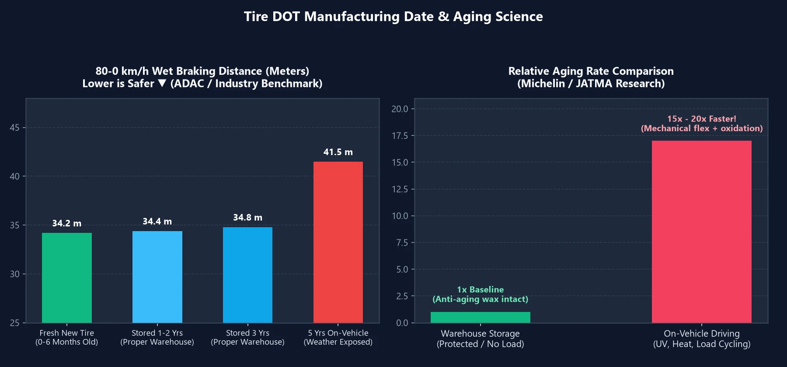

عند شراء إطارات جديدة، ينحني معظم ملاك السيارات بدافع الغريزة لفحص **رمز تاريخ الإنتاج `DOT`** المطبوع على الجدار الجانبي. فإذا صُنع الإطار قبل ثلاثة أشهر فقط شعروا بالارتياح والصفقة الرابحة؛ أما إذا كان قد أُنتج قبل عام أو عامين كمخزون مستودع، فإنهم يظنون فورًا أن البائع يفرغ بضاعة قديمة متصلبة فاقدة لكفاءتها.

لكن التعامل مع إطارات السيارات كما لو كانت عبوات حليب طازج يتعارض تمامًا مع فيزياء هندسة المواد. فهل الإطار المخزن بصورة سليمة لمدة عام أو عامين يهدد الأمان حقًا؟ إليك الحقيقة المدعومة ببيانات الاختبارات العالمية.

---

## 1. قراءة تاريخ إنتاج الإطار (رمز DOT) في 10 ثوانٍ

على الجدار الخارجي للإطار، ابحث عن التسلسل الذي يبدأ بالحروف **`DOT`**. يوضح آخر **رقم مكون من 4 خانات** داخل إطار بيضاوي دفعة التصنيع:

| مثال الرمز | التحليل | المعنى الفني |
| :---: | :---: | :--- |
| **`3525`** | أول خانتين **`35`** (الأسبوع) + آخر خانتين **`25`** (السنة) | صُنع في **الأسبوع 35 من عام 2025** (أواخر أغسطس 2025) |
| **`0826`** | أول خانتين **`08`** (الأسبوع) + آخر خانتين **`26`** (السنة) | صُنع في **الأسبوع 8 من عام 2026** (أواخر فبراير 2026) |

---

## 2. الاختبارات العلمية: هل تفقد الإطارات المخزنة لـ 1 إلى 3 سنوات أداءها؟

أجرت منظمات وهيئات سيارات عالمية مستقلة بالتعاون مع كبرى مصانع الإطارات اختبارات مقارنة دقيقة:

- **نادي السيارات الألماني (ADAC) وهيئة المستهلك الكورية (KCA)**: قارنت إطارات حديثة الصنع بإطارات مخزنة غير مستعملة بعمر **$$2 \sim 3\text{ سنوات}$$**. وعلى حلبات الاستقرار عالي السرعة، والفرملة الطارئة مع ABS على الأسطح المبتلة، واختبار مقاومة الانزلاق المائي، **كانت مسافات التوقف وتماسك المنعطفات متطابقة إحصائيًا**.
- **هيئة التقييس السعودية (SASO) وجمعية JATMA اليابانية**: أثبتت الدراسات أن قيادة السيارة على إطار لمدة **$$3\text{ أسابيع}$$** فقط تسبب إجهادًا تأكسديًا وحراريًا يعادل بقاءه في المستودع لمدة **$$1\text{ سنة كاملة}$$** دون حراك!
- **أبحاث ميشلان وبريدجستون**: الإطارات الجديدة غير المستخدمة المخزنة في ظروف داخلية نظامية تتقادم بمعدل يتراوح بين **$$\frac{1}{15} \sim \frac{1}{20}$$** فقط مقارنة بالإطارات المثبتة على المركبات. علاوة على ذلك، تستمر الروابط الكيميائية الفلكانية للمطاط في الاستقرار خلال الأشهر الأولى بعد الإنتاج؛ لذا غالبًا ما تظهر الإطارات المخزنة باعتدال قدرة فائقة على مقاومة التآكل.

> **لماذا لا يتلف الإطار الجديد في المستودع؟**  
> تحتوي خلطة كل إطار حديث على **مواد مضادة للأوزون وشمعيات حماية**. أثناء سكون الإطار في المستودع، تهاجر هذه الشمعيات إلى السطح مكونة طبقة رمادية واقية تمنع تفاعل الأكسجين والأوزون مع المطاط. وفي غياب ثقل السيارة والأشعة فوق البنفسجية وحرارة الطريق، يظل التحلل الكيميائي شبه معدوم.

---

## 3. القرار الذكي: إطار العام الحالي أم مخزون العام السابق المخفض؟

معرفة خصائص تقادم المطاط تمكنك من اختيار الأنسب وفقًا لـ **المسافة السنوية التي تقطعها**:

| نمط قيادة السائق | المسافة السنوية | الخيار الأكثر ذكاءً | التبرير الاستراتيجي |
| :---: | :---: | :--- | :--- |
| **المسافات الطويلة / التنقل اليومي** | **$$> 15,000\text{ كم / سنة}$$** | **مخزون عمره 1 إلى 2 سنة** **(أفضل قيمة مقابل السعر!)** | ستستهلك مداس الإطار خلال $$2 \sim 3\text{ سنوات}$$ قبل أن يمثل التقادم الزمني أي مشكلة. شراء إطارات مخزنة مخفضة يوفر مبالغ ممتازة دون أي تنازل عن الأمان. |
| **المسافات القصيرة / عطلات الأسبوع** | **$$< 5,000\text{ كم / سنة}$$** | **إطارات حديثة لعام الشراء** | نظرًا لأن مطاط الإطار سيصل إلى نهاية عمره الافتراضي الزمني قبل تآكل النقشة، فإن الحصول على أحدث رمز DOT يمنحك أقصى سنوات استخدام ممكنة. |

---

## 4. القاعدة الذهبية « 3 / 5 / 10 » لاستبدال الإطارات

1. **أقل من 3 سنوات (غير مركبة) = تباع كجديدة من المصنع**:  
   وفقًا لمعايير DIN الألمانية واللوائح الأوروبية، تصنف الإطارات المخزنة وفق الأصول الفنية حتى **$$3\text{ سنوات}$$** قانونيًا كإطارات جديدة كليًا من المصنع ("fabrikneu").
2. **5 سنوات قيد التشغيل = فحص سنوي إلزامي**:  
   بعد مضي **$$5\text{ سنوات}$$** من التركيب والاستخدام، يجب فحص الإطار سنويًا من قِبل فني مختص للتحقق من خلو الجدران من الشروخ الدقيقة وتصلب الأخاديد بغض النظر عن عمق النقشة.
3. **10 سنوات من تاريخ DOT = إحالة إلزامية للتقاعد**:  
   عند انقضاء **$$10\text{ سنوات}$$** من تاريخ رمز DOT المطبوع (بما في ذلك الإطار الاحتياطي/الاستبنة)، يجب استبدال الإطار فورًا لتفادي مخاطر الانفجار المفاجئ على السرعات العالية.

