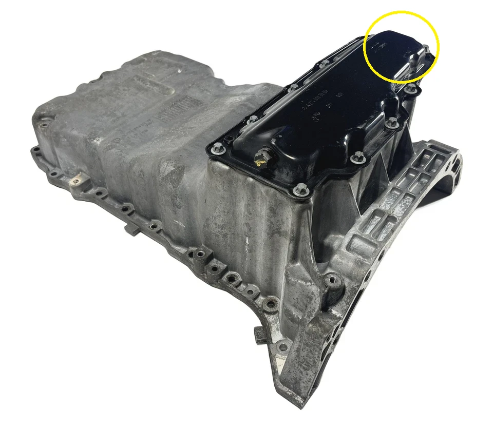

عند الحديث عن **مرسيدس-بنز W205 (وخاصة C300)**، غالباً ما تحضر بعض الصور النمطية الطريفة. لكن بعيداً عن الانطباعات السطحية، وبنظرة موضوعية على الهندسة والقيمة، تُعد W205 خياراً ذكياً للغاية للاستمتاع بمتعة القيادة الأوروبية الأصيلة بتكلفة معقولة.

ففي سوق المستعمل اليوم، تتوفر نسخ ما قبل التحديث المزودة بمحرك **M274** بسعر أقل من سعر سيارة اقتصادية جديدة، بينما تمنحك **منصة دفع خلفي طولية**، و**إطارات متدرجة المقاس**، و**أقراص فرامل مثقبة** مع كليبرات **متعددة المكابس**، و**نظام تعليق متعدد الوصلات أمامي وخلفي** من الألمنيوم، و**زجاجاً عازلاً للصوت**، وأسفل سيارة انسيابياً.

قد يظن البعض أمام هذه المواصفات أن الصيانة معقدة ومكلفة، لكن الواقع عكس ذلك تماماً: فقد صُممت **W205 (محرك M274)** والعديد من السيارات الأوروبية (مثل محركات VW/Audi EA888) **من المصنع لتكون مثالية لتغيير الزيت الذاتي بالشفط العلوي**.

## 1. تحليل كارتير الزيت بالصور: أنبوب الشفط يصل لأعمق نقطة

أكبر تساؤل حول شفط الزيت هو: «هل يترك زيتاً قديماً أو رواسب في القاع؟» نظرة واحدة إلى كارتير محرك **M274** المفكوك تحسم الإجابة (وهو نفس المحرك المستخدم أيضاً في **E-Class W212/W213 وGLC X253 وSLC R172** وكذلك **إنفينيتي Q50/Q60 2.0t**):

*منظر داخلي لكارتير M274: على اليسار الحوض الخلفي العميق (جهة القير) بقاع مسطح تماماً بلا عوائق؛ وتوضح **الدائرة الصفراء** فتحة أنبوب عيار الزيت فوقه مباشرة.*

*منظر خارجي لكارتير M274: جزء علوي من الألمنيوم متصل بحوض سفلي مسطح من الفولاذ الأسود؛ وتشير **الدائرة الصفراء** إلى موضع وصول أنبوب الشفط، وهو على نفس أدنى مستوى لصرة التفريغ في الطرف المقابل.*  
*مصدر الصور: [2015-2019 MERCEDES C300 E300 GLC300 2.0L (M274) ENGINE UPPER & LOWER OIL PAN | eBay](https://www.ebay.com/itm/236894951872)*

تثبت الصورتان حقيقتين هندسيتين مهمتين:

1. **حوض خلفي عميق (Rear Sump)**: لتفادي الجسر الأمامي، يأتي كارتير M274 (كما في W210 M111 الكلاسيكي) ضحلاً في الأمام وعميقاً في الخلف مع قنوات توجيه لتجميع الزيت في الحوض الخلفي.
2. **قاع مسطح ووصول مباشر**: قاع الحوض الأسود أملس تماماً بلا حواجز تعيق الأنبوب. وبمقارنة **الدائرتين الصفراوين**، يصل أنبوب الشفط عبر مجرى العيار إلى نفس أدنى مستوى لصرة التفريغ، ليسحب نفس الكمية تقريباً والسيارة واقفة على أرض مستوية.

## 2. لماذا تناسب السيارات الأوروبية الصيانة الذاتية؟

1. **فلتر زيت علوي (خرطوشة ورقية)**: تضع W205 (M274) ومعظم السيارات الأوروبية الفلتر أعلى حجرة المحرك، بحيث يمكن تغييره بمفتاح 27 ملم وأنت واقف بنظافة تامة دون الزحف أسفل السيارة.
2. **بدون فك الصاجة السفلية وبلا مخاطرة**: توفر عناء رفع السيارة وفك عشرات البراغي، وتتفادى تماماً خطر تلف أسنان صرة الزيت في أحواض الألمنيوم أو البلاستيك.
3. **طريقة معتمدة من المصنع مع قياس دقيق**: تعتمد العديد من ورش مرسيدس الأوروبية الشفط وفق دليل WIS، كما تتيح تدريجات خزان المضخة معرفة كمية الزيت المسحوبة بدقة ومراقبة أي نقص زيت.

## 3. نصائح عملية للحصول على أفضل نتيجة شفط

يمكنك مشاهدة الخطوات العملية كاملة على سيارة W205 C300 في هذا الفيديو:

<iframe width="560" height="315" src="https://www.youtube.com/embed/Z1Efjx6lfBE?start=150" title="DIY Oil Change and Filter Replacement Mercedes-Benz C300 Easy Step by Step" frameborder="0" allow="accelerometer; autoplay; clipboard-write; encrypted-media; gyroscope; picture-in-picture; web-share" referrerpolicy="strict-origin-when-cross-origin" allowfullscreen></iframe>

1. **تسخين المحرك ثم الانتظار 5–10 دقائق**: عند حرارة 60–80 درجة مئوية يكون الزيت سلس الجريان، والانتظار يسمح بنزول الزيت من أعلى المحرك (تجنب الشفط والزيت شديد السخونة بعد القيادة السريعة حتى لا يلين الأنبوب).
2. **فك غطاء الفلتر أولاً**: ارخِ غطاء الفلتر العلوي وارفعه قليلاً قبل الشفط لينزل الزيت المتبقي داخل بيت الفلتر إلى الكارتير ويُسحب معه.
3. **أرض مستوية وعدم الضغط بقوة على الأنبوب**: عند ملامسة القاع المعدني **لا تدفع الأنبوب بقوة** حتى لا ينثني أو يُسد طرفه. وفي النهاية حركه ولفه بضعة مليمترات لسحب آخر قطرات (W205 M274: نحو 6.5–7.0 لتر؛ W210 M111: نحو 5.3–5.5 لتر).
4. **تغيير حلقات O-Ring والشد بالعزم المحدد**: رطّب الحلقات الجديدة بقليل من الزيت النظيف وشد الغطاء بالعزم الموصى به (غالباً 25 نيوتن·متر).
5. **التخلص السليم من الزيت المستعمل**: أعد تعبئته في عبوات الزيت الفارغة لتسليمه لجهات التدوير. للمزيد راجع [دليل التخلص من زيت المحرك المستعمل DIY](/ar/2026/diy-waste-engine-oil-disposal-guide.html).

## 4. تنبيه مهم قبل البدء

ألغت العديد من المحركات الأوروبية الأحدث أنبوب عيار الزيت الفعلي تماماً (مثل أغلب سيارات BMW الحديثة ومحركات مرسيدس **M264 / M254** الجديدة)، وهذه لا تزال تتطلب التفريغ السفلي. افتح غطاء المحرك أولاً للتأكد من وجود أنبوب عيار أو فتحة شفط، وعندها ستستمتع بأسهل وأنظف تغيير زيت منزلي على الإطلاق!
