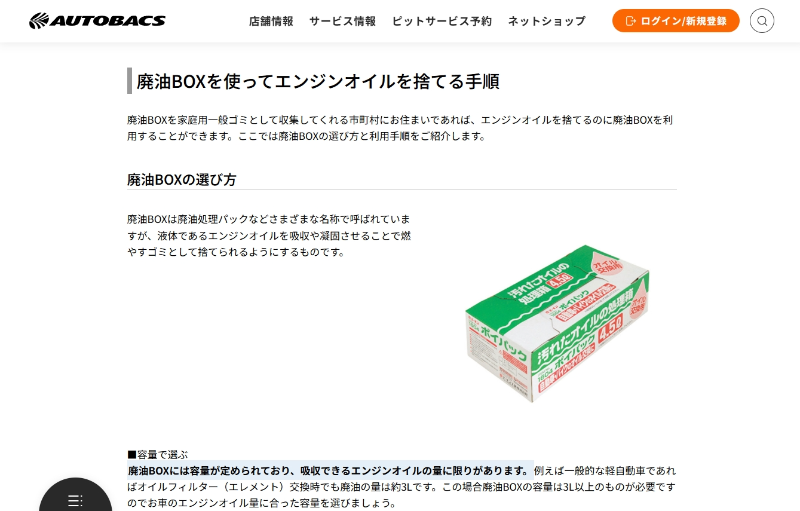
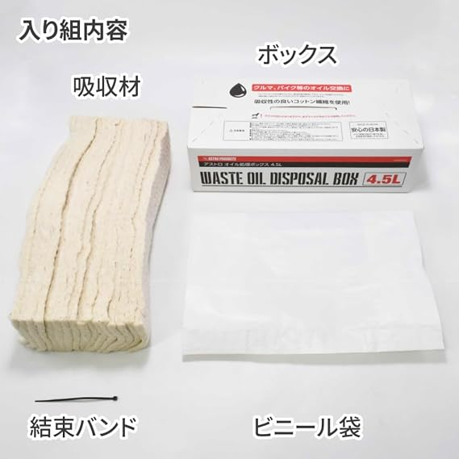
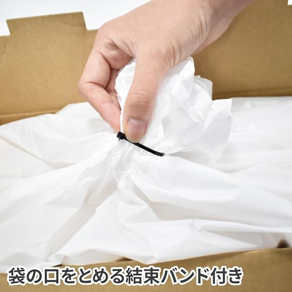

بالنسبة لعشاق السيارات والدراجات النارية الذين يفضلون إجراء الصيانة بأنفسهم بنمط «افعلها بنفسك» (DIY)، فإن اختيار زيت تخليقي ممتاز، وفك برغي الكارتير، وتركيب فلتر زيت جديد لا يوفر تكاليف أجور الأيدي العاملة فحسب، بل يمنح أيضًا معرفة حقيقية بالحالة الميكانيكية للسيارة. ولكن بمجرد الانتهاء من العمل وإعادة العدة إلى مكانها، يواجه الكثيرون سؤالاً محيرًا: **«أين يفترض بي التخلص من هذا الزيت الأسود المستهلك؟»**

في الماضي، كانت ورش الأحياء ومحطات الوقود ترحب بتفريغ الزيت في براميل التجميع الخاصة بها. أما اليوم، فرفعت الغالبية لوحات تعلن «نعتذر عن استقبال الزيوت الخارجية». فما سبب هذا التغيير، وكيف نتخلص من زيت المحرك المستعمل بصورة قانونية، وآمنة، ونظيفة؟

*المرجع: [الموقع الرسمي لشركة AUTOBACS - دليل التخلص السليم من زيت المحرك: تجميد، امتصاص، حرق، أم إعادة تدوير؟](https://www.autobacs.com/static_html/srv/engineoil/article/1031/)*

## الحل الياباني للصيانة الذاتية: صندوق امتصاص وتصريف الزيت

تعد اليابان من أكثر دول العالم تطورًا في ثقافة صيانة السيارات المنزلية. ويستعرض الدليل الصادر عن سلسلة مراكز السيارات الرائدة [AUTOBACS](https://www.autobacs.com/static_html/srv/engineoil/article/1031/) الطرق المتعددة للتخلص من الزيت، مسلطًا الضوء على كفاءة استخدام «صندوق التخلص من الزيت المستعمل»:

### المكونات الهيكلية الأربعة لصندوق الزيت المستعمل
قد يبدو صندوق امتصاص الزيت بسيطًا، لكن كل تفصيل فيه مصمم لمواجهة تحديات عملية تغيير الزيت. وبأخذ صندوق [ASTRO PRODUCTS 4.5L](https://www.amazon.co.jp/dp/B0DJTH698N) كمثال:

*مصدر الصورة: [Amazon.co.jp - صندوق التخلص من الزيت 4.5 لتر | ASTRO PRODUCTS](https://www.amazon.co.jp/dp/B0DJTH698N)*

1. **كرتون مقوى خارجي عالي المتانة (Box)**: يوفر ثباتًا أرضيًا ممتازًا وعزلاً حراريًا، مما يمنع سخونة الزيت من ملامسة الأرضيات مباشرة ويمنع انقلاب الكيس تحت اندفاع الزيت.
2. **مادة قطنية ماصة عالية الكثافة (Absorbent Core)**: تتكون من طبقات متعددة من ألياف القطن أو البوليمرات الخاصة لامتصاص وتثبيت عدة لترات من الزيت السائل وتحويلها إلى قوام متماسك غير متدفق.
3. **كيس بلاستيكي داخلي مانع للتسرب ومتحمل للحرارة (Plastic Liner)**: كيس قوي شديد المقاومة للثقوب ولحرارة الزيت المفرغ حديثًا.
4. **رباط كابلات نايلون متين للإغلاق (Cable Tie)**: **العنصر الأكثر حسمًا لضمان «صفر تسريب وصفر رائحة»!**

*مصدر الصورة: [Amazon.co.jp - تفاصيل صندوق ASTRO PRODUCTS 4.5 لتر](https://www.amazon.co.jp/dp/B0DJTH698N)*

### لماذا يعتبر رباط الكابلات روح الأمان في هذا النظام؟

بعد اكتمال تفريغ الزيت، يحتوي الكيس على 3 إلى 5 كيلوغرامات من الزيت الساخن والثقيل. والاعتماد على «ربط الكيس باليد» يسبب مخاطر جسيمة:
* **فجوات دقيقة عند الثنيات السميكة**: البلاستيك القوي لا ينغلق بإحكام عند عقده يدويًا، ومع اهتزاز الكيس أثناء النقل في صندوق السيارة تبدأ السوائل بالرشح.
* **إهدار سعة الكيس الداخلية**: سحب الكيس لربطه يدويًا يضغط الألياف الماصة لأعلى ويدفع الزيت غير الممتص نحو فتحة الكيس.
* **قوة إحكام فائقة وختم تام**: باستخدام رباط الكابلات المرفق، يكفي تفريغ الهواء الزائد، ثم **لف عنق الكيس كالبريمة بإحكام**، وشد الرباط بقوة عند القاعدة. وبذلك لن يهرب أي زيت أو دخان حتى لو انقلب الصندوق بالكامل في السيارة!

| السعة المحددة | أنواع المركبات الموصى بها | مراعاة تغيير فلتر الزيت |
|:---:|:---:|:---:|
| **2.5 لتر** | الدراجات النارية الصغيرة والمتوسطة والسكوتر | سعة واسعة جدًا (الدراجات تتطلب 0.8 إلى 1.5 لتر) |
| **4.5 لتر** | سيارات البنزين 4 سلندر القياسية والدراجات الكبيرة | السعة المثالية لمحركات 4 سلندر الشائعة |
| **6.5 لتر** | محركات 6 سلندر وسيارات الدفع الرباعي والديزل | المحركات ذات السعات الزيتية الكبيرة |

> **تنبيه تنظيمي (اليابان مقابل الدول الأخرى)**: في اليابان، تسمح معظم البلديات بجمع هذه الصناديق المغلقة برباط الكابلات مع القمامة المنزلية القابلة للحرق. **أما في معظم دول العالم وتايوان، فتصنف القوانين البيئية الزيوت المعدنية كنفايات مستقلة تتطلب تدويرًا مخصصًا.** لذلك، تكمن الفائدة الكبرى لهذه الصناديق خارج اليابان في **منع اتساخ مكان العمل وتوفير وسيلة نقل نظيفة 100% دون أي تسريب** إلى محطات الجمع والتدوير المعتمدة.

## القواعد الذهبية الأربع للتعامل مع زيت المحرك المستعمل

1. **لا تسكب الزيت في المجاري أو مصارف المياه أو على التربة مطلقًا**:  
   لتر واحد فقط من زيت المحرك قادر على تلويث قرابة مليون لتر من المياه العذبة، وتفرض القوانين البيئية عقوبات صارمة على المخالفين.
2. **لا تخلط السوائل المختلفة معًا**:  
   تتطلب إعادة تدوير الزيوت درجة نقاء كيميائي عالية. لا تخلط **سائل التبريد (جليكول الإيثيلين) أو سائل الفرامل أو البنزين أو الماء** مع الزيت المستعمل.
3. **تجنب الزجاجات الضعيفة (مثل زجاجات مياه الشرب البلاستيكية PET)**:  
   زجاجات المياه المعدنية الرقيقة تملك فوهات ضيقة وتلين بسرعة تحت حرارة الزيت، مما يجعلها عرضة للتمزق والانسكاب الكارثي في حقيبة السيارة.
4. **التخلص السليم من فلتر الزيت المعدني**:  
   يحتفظ فلتر الزيت بكمية لا بأس بها من الزيت. اقلبه رأسًا على عقب واتركه يصفى لمدة لا تقل عن 12 ساعة في وعاء التجميع، ثم سلم الهيكل المعدني لمراكز تدوير الخردة المعدنية.

## الخلاصة: استمتع بالصيانة الذاتية بمسؤولية بيئية

تغيير زيت المحرك بنفسك تجربة ممتعة ومجزية لكل عشاق الميكانيكا. **و«إنهاء العمل بالتخلص المسؤول والنظيف من النفايات» هو العلامة الحقيقية للشغف الواعي والمهارة الفائقة.** وسواء اخترت إعادة الزيت في عبوته الأصلية إلى مراكز التدوير أو استخدمت الصناديق الماصة اليابانية المزودة بـ **أربطة الكابلات المحكمة** لنقله بأمان، يمكنك توفير المال والحفاظ على نظافة كراجك وكوكبنا في آن واحد!

