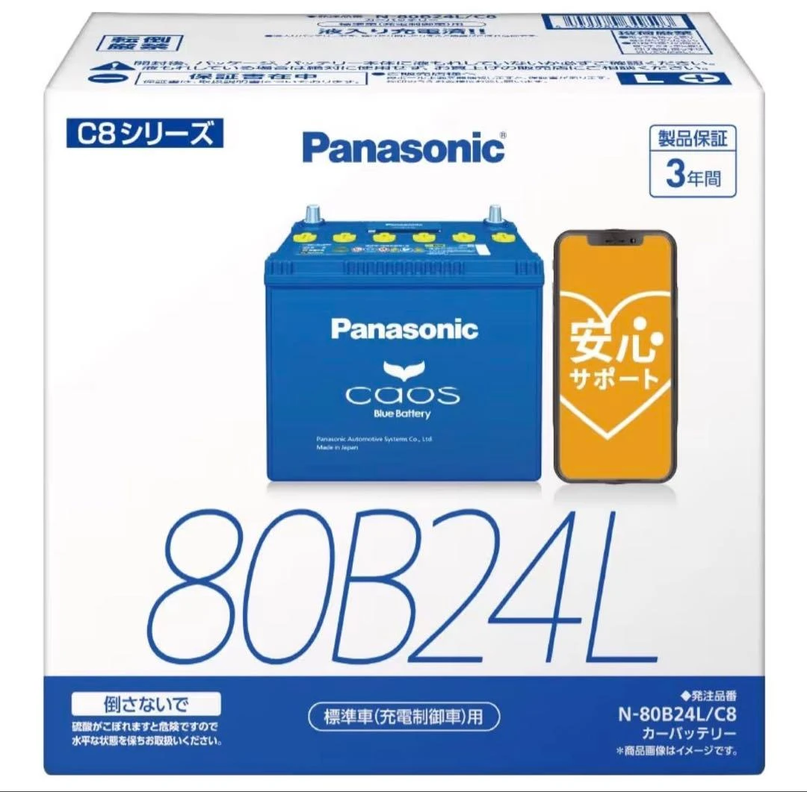

عند البحث عن بطارية لسيارة يابانية أو استبدالها، ستصادف كثيرًا رموزًا أبجدية رقمية مثل **`80B24L`** أو **`55D23L`**. ورغم أنها تبدو معقدة للوهلة الأولى، إلا أنها تتبع بدقة متناهية المعيار الصناعي الياباني (**JIS D 5301**). ويصف كل حرف ورقم بدقة القدرة الكهربائية والأبعاد الهيكلية للبطارية. وفيما يلي تفصيل شامل لكل جزء من هذا الرمز.

---

## 1. تفكيك شفرة موديلات البطاريات اليابانية: مثال «80B24L»

يقسم معيار JIS رمز طراز البطارية إلى أربعة مقاطع رئيسية:

| رمز المثال | التسمية | المعنى والشرح الفني |
| :---: | :--- | :--- |
| **80** | **رتبة الأداء (Performance Rank)** | تشير الأرقام الأعلى إلى أداء تدوير أقوى وسعة كهربائية واحتياطية أكبر. |
| **B** | **رمز العرض والارتفاع** | يحدد الأبعاد المقطعية القياسية لصندوق البطارية (العرض والارتفاع). |
| **24** | **طول الصندوق** | يمثل الطول الخارجي التقريبي البالغ **24 سم** ($$240\text{ مم}$$). |
| **L** | **موضع القطب الموجب** | يدل على أن القطب الموجب (+) يقع في جهة **اليسار** (Left). |

---

### تفصيل دقيق لكل مقطع

1. **رتبة الأداء (مثلاً: 80)**
   * تصنيف مركب يقيم قدرة التدوير والسعة الكهربائية الإجمالية. يشير الرقم الأكبر إلى استقرار أعلى وبدء تشغيل أكثر حيوية للمحرك.
   * عند الاستبدال، يمكن لمالك السيارة اختيار نفس الرقم الأصلي أو **الترقية إلى رقم أعلى** (مثلاً، الانتقال من 46 إلى 60 أو 80) لضمان طاقة كافية للملحقات الإضافية.

2. **رمز مقطع الصندوق (مثلاً: B)**
   * تحدد الحروف الإنجليزية العرض والارتفاع بدقة:
     * **B**: العرض حوالي $$129\text{ مم}$$، والارتفاع حوالي $$203\text{ مم}$$.
     * **D**: العرض حوالي $$173\text{ مم}$$، والارتفاع حوالي $$204\text{ مم}$$.
   * **تحذير**: يحدد هذا الحرف إمكانية استقرار البطارية داخل صينية المحرك وتحت حامل التثبيت المصنعي، ولا يجوز تغييره عشوائيًا.

3. **طول الصندوق (مثلاً: 24)**
   * يعبر عن الطول الخارجي التقريبي بالسنتيمتر (**24 سم / $$240\text{ مم}$$**).
   * نظرًا لأن صينية حجرة المحرك ذات أبعاد محددة، يجب أن يتطابق الطول مع مساحة التثبيت.

4. **قطبية الأقطاب (مثلاً: L أو R)**
   * **قاعدة زاوية الرؤية**: انظر للبطارية من الأمام بحيث تكون الأقطاب هي الأقرب إلى صدرك:
     * **L** (Left): القطب الموجب (+) يقع على **اليسار**.
     * **R** (Right): القطب الموجب (+) يقع على **اليمين**.
   * **تنبيه حاسم**: صُممت أسلاك البطارية في السيارات بأطوال محكمة دون أي تراخٍ. فإذا اشتريت قطبية معكوسة، فلن تتمكن الأسلاك من الوصول إلى الأطراف المقابلة، مما يجعل التركيب مستحيلاً.

---

## 2. معلومة تقنية متقدمة: كيف تُحسب رتبة الأداء؟

وفقًا لمعيار JIS D 5301، فإن الرقم المتقدم (مثل 50 أو 80) ليس مجرد علامة تسويقية عشوائية، بل يُحسب رياضيًا عبر المعادلة التالية ويُقرب لأقرب عدد صحيح:

$$\text{رتبة الأداء} = \sqrt{\text{CCA} \times \text{RC} \times 0.28}$$

تجمع المعادلة بين مقياسين أساسيين لأداء البطارية: **CCA** و**RC**:

* **تيار التدوير على البارد (CCA - Cold Cranking Amperes)**:
  * **التعريف**: أقصى تيار تفريغ يمكن للبطارية توفيره عند **$$0^\circ\text{F}$$ (حوالي $$-17.8^\circ\text{C}$$)** تحت البرودة الشديدة مع الحفاظ على جهد تشغيلي آمن.
  * **الأهمية**: يعكس قوة التدوير عند بدء التشغيل في الصباح الباكر أو الشتاء القارس.
* **سعة الاحتياط (RC - Reserve Capacity)**:
  * **التعريف**: عدد الدقائق التي يمكن للبطارية فيها الاستمرار بتفريغ تيار ثابت مقداره **$$25\text{ أمبير}$$ عند $$25^\circ\text{C}$$** قبل أن ينخفض جهدها إلى $$10.5\text{ فولت}$$.
  * **الأهمية**: يقيس صمود المنظومة الكهربائية في حال تعطل الدينامو أو عند تشغيل الملحقات والمحرك متوقف.

---

## 3. إرشادات عملية للشراء والاستبدال

1. **تطابق الأبعاد الهيكلية تمامًا (الحرف + الطول)**: مقاسات مثل `B24` أو `D23` شروط تثبيت غير قابلة للمساومة، وأي مقاس خاطئ لن يلائم صينية التثبيت.
2. **عدم الخطأ في قطبية الأطراف (L مقابل R)**: افتح غطاء المحرك وتأكد من موضع القطب الموجب لبطاريتك الحالية قبل الشراء.
3. **إمكانية ترقية رتبة الأداء بأمان تام**: إذا كانت سيارتك مزودة بكاميرات مراقبة (داش كام)، أو نظام صوتي قوي، أو شاشات ذكية، فإن اختيار رتبة أداء أعلى ضمن نفس الحجم الفيزيائي (مثل الترقية من `46B24L` إلى `80B24L`) يمنحك عمرًا أطول وموثوقية فائقة.

