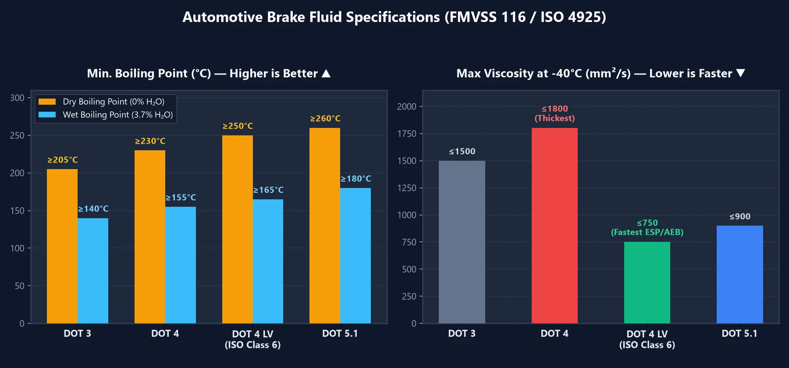

عند صيانة سيارتك، ستلاحظ كثيرًا على عبوات زيت الفرامل تسميات مثل **`DOT 3`** أو **`DOT 4`** أو **`DOT 4 LV`** أو **`DOT 5.1`**. فهل يعني الرقم الأكبر دائمًا أداءً فرمليًا أقوى؟ ولماذا يصر الفنيون المحترفون على تغيير زيت الفرامل كل عامين حتى لو كانت السيارة مركونة في الكراج؟ إليك الدليل الأكثر وضوحًا لفهم مواصفات سائل الفرامل ومعايير الأمان.

---

## 1. جدول مقارنة سوائل الفرامل: المعايير الثلاثة الأساسية

عند اختيار سائل الفرامل، انتبه إلى ثلاثة مؤشرات رئيسية:
1. **درجة الغليان الجافة (Dry Boiling Point)**: أقصى عتبة حرارية يتحملها السائل الجديد المغلق تمامًا ($$0\%$$ نسبة ماء).
2. **درجة الغليان الرطبة (Wet Boiling Point)**: نقطة الغليان بعد حوالي 1 إلى 2 سنة من الاستخدام الفعلي (**$$3.7\%$$ نسبة رطوبة**)—**وهذا هو مقياس الأمان الفعلي على الطرقات**.
3. **اللزوجة الحركية في درجات الحرارة المنخفضة**: كلما كان الرقم **أقل**، كان السائل أسرع تدفقًا وأسرع استجابة لأنظمة ABS وESP وAEB.

| المواصفة | درجة الغليان الجافة (جديد) | درجة الغليان الرطبة (3.7% ماء) | أقصى لزوجة عند $$-40^\circ\text{C}$$ | الخصائص والاستخدامات |
| :---: | :---: | :---: | :---: | :--- |
| **DOT 3** | $$\ge 205^\circ\text{C}$$ | $$\ge 140^\circ\text{C}$$ | $$\le 1500\text{ mm}^2/\text{s}$$ | شائع في السيارات القديمة واليابانية/الكورية الاقتصادية؛ يمتص الرطوبة ببطء لكنه يغلي عند درجات حرارة أقل. |
| **DOT 4** | $$\ge 230^\circ\text{C}$$ | $$\ge 155^\circ\text{C}$$ | $$\le 1800\text{ mm}^2/\text{s}$$ | يتحمل حرارة أعلى من DOT 3، لكنه **أكثر كثافة ولزوجة في درجات الحرارة المنخفضة**. |
| **DOT 4 LV** **(Class 6)** | $$\ge 250^\circ\text{C}$$ | $$\ge 165^\circ\text{C}$$ | **$$\le 750\text{ mm}^2/\text{s}$$** | **الخيار الأفضل للسيارات الحديثة!** مقاومة حرارية عالية + سيولة فائقة؛ ضروري لمنظومات ESP/AEB. |
| **DOT 5.1** | $$\ge 260^\circ\text{C}$$ | $$\ge 180^\circ\text{C}$$ | $$\le 900\text{ mm}^2/\text{s}$$ | أداء عالٍ للقيادة الرياضية والحمولات الشاقة والمنحدرات الجبلية. |
| **DOT 5** | $$\ge 260^\circ\text{C}$$ | **(غير ماص للرطوبة)** | $$\le 900\text{ mm}^2/\text{s}$$ | **قائم على السيليكون (للجيش والسيارات الكلاسيكية فقط)**؛ **يُحظر تمامًا** في سيارات الطرق ذات ABS! |

> **لماذا يُعد `DOT 4 LV` (`ISO 4925 Class 6`) الخيار الأهم اليوم؟**  
> على الرغم من أن `DOT 4` القياسي يتحمل حرارة أعلى من `DOT 3`، إلا أنه أكثر لزوجة. وتعتمد السيارات الحديثة على نظام الثبات الإلكتروني **ESP** والفرملة التلقائية **AEB** التي تتطلب ضخ السائل عبر صمامات ABS متناهية الصغر في أجزاء من الثانية. الترقية إلى **`DOT 4 LV`** تضمن بناء الضغط الهيدروليكي فورًا في المواقف الطارئة!

---

## 2. لماذا يجب تغيير سائل الفرامل بانتظام؟ خطر «القفل البخاري»

يتساءل الكثير من السائقين: **«أليست دورة الفرامل محكمة الإغلاق؟ كيف يدخل إليها الماء؟»**

في الحقيقة، تنفذ رطوبة الغلاف الجوي طوال 24 ساعة يوميًا عبر المسام المجهرية لـ **الخراطيم المطاطية** عند العجلات الأربع وعبر جلود الكليبرات. وسوائل الفرامل الشائعة (DOT 3 / 4 / 5.1) مصممة قصدًا لتكون **شديدة الامتصاص للماء (Hygroscopic)**:
- **لماذا صُمم ليمتص الماء بدلاً من طرده؟** لو كان السائل طاردًا للماء (مثل سيليكون DOT 5)، لتجمعت الرطوبة في أدنى نقطة وأشدها حرارة: **كليبرات الفرامل**. كانت قطرات الماء ستغلي منفصلة عند $$100^\circ\text{C}$$ فقط مسببة تآكل المكابس وانهيار الفرملة. وبإذابة الرطوبة بانتظام داخل تركيبة الجليكول، يمنع السائل تكون قطرات ماء حرة تغلي عند $$100^\circ\text{C}$$، على حساب **انخفاض تدريجي في درجة غليان السائل بالكامل**.

### ما هي ظاهرة القفل البخاري؟

- **الحالة الطبيعية (السوائل غير قابلة للانضغاط)**: عندما تضغط على دواسة الفرامل، ينقل السائل الهيدروليكي قوة قدمك بنسبة $$100\%$$ مباشرة لمكابس الفرامل.
- **حالة الانهيار (الغازات قابلة للانضغاط)**: عندما يحتوي السائل القديم على نسبة رطوبة تتجاوز $$3\%$$ وتنخفض درجة غليانه إلى قرابة $$140^\circ\text{C}$$، فإن الكبح المستمر في المنحدرات الجبلية يجعل السائل داخل الكليبر **يغلي مكونًا فقاعات بخار غازية**. وبما أن الغاز ينضغط، فإن ضغطك على الدواسة يكتفي بضغط فقاعات الهواء دون دفع الأقمشة: **تهبط الدواسة إلى أرضية السيارة تمامًا مع فقدان كامل للفرامل**!

---

## 3. ثلاث نصائح عملية للصيانة والشراء

1. **الاستبدال بناءً على «المدة الزمنية» وليس الكيلومترات فقط**:  
   تتسلل الرطوبة باستمرار عبر خراطيم العجلات حتى لو كانت السيارة متوقفة في الكراج. استبدل زيت الفرامل كل **سنتين أو 40,000 كم** (أيهما أسبق).
2. **لا تعتمد كليًا على أقلام الفحص أو شفط العلبة العلوية فقط**:  
   زيت الفرامل لا يدور كدورة مغلقة متجددة. يدخل الماء عند الإطارات وتتركز الحرارة في **الكليبرات الأربعة**. فحص الخزان العلوي بقلم التوصيل يعطي ضوءًا أخضر مضللاً بينما الزيت في الأسفل ملوث تمامًا. احرص دائمًا على تفريغ وتنسيم الزيت من **مسامير التنفيس عند الكليبرات الأربعة بالكامل**.
3. **كيف تختار السائل عند الترقية؟**  
   إذا كان كتيب سيارتك يحدد `DOT 3` أو `DOT 4`، اختر ببساطة سائل **`DOT 4 LV` (`ISO 4925 Class 6`)** عالي الجودة (مثل ATE SL.6 أو Bosch ENV6) لتحقيق أعلى مقاومة حرارية واستجابة أسرع للفرامل الإلكترونية.

