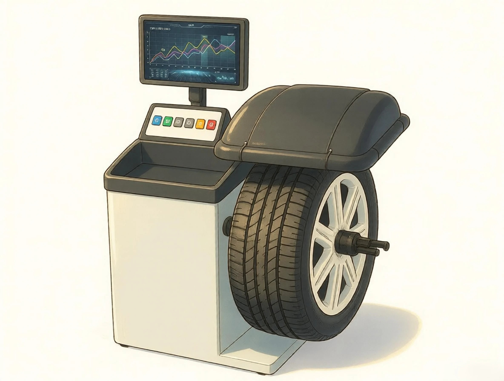
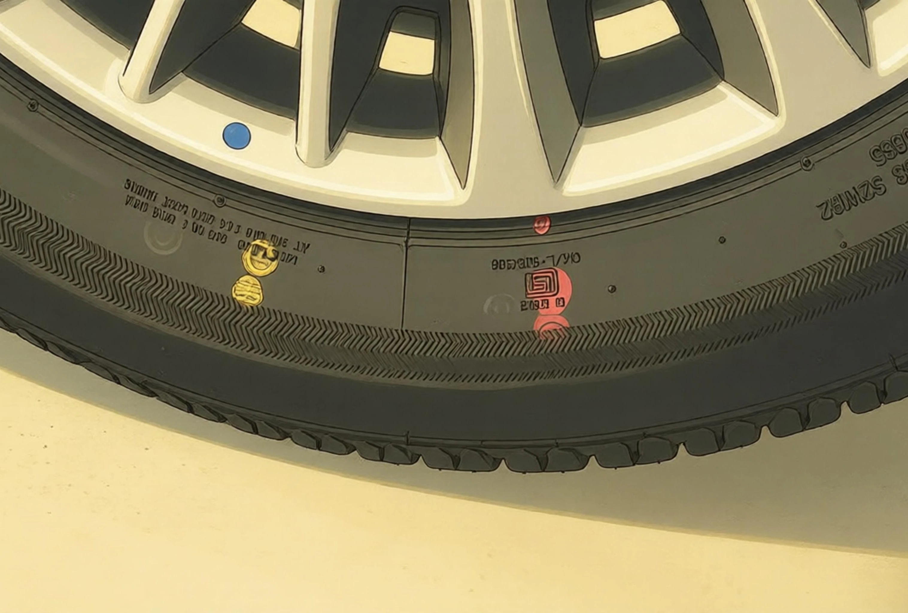
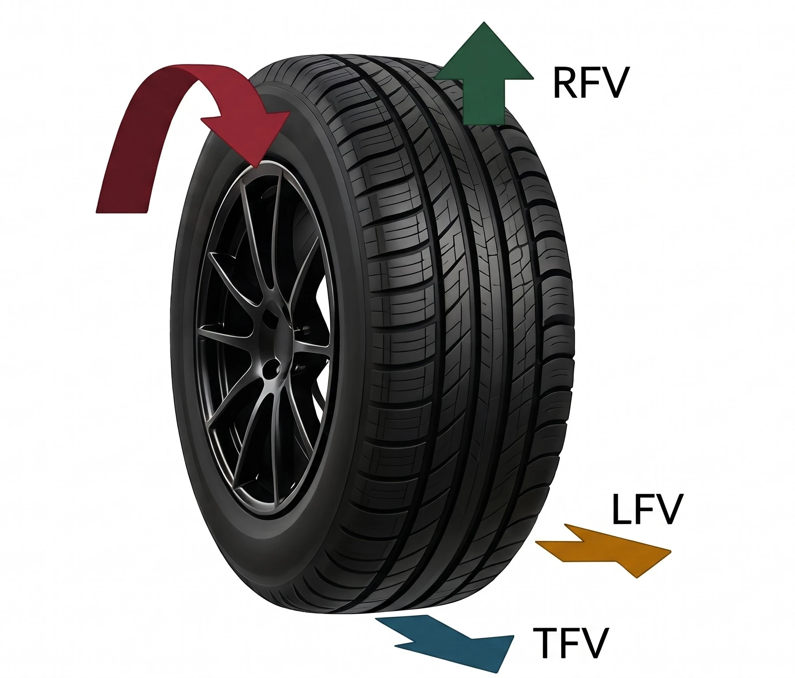

يصطدم العديد من السائقين بهذه المعضلة المحيرة: **تخرج العجلات من ورشة الصيانة مرصصة على الصفر التام (0g / 0g)، ومع ذلك تهتز طارة القيادة بعنف عند سرعة 110 كم/ساعة؛ وميزان الأذرعة مضبوط بالمللي، ومع ذلك تحذف السيارة بشكل عنيد إلى جانب الطريق بمجرد ترك المقود.** ولحل مشاكل اهتزاز الشاسيه على السرعات العالية، يجب أن ننظر لما هو أبعد من مجرد توزيع الأوزان، ونفهم فيزياء «تجانس الإطارات» (Tire Uniformity - U/F).

## 1. مبادئ تشغيل جهاز ترصيص العجلات
عند دوران العجلة بسرعات عالية، تتضاعف أي فجوة في توزيع الكتلة أضعافًا مضاعفة بفعل قوة الطرد المركزي. وصُمم جهاز الترصيص لرصد هذه القوى الديناميكية ومعادلتها.

*   **معالجة نوعين رئيسيين من عدم الاتزان:**
    *   **عدم الاتزان الاستاتيكي (القفز الرأسي):** يكون مركز الثقل مزاحًا عن محور الدوران. وتولد قوة الطرد المركزي الشعاعية حركة سحب للخارج في كل دورة مسببة **قفزًا رأسيًا (نطّة)** للعجلة.
    *   **عدم الاتزان الديناميكي (التأرجح الجانبي / الرعشة):** يؤدي التوزيع غير المتماثل للكتلة بين المستويين الداخلي والخارجي إلى **ازدواج قوى دوراني**، مما يجعل العجلة **تتأرجح وتهتز يمنة ويسرة** حول محور التوجيه.
*   **الاستشعار والحل على مستويين:**
    *   **حساسات كهرضغطية (Piezoelectric):** محولات كوارتز عالية الصلابة على محامل العمود تقيس أدق الانحرافات بالميكرومتر ($$\mu\text{m}$$) وشدة القوى المتناوبة.
    *   **مشفر دوران بصري (Optical Encoder):** يتعقب زاوية الدوران بدقة تقل عن نصف درجة ($$< 0.5^\circ$$) لتحديد طور عدم الاتزان بدقة بالغة.
    *   **خوارزمية المستويين:** تحل معادلتي اتزان القوى ($$\sum \vec{F} = 0$$) واتزان العزوم ($$\sum \vec{M} = 0$$) في آن واحد لحساب الوزن الدقيق بالجرام والموضع بالساعة لأثقال الرصاص على الحافتين الداخلية والخارجية للجنط.

## 2. ماذا تعني النقطتان الحمراء والصفراء على الإطار؟
النقاط الملونة على جدار الإطارات الجديدة هي أختام فحص الجودة والتجانس من المصنع، وتعتبر خط الدفاع الأول أثناء التركيب:

*   **النقطة الحمراء (RFV 1H / أقصى نتوء شعاعي):**
    *   تحدد قمة **التوافق الأول لتباين القوة الشعاعية (RFV 1H)**، وهو أعلى بروز لصلابة المطاط في الدورة الواحدة والذي يحفز الرنين في الشاسيه بسهولة.
    *   **قاعدة التركيب:** الأولوية القصوى هي مطابقة النقطة الحمراء مع **النقطة الغائرة في الجنط (أدنى نقطة مصنعية)**. فالانخفاض الهندسي في الجنط يلغي ويمتص القمة الصلبة للإطار.
*   **النقطة الصفراء (أخف نقطة في الوزن):**
    *   تحدد النقطة الأخف وزنًا على محيط الإطار بالكامل.
    *   **قاعدة التركيب:** إذا لم يكن بالجنط علامة للنقطة الغائرة، طابق النقطة الصفراء مع **بلف الهواء** (وهو أثقل نقطة في الجنط) لتقليل كمية أثقال الرصاص المطلوبة للترصيص.
*   **أيهما نفضل عند التعارض بين النقطة الحمراء والصفراء؟**
    *   **النقطة الحمراء لها الأولوية المطلقة دائمًا.** لأن عدم اتزان الوزن (النقطة الصفراء) يسهل تعويضه بأثقال الرصاص على الجهاز، أما التباين الهيكلي في الصلابة (النقطة الحمراء) فلا يمكن معالجته بالرصاص مطلقًا إذا رُكب بصورة خاطئة.

## 3. لماذا ترج العجلة المرصصة على 0g: قوى RFV و LFV والحلول الحقيقية
العيب الجوهري في أجهزة الترصيص العادية هو أن الإطار يدور **معلقًا في الهواء دون أي وزن**. فهي تعالج الأوزان فقط، وتترك **قوى RFV و LFV دون أي مساس**.

*   **RFV و RFV 1H (تباين القوة الشعاعية، كلما قلت كان أفضل):**
    *   **السبب:** عدم تجانس وصلات طبقات الإطار أو تباين صلابة الجدران الجانبية. في الهواء يدور الإطار بشكل دائري، ولكن تحت ثقل السيارة (~500 كجم)، ترفض المنطقة الأكثر صلابة الانضغاط، فتعمل مثل «الكامة» التي تدك الشاسيه للأعلى والأسفل مع كل دورة.
*   **LFV و CONG و PLY (تباين القوة الجانبية والمخروطية، الأفضل اقترابها من الصفر):**
    *   **CONG (المخروطية):** تنتج عن شكل مخروطي طفيف (اختلاف القطر بين الجانبين). يتدحرج الإطار مثل كوب ورقي، ساحبًا السيارة نحو القطر الأصغر. **وقلب الإطار على الجنط يعكس اتجاه الحذفة**.
    *   **PLY (دفع أحزمة الفولاذ / Ply Steer):** قوة قص جانبية تتولد من انضغاط أحزمة الفولاذ المائلة تحت الحمل الرأسي. **وقلب الإطار لا يعكس اتجاه هذه القوة** (خاصية بنيوية ثابتة).
    *   **محصلة الدفع الجانبي:** تحكمها المعادلة المتجهة:
        $$\text{إجمالي القوة الجانبية} = \text{CONG} + \text{PLY}$$
        *   **مثال:** إطار يخرج من المصنع بقوة $$CONG = +80\text{ N}$$ (دفع لليمين) و $$PLY = +40\text{ N}$$ (دفع لليمين):

            $$\text{محصلة الدفع الأصلية} = (+80\text{ N}) + (+40\text{ N}) = +120\text{ N} \quad (\text{حذفة واضحة لليمين})$$

            إذا قام الفني بفك الإطار و**قلبه على الجنط**، تنعكس CONG إلى $$-80\text{ N}$$، بينما تظل PLY عند $$+40\text{ N}$$:

            $$\text{محصلة الدفع بعد القلب} = (-80\text{ N}) + (+40\text{ N}) = -40\text{ N} \quad (\text{تراجع هائل في الدفع})$$

            وبذلك تختفي حذفة المقود المزعجة بشكل شبه كامل!
    *   **RAT (عزم المحاذاة المتبقي):** يولد انحراف القوة الجانبية عزم دوران طفيلي حول محور التوجيه، مما يؤدي إلى انحراف عجلة القيادة عن المنتصف أو عدم تماثل عودة المقود لوضعه الطبيعي.

### كيف نقضي نهائيًا على قوى RFV والحذفة الجانبية؟
1. **الفحص بأجهزة ترصيص القوة الأرضية (Road Force):**  
   تقوم أجهزة مثل Hunter Road Force بضغط أسطوانة هيدروليكية بقوة 500 إلى 600 كجم ضد الإطار، لقياس قوى RFV والقوى الجانبية الفعلية تحت الحمل الواقعي.
2. **تحسين الطور بتقنية ForceMatch (معادلة RFV):**  
   يمسح الجهاز أدنى نقطة في الجنط ويحسب أعلى نقطة صلابة RFV 1H في الإطار. يقوم الفني بفك شفتي الإطار وتدويره على الجنط (بزاوية 180° مثلاً) **لتتطابق النقطة المنخفضة في الجنط مع النقطة الصلبة للإطار**، مما يخمد الاهتزاز الميكانيكي تمامًا.
3. **توزيع الإطارات الاستراتيجي (معادلة الدفع الجانبي):**  
   بدمج القوى الجانبية (CONG + PLY)، يتم تبديل موقع الإطارات الأمامية لتعادل القوى بعضها البعض. وتُركب الإطارات الأقل تباينًا في الـ RFV/LFV دائمًا على محور التوجيه الأمامي.

## 4. العلامات الخمس للترصيص الاحترافي المتقن
1. **نظافة وسلامة مخروط التثبيت:** تآكل المخروط أو وجود بوش بمقدار 0.1 مم يولد عدم اتزان وهمي يتراوح بين 10 إلى 15 جرامًا.
2. **تنظيف السطوح بالكامل:** يجب كشط بقايا اللواصق القديمة بالكامل، وإزالة الحصى العالق بين مداسات الإطار.
3. **الالتزام بمحاذاة النقاط الملونة:** يجب تركيب الإطارات باحترام ودقة بناءً على النقاط الحمراء والصفراء وليس عشوائيًا مع الإفراط في الرصاص.
4. **التأكيد بدورة تدوير ثانية:** يجب على الفني دائمًا إنزال الغطاء وإجراء دورة فحص ثانية للتأكد من ظهور «0g / 0g» المؤكدة.
5. **استخدام الترصيص الأرضي للحالات المستعصية:** إذا استمرت الرجفة عند سرعة 110-120 كم/ساعة برغم الترصيص الصفري، اطلب خدمة الترصيص بأسطوانة الحمل ForceMatch.

## الخلاصة
سلسلة الاستقرار على السرعات العالية:
1. **أجهزة الترصيص العادية** تضبط كتل الدوران الحر، معالجة النط والاهتزاز بأثقال الرصاص.
2. **النقاط الحمراء والصفراء** توجه التركيب السليم لتقليل الرصاص والانحراف الأولي.
3. **قوى RFV و LFV** قوى صلابة هيكلية تحت الحمل لا يشفيها الرصاص: وحدها أجهزة Road Force بتقنية ForceMatch قادرة على التغلب عليها.

