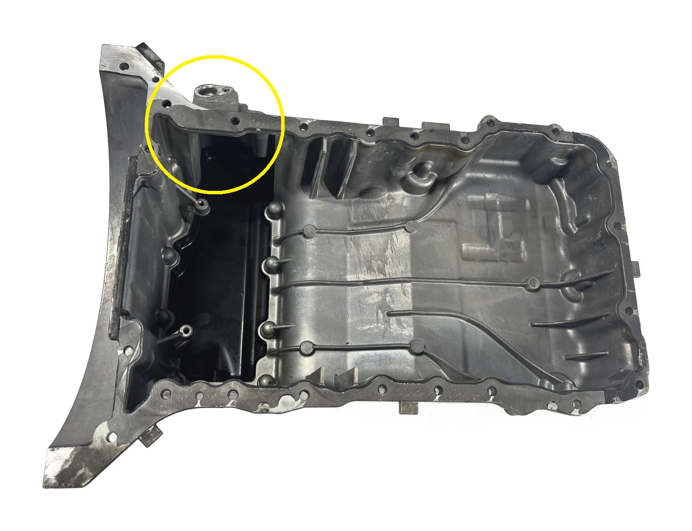

Spricht man über den **Mercedes-Benz W205 (besonders den C300)**, schwingen oft gewisse Klischees mit. Schaut man jedoch nüchtern auf Technik und Gebrauchtpreise, ist der W205 ein echtes Preis-Leistungs-Highlight für Liebhaber klassischer Fahrdynamik.

Vor-Facelift-Modelle mit dem **M274-Motor** kosten auf dem Gebrauchtmarkt oft weniger als ein neuer Kompaktwagen – bieten aber eine **Längsmotor-Hinterradantriebs-Plattform**, **Mischbereifung**, **gelochte Bremsscheiben** mit **Mehrkolben**-Festsätteln, **Mehrlenkerachsen vorn und hinten** aus Aluminium, **Akustikverglasung** und einen aerodynamisch glatten Unterboden.

Bei so viel anspruchsvoller Technik vermuten viele hohe Wartungshürden. Tatsächlich ist das Gegenteil der Fall: Der **W205 (M274)** und viele andere europäische Motoren (wie der VW/Audi EA888) sind **ab Werk perfekt auf den DIY-Ölwechsel per Absaugung von oben ausgelegt**.

## 1. Blick in die Ölwanne: Die Sonde erreicht den tiefsten Punkt

Die häufigste Sorge beim Absaugen lautet: „Bleibt nicht Ölschlamm oder Altöl zurück?“ Ein direkter Blick auf die demontierte Ölwanne des **M274-Motors** liefert die Antwort (derselbe Motor steckt auch in **E-Klasse W212/W213, GLC X253, SLC R172** sowie **Infiniti Q50/Q60 2.0t**):

*Innenansicht der M274-Ölwanne: Links der schwarze, tiefe hintere Ölsumpf (Getriebeseite) mit völlig ebenem Boden ohne Hindernisse; der **gelbe Kreis** zeigt die Peilstab-Führung direkt darüber.*

*Außenansicht der M274-Ölwanne: Aluminium-Oberteil kombiniert mit flachem, schwarzem Stahl-Unterteil; der **gelbe Kreis** markiert die Stelle, an der die Absaugsonde aufliegt – exakt auf derselben tiefsten Ebene wie die Ablassschraube am anderen Ende.*  
*Bildquelle: [2015-2019 MERCEDES C300 E300 GLC300 2.0L (M274) ENGINE UPPER & LOWER OIL PAN | eBay](https://www.ebay.com/itm/236894951872)*

Die beiden Fotos belegen zwei entscheidende Konstruktionsmerkmale:

1. **Hinterer Ölsumpf (Rear Sump)**: Um Platz für den Vorderachsträger zu schaffen, ist die Ölwanne beim M274 (wie schon beim W210 M111) vorn flach und hinten tief, mit Leitrippen Richtung Sumpf.
2. **Ebener Boden, direkter Zugang**: Der Boden der schwarzen Unterwanne ist komplett plan ohne störende Schwallbleche. Vergleicht man die **gelben Kreise**, landet die Absaugsonde exakt auf der tiefsten Ebene der Ablassschraube – die abgesaugte Ölmenge entspricht praktisch dem klassischen Ablassen.

## 2. Warum sich europäische Autos so gut für DIY-Wartung eignen

1. **Obenliegender Papier-Ölfilter**: Beim W205 (M274) und vielen Europäern sitzt der Ölfilter bequem von oben zugänglich im Motorraum. Mit einer 27-mm-Nuss lässt er sich sauber im Stehen wechseln – ohne unter das Auto zu kriechen.
2. **Kein Unterbodenschutz-Ausbau, kein Gewinderisiko**: Kein Wagenheber, keine Unterstellböcke, kein Lösen dutzender Unterboden-Schrauben – und keine Gefahr, das Gewinde der Ölablassschraube zu überdrehen.
3. **Herstellerkonform & exakte Mengenkontrolle**: Auch viele Mercedes-Werkstätten arbeiten nach WIS-Vorgabe mit Absauggeräten. Dank der Skala am Absaugbehälter lässt sich zudem sofort prüfen, ob der Motor Öl verbraucht.

## 3. Praxis-Tipps für ein perfektes Absaugergebnis

Den kompletten Ablauf am W205 C300 zeigt dieses Schritt-für-Schritt-Video:

<iframe width="560" height="315" src="https://www.youtube.com/embed/Z1Efjx6lfBE?start=150" title="DIY Oil Change and Filter Replacement Mercedes-Benz C300 Easy Step by Step" frameborder="0" allow="accelerometer; autoplay; clipboard-write; encrypted-media; gyroscope; picture-in-picture; web-share" referrerpolicy="strict-origin-when-cross-origin" allowfullscreen></iframe>

1. **Warmfahren, abstellen und 5–10 Minuten warten**: Bei ca. 60–80 °C fließt das Öl optimal, und Restöl aus dem Zylinderkopf läuft nach unten (nicht direkt nach Vollgasfahrt absaugen, da extrem heißes Öl den Schlauch aufweichen kann).
2. **Ölfilterdeckel zuerst anlösen**: Deckel oben im Motorraum vor dem Absaugen leicht lösen und anheben, damit das Öl aus dem Filtergehäuse in die Ölwanne zurückfließt und mit abgesaugt wird.
3. **Eben parken & Sonde nicht mit Gewalt drücken**: Sobald die Sonde sanft den Wannenboden berührt, **nicht fest nachdrücken** (sonst knickt oder verschließt sich die Spitze). Gegen Ende leicht anheben und drehen – so lassen sich nahezu die vollen Füllmengen absaugen (W205 M274: ca. 6,5–7,0 L; W210 M111: ca. 5,3–5,5 L).
4. **Neue O-Ringe & Drehmoment beachten**: Neue O-Ringe leicht mit Frischöl benetzen und den Deckel nach Vorgabe (meist 25 Nm) anziehen.
5. **Altöl fachgerecht entsorgen**: Altöl sauber in die leeren Ölkanister umfüllen und ordnungsgemäß abgeben. Mehr dazu im [Ratgeber zur Altölentsorgung beim DIY-Ölwechsel](/de/2026/diy-waste-engine-oil-disposal-guide.html).

## 4. Hinweis vorab: Nicht jeder Europäer hat noch ein Peilstabrohr

Viele moderne Motoren verzichten inzwischen komplett auf Peilstab und Führungsrohr – darunter die meisten aktuellen BMW-Benziner sowie neuere Mercedes-Motoren (**M264 / M254**). Dort bleibt nur das Ablassen von unten. Wer jedoch vorab unter die Haube schaut und ein Peilstabrohr vorfindet, genießt den wohl saubersten und entspanntesten DIY-Ölwechsel überhaupt!
