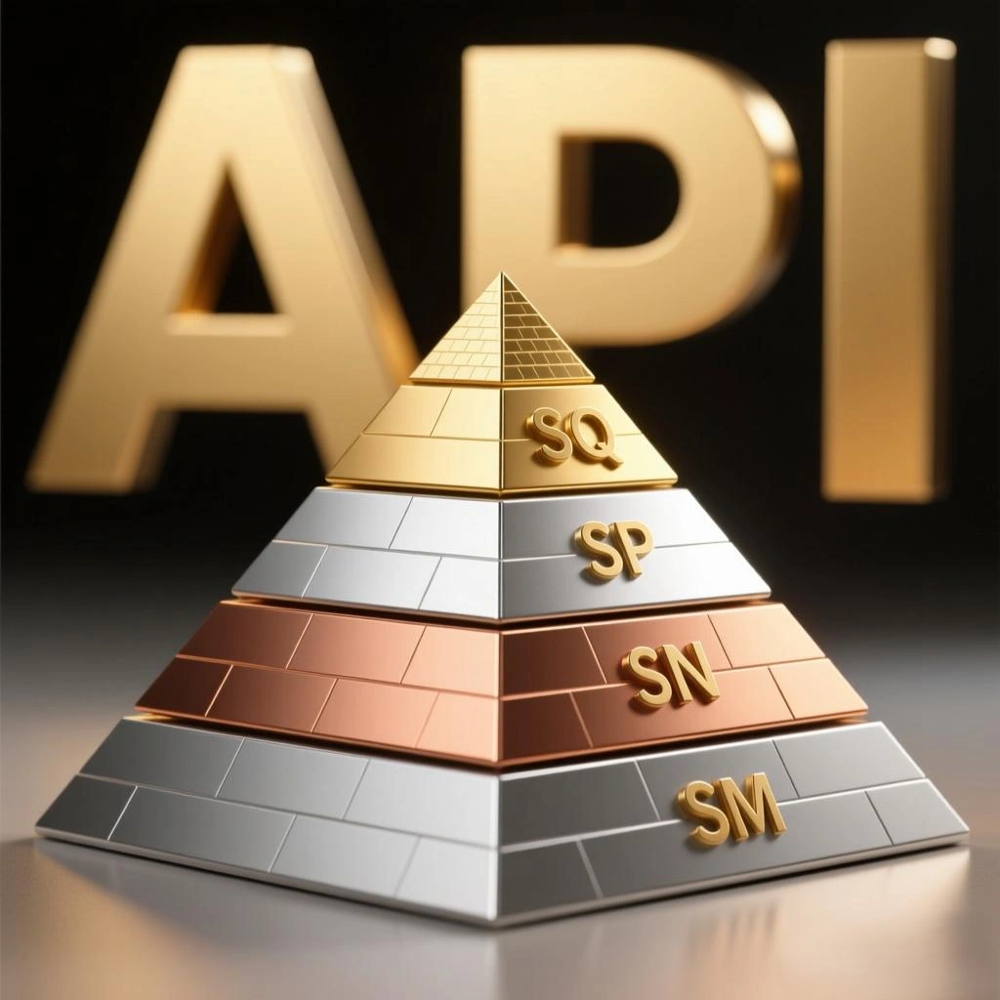

API SQ (aligned with ILSAC GF-7) raises the bar over API SP, SN, and SM across piston cleanliness, timing chain wear, LSPI protection, and turbocharger deposit control—while remaining backward-compatible for older gasoline engines.

## Technical Specification Comparison Table

| Testing Category (Sequence) | API SM (2004) | API SN (2010) | API SP (2020) | API SQ (2024) |
| :--- | :--- | :--- | :--- | :--- |
| **Piston Deposits (IIIH)** | N/A (IIIG) | No explicit req. | ≥ 3.5 pts | **≥ 4.0 pts** |
| **Viscosity Increase (IIIH)** | ≤ 275% | ≤ 200% | ≤ 150% | **≤ 125%** |
| **Oil Volatility (IIIH)** | N/A (IIIG) | No explicit req. | ≤ 80 mL | **≤ 60 mL** |
| **Low-Temp Sludge (VH)** | Piston ≥ 4.0 (VG) | Piston ≥ 5.0 | Piston ≥ 7.6 | **Piston ≥ 8.0** |
| **Valvetrain Wear (IVB)** | N/A (IVA) | Average < 90µm | Volume Loss < 2.7% | **Volume Loss < 2.3%** |
| **LSPI Protection (IX)** | N/A | N/A | Avg. 0 Pre-ignitions | **Stricter Threshold** |
| **Timing Chain Wear (X)** | N/A | N/A | ≤ 0.085% | **≤ 0.070%** |
| **Fuel Compatibility** | Standard | Standard | Standard | **Added E85 Support** |
| **Hybrid Optimization** | No | No | Basic | **Full Support** |

## Key Analysis of the API SQ (ILSAC GF-7) Standard

### 1. Superior Cleaning Performance (Sequence IIIH)
In the critical Sequence IIIH test, the requirement for piston deposits has been raised from 3.5 to **4.0**. This means oils must possess even stronger detergency to prevent ring sticking and maintain engine compression over longer intervals.

### 2. Resistance to Thickening
The allowable viscosity increase has been further restricted to **125%**. This ensures the oil maintains its flow characteristics and doesn't turn into sludge under high-temperature stress, which is vital for modern turbocharged engines.

### 3. Timing Chain Protection
With the rise of direct-injection engines, timing chain wear caused by soot has become a major concern. API SQ lowers the allowable chain stretch from 0.085% to **0.070%**, providing a safer environment for your engine's internal timing components.

### 4. Global Emission Standards
API SQ is designed to be fully compatible with the latest **GPF (Gasoline Particulate Filters)** and **DPF** systems, ensuring that additives do not clog or poison expensive catalytic converters.

## Conclusion

The evolution from API SM to SQ represents a steady climb in engine protection, efficiency, and environmental compatibility. When choosing oil in 2026, always prioritize the highest certification your vehicle supports. **API SQ (GF-7)** is not just a marketing label; it is a significantly tougher set of tests designed to meet the demands of modern GDI, Turbocharged, and Hybrid powertrains.

