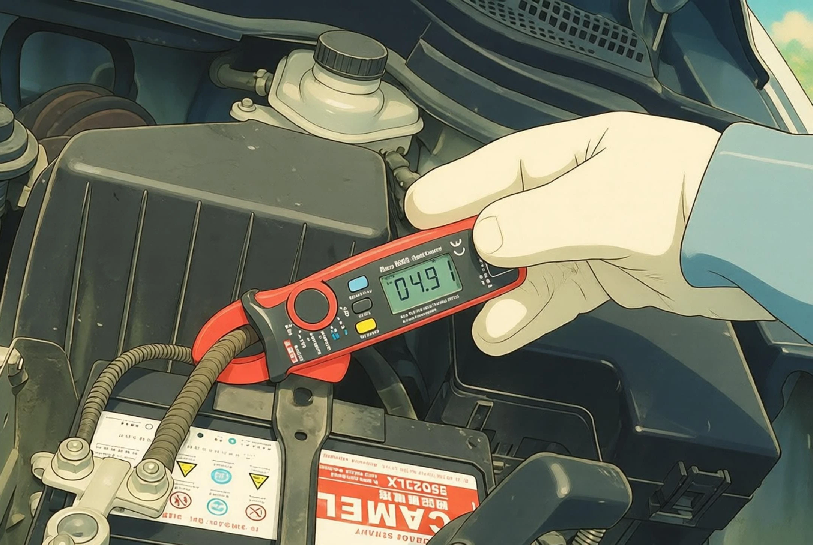

Struggling with a parasitic drain that leaves your battery flat after sitting for a few days, but worried about wrenching on battery cables, losing ECU calibrations, or blowing multimeter fuses?

A **DC Microamp Clamp Meter** is the cleanest and fastest solution. It offers **100% zero-disassembly, non-contact measurement**—simply clamp around the negative ground cable to diagnose vehicle sleep current within seconds!

> 💡 **Series Navigation:**  
> If you don't own a precision DC clamp meter and want to test using an inexpensive multimeter and bypass switch, read the first part of our series:  
> 👉 [Car Parasitic Drain Testing (Series Edition): Measuring Parasitic Draw with a Tester Switch](/en/2026/parasitic-drain-tester-guide.html)

---

## Step 1: Did You Buy the Right Clamp Meter? (3 Common Traps)

Many DIYers grab an electrical clamp meter from their toolbox, clamp the battery cable, see `0.00`, and wrongly assume there is no leak. Here is why:

### ❌ Trap 1: AC-Only Clamp Meters
Standard residential clamp meters use current transformers (CT) designed exclusively for **AC (Alternating Current)**. Car electronics run on **DC (Direct Current)**, which produces zero alternating magnetic flux. An AC meter will **never register DC current**.
* **Requirement**: The meter dial and display must explicitly feature **"DC A"**.

### ❌ Trap 2: Excessive Range Lacking Milliamp Resolution
Industrial automotive clamp meters (400A - 1000A) are built for starter motors and alternators. Their minimum resolution is **0.1A (100mA)**, which treats 30mA sleep currents as negligible zero-noise.
* **Requirement**: Must have a **2A (2000mA) micro-current range** with **1mA (0.001A) resolution**.

### ✅ Recommended Standard (e.g., UNI-T UT210E)
In the automotive DIY community, the **UNI-T UT210E** (or equivalent compact meter) is widely favored because it features:
1. **DC 2A range with 1mA resolution**.
2. **One-touch ZERO / REL offset calibration**.
3. **Slim 17mm jaw** that easily maneuvers through crowded engine harnesses.

---

## Hall Effect Sensors & Geomagnetic Interference

DC clamp meters rely on sensitive **Hall Effect Sensors** to measure static magnetic fields. Because they are so sensitive, **Earth's natural geomagnetic field and nearby engine metal** will register as current!
* Waving a 2A DC clamp meter in the air will cause numbers to fluctuate between `0.100A` and `0.300A`. This is normal physics, not a defect.
* **Mastering the "On-Site ZERO" procedure is the key to accurate readings!**

---

## Standard Operating Procedure (5 SOP Steps)

### Step 1: Vehicle Prep & Hood Latch Disguise
1. Turn off the engine, remove keys, and switch off all cabin lights.
2. **Roll down all four windows completely** to avoid accidental lockouts.
3. Open the hood. Use a screwdriver to push the hood latch down into the **"closed/locked"** position so the vehicle's body computer registers the hood as closed.

---

### Step 2: Lock the Car & Wait for Deep Sleep (15 - 45 Minutes)
1. Close all doors and press the remote lock button.
2. **Keep smart key fobs (Keyless) at least 5 meters away** from the vehicle.
3. Allow **15 to 45 minutes** for all onboard computers (ECU, BCM, CAN gateways) to complete shutdown cycles and enter deep sleep.

---

### Step 3: Set Dial & Perform "On-Site ZERO" Calibration
1. Turn the dial to the **2A range** and confirm the display reads **DC**.
2. Position the clamp **2 to 3 cm away from the target negative cable, maintaining the exact angle and orientation you plan to measure with**.
3. Press the **ZERO (or REL) button** to tare out environmental magnetic fields down to `0.000`.

> [!IMPORTANT]
> **Do not press ZERO far away and then carry the meter to the car!**  
> Changing the physical orientation of the clamp relative to Earth's magnetic poles shifts the baseline reading by tens of milliamps.

---

### Step 4: Clamp Around the Negative Ground Cable
1. Squeeze the trigger and clamp around the **main negative battery ground cable**.
2. **Center the Wire**: Keep the cable centered inside the jaw alignment markings; do not wedge it against the jaw hinges.
3. Keep your hands steady and observe the display.

---

### Step 5: Evaluate Parasitic Draw

| Reading (2A DC Range) | Assessment | Status & Action |
| :--- | :--- | :--- |
| **0.020A - 0.060A (20mA - 60mA)** | ✅ **Normal** | Healthy standby draw (clock, alarm memory). Battery lasts weeks. |
| **0.060A - 0.090A (60mA - 90mA)** | ⚠️ **Elevated** | Check standby accessories (e.g., parking mode dashcams). |
| **> 0.100A (100mA+ to several Amps)** | ❌ **Severe Leak** | Drains battery within days. Immediate branch isolation required! |

---

## Pro Diagnostic Technique: Fuse-Free Branch Isolation

A major advantage of a clamp meter is the ability to track down leaks across individual wires without pulling fuses:

### 1. Check the Alternator B+ Heavy Output Wire
* **The Culprit**: Internal **rectifier diode breakdown** inside the alternator allows battery power to leak directly to ground. This is a common failure that interior fuse pulling will never reveal!
* **How to Test**: Clamp the heavy red B+ output wire on the back of the alternator. **Sleep draw on this line should be strictly 0.00A**. If you see 0.5A - 3A, the alternator rectifier is blown—replace the alternator.

### 2. Check Ground Straps and Harness Trunks
* If your vehicle features multiple ground straps, clamp each individual strap to determine which zone (engine bay vs. cabin) contains the parasitic leak.

### 3. Check Aftermarket Power Feeds
* Clamp directly onto inline fuse leads for aftermarket amplifiers, Android head units, or dashcam hardwire kits to spot phantom draws instantly.

---

## Comparison: Series Switch vs. DC Clamp Meter

| Evaluation Criteria | Method 1: Parasitic Tester Switch + Multimeter | Method 2: DC Clamp Meter (e.g., UT210E) |
| :--- | :--- | :--- |
| **Disassembly Required** | Requires loosening negative clamp (M10 wrench) | **100% Zero-Disassembly, No Tools Needed** |
| **Operational Risk** | Must follow SOP to prevent blown meter fuses | **Zero Short-Circuit Risk, Non-Invasive** |
| **Measurement Precision** | ⭐⭐⭐⭐⭐ **Extreme (resolves to 0.1mA)** | ⭐⭐⭐⭐ **Good (approx. 1mA - 5mA tolerance)** |
| **Environmental Immunity** | Completely immune to geomagnetic drift | Requires careful on-site ZERO calibration |
| **Tool Cost** | Low (inexpensive switch + generic multimeter) | Moderate (requires specialized DC mA clamp) |
| **Diagnostic Mobility** | Requires sequential fuse pulling | **Freely clamp various branch wires (e.g., alternator)** |

---

## Conclusion & Buying Advice

* **For beginners or fast checks without pulling wrenches**: A compact DC clamp meter with a 2A range is the safest and most convenient diagnostic investment.
* **For chasing subtle phantom drains (30mA - 50mA) requiring long-term zero drift stability during fuse pulling**: The **Parasitic Drain Tester Switch with a digital multimeter** remains the unbeatable gold standard!
