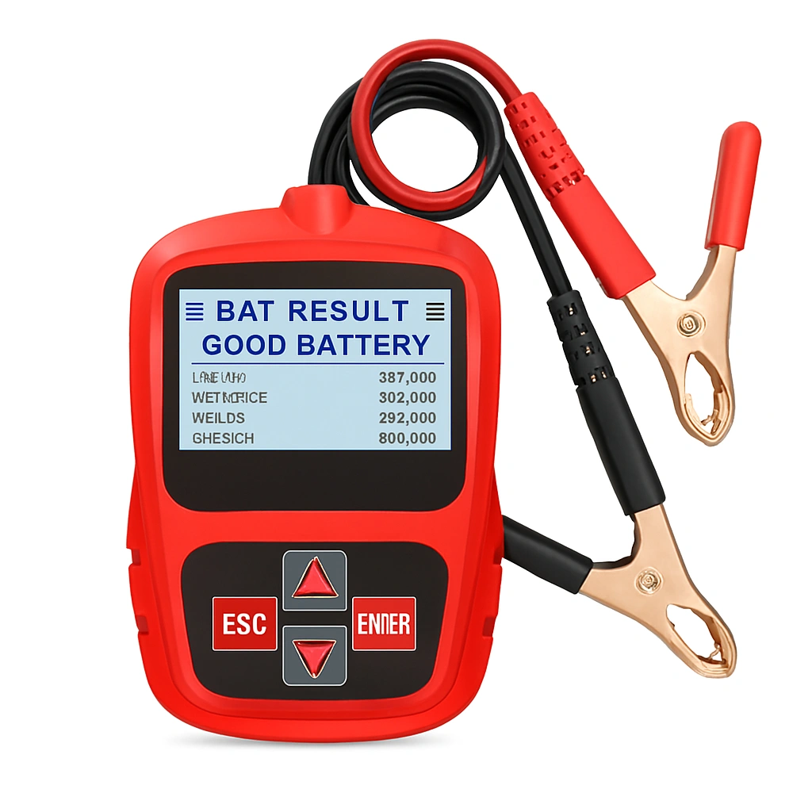

Muchos juzgan la salud de una batería por el CCA y el SOH que marca un comprobador de resistencia interna, pero casi siempre son «valores estimados». Si entiendes la lógica y los límites aplicados a las baterías tradicionales de plomo-ácido, interpretarás los datos con criterio (sobre por qué no aplica el CCA al litio, consulta **[Sobre la inutilidad de medir el CCA en las baterías de iones de litio](/es/2025/about-cca.html)**).

## 1. ¿Qué mide realmente un comprobador simple?
Estos equipos electrónicos no hacen una descarga real de cientos de amperios: únicamente miden el **voltaje en reposo (V)** y, mediante una señal débil (conductancia CA o pequeño pulso), la **resistencia interna (mΩ)**.

En baterías tradicionales de plomo-ácido, el **SOC (%)** se estima principalmente por el voltaje en reposo, mientras que el **CCA estimado** y el **SOH (%)** se calculan a partir de la resistencia interna con fórmulas empíricas (similar a una báscula de bioimpedancia). Sirve para **detección rápida y seguimiento de tendencias**, no como prueba de carga real, y pierde validez fuera de la química plomo-ácido.

## 2. ¿Importa qué valor de referencia se configure?
Bajo un **mismo estándar de prueba (p. ej., CCA) y tipo de batería**, ajustar la referencia **no altera la resistencia interna medida (mΩ) ni el CCA estimado**; solo cambia el **porcentaje SOH** y el dictamen en pantalla:

$$\text{SOH (\%)} \approx \frac{\text{CCA estimado}}{\text{Referencia ingresada}} \times 100\%$$

La fórmula exacta varía según la marca (algunas usan proporción lineal, otras cuadrática como $$(400/500)^2 = 64\%$$, con tope habitual en `100%`; cambiar de norma o de batería líquida a AGM puede alterar el cálculo en ciertos modelos). Lo importante no es poner 400 o 500, sino **mantener el mismo ajuste para seguir la evolución**.

## 3. ¿Por qué cambian los valores de una misma batería?
Además de la tolerancia del equipo, cuatro condiciones alteran las lecturas:
* **Motor recién apagado o recién cargada:** La carga superficial y el calor suelen hacer que el SOC parezca optimista y baje la resistencia; recién terminada la carga, la polarización y microburbujas pueden hacer variar la resistencia.
* **Baja carga (por debajo de ~12,4 V–12,5 V):** La falta de carga (umbral mayor en AGM) eleva temporalmente la resistencia y facilita confundir «descargada» con «agotada».
* **Temperatura ambiente:** Las reacciones químicas dependen mucho de la temperatura, generando diferencias claras entre verano e invierno.
* **Resistencia de contacto:** La limpieza de las pinzas y su agarre firme al borne de plomo afectan directamente al valor en `mΩ`.

## 4. ¿Una resistencia alta significa mala batería?
No necesariamente (**Nota: válido solo para plomo-ácido; la lógica de CCA es [totalmente inaplicable](/es/2025/about-cca.html) a baterías que no son de plomo**). Las diferencias entre marcas del mismo formato suelen deberse a compromisos técnicos y de almacenaje:
* **Placas y densidad del ácido:** Más placas delgadas o mayor densidad mejoran las cifras iniciales, pero resisten peor el calor o aceleran la corrosión de la rejilla. Placas gruesas parten con algo más de resistencia, pero suelen ser más estables.
* **Frescura de inventario:** Una batería recién fabricada y otra almacenada meses tienen resistencias base distintas.

Por ello **comparar resistencias directamente entre marcas carece de sentido**; conviene revisar también el peso y el comportamiento del voltaje.

## 5. Cómo medir para obtener datos útiles
1. **Medir cargada al 100 % y en reposo:** Asegúrate de que esté cargada y reposada (plomo-ácido tradicional ~`12,6 V+`, AGM ~`12,8 V+`; al menos por encima de `12,5 V`).
2. **Sujetar directamente los bornes:** Evita tornillos de fijación y cables. Las **pinzas Kelvin de 4 hilos** eliminan la resistencia del cable y de la pinza, pero no la resistencia de transición u óxido entre el borne y la abrazadera.
3. **Comparar contra su propia referencia de nueva:** Contrasta primero con la lectura registrada cuando esa batería era nueva (cargada y en reposo); si no existe, usa el rango de fábrica de un modelo nuevo idéntico.
4. **Usar siempre el mismo comprobador:** Cada fabricante usa algoritmos distintos; solo un mismo equipo muestra la tendencia real de desgaste.

## Conclusión
El mayor valor de un comprobador simple no está en una lectura aislada de CCA o SOH, sino en **seguir la tendencia de la resistencia interna de la misma batería** cargada y en reposo. En baterías de plomo-ácido, observar esa evolución dice mucho más que obsesionarse con los porcentajes (por qué el CCA falla en litio se detalla en **[Sobre la inutilidad de medir el CCA en las baterías de iones de litio](/es/2025/about-cca.html)**).
