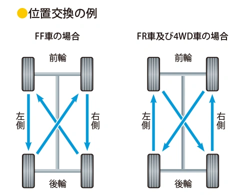
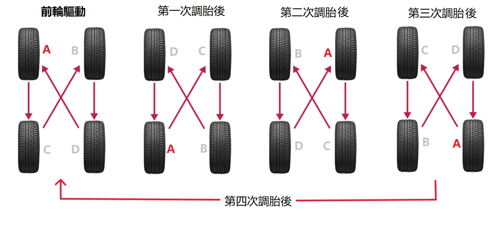
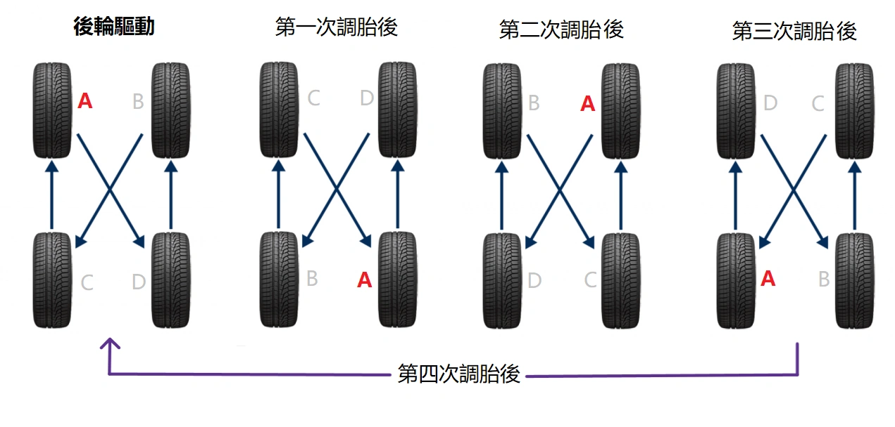

Il est universellement reconnu qu'une permutation des pneumatiques tous les **5 000 km** permet d'équilibrer l'abrasion, de prolonger efficacement la durée de vie des pneus et de prévenir l'usure irrégulière de la bande de roulement.

Bien qu'il existe plusieurs variantes de permutation sur le marché, la **NHTSA (National Highway Traffic Safety Administration)** aux États-Unis et la **JATMA (Japan Automobile Tyre Manufacturers Association)** préconisent des **recommandations de permutation strictement identiques**.

Après **trois cycles de permutation**, chaque pneu aura été exploité aux quatre positions du châssis. Il s'agit d'une approche rationnelle et éprouvée. Lors de votre visite en atelier pneumatique, vous pouvez demander au technicien d'appliquer scrupuleusement ce protocole.

## Synthèse des règles de permutation standard NHTSA / JATMA

Pour mémoriser aisément la règle : « Les roues de l'essieu moteur reculent/avancent en ligne droite, les roues de l'essieu non moteur sont croisées en diagonale » :

| Type de transmission | Déplacement des pneus avant | Déplacement des pneus arrière | Règle mécanique |
| :--- | :--- | :--- | :--- |
| **Traction avant (FF / FWD)** | Recul **en ligne droite** vers l'arrière | Montée **croisée en diagonale** vers l'avant | Essieu moteur (avant) direct, essieu non moteur (arrière) croisé |
| **Propulsion (FR / RWD)** / **Transmission Intégrale (AWD)** | Recul **croisé en diagonale** vers l'arrière | Montée **en ligne droite** vers l'avant | Essieu moteur (arrière) direct, essieu non moteur (avant) croisé |

## Schéma pour véhicule à Traction Avant (FF / FWD)
Sur les tractions, le train avant assure simultanément la motricité et le guidage directionnel, ce qui accentue son usure. Lors de la permutation, **les pneus arrière montent vers l'avant en se croisant, et les pneus avant reculent directement en ligne droite**.

## Schéma pour véhicule à Propulsion (FR / RWD) et Transmission Intégrale (AWD)
Pour les propulsions et transmissions intégrales, la logique cinématique est inversée. **Les pneus avant reculent vers l'arrière en diagonale croisée, et les pneus arrière avancent en ligne droite**.

