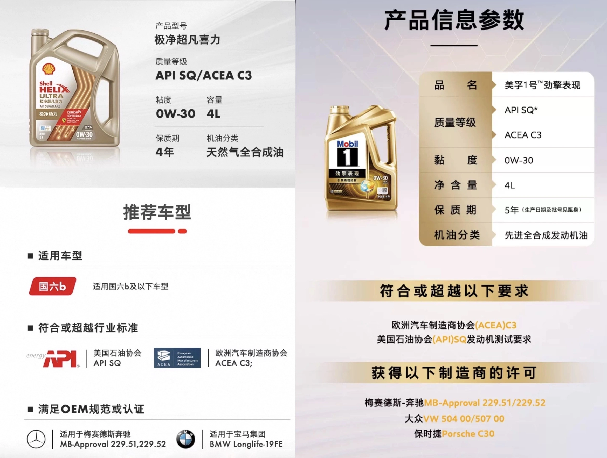

## Les Principes de Sélection d'Huile Moteur

Quelle que soit la marque de votre véhicule, le choix d'une huile moteur doit **toujours commencer par les homologations constructeur officielles**. Ce n'est qu'une fois l'homologation validée que l'on étudie la viscosité et les paramètres physiques.  
Pour les motorisations essence de la W205, les homologations privilégiées demeurent **MB 229.5 et MB 229.6**, grâce à leur réserve de basicité TBN nettement supérieure.

### **Problématique du LSPI (Pré-Allumage à Bas Régime) et Sélection d'Huile**
En raison de son injection directe d'essence couplée à la suralimentation, la W205 est exposée au phénomène de **LSPI (Low-Speed Pre-Ignition)**, susceptible de fracturer net les pistons. Pour neutraliser ce risque :
- **À bas régime sur un rapport élevé, rétrogradez avant d'accélérer franchement**
- Le choix du lubrifiant est capital : au-delà d'une **[formulation à faible taux de calcium (< 2000 ppm)](/fr/2021/oil-parameter.html)**, il est crucial d'exiger des huiles **ayant réussi le test d'évaluation LSPI (Sequence IX)**.

### **Homologations Intégrant le Test LSPI**
- **DEXOS1 GEN 2 / GEN 3** : Exige la réussite du test LSPI
- **DEXOS2**
  - Spécifique essence : Exige la réussite du test LSPI
  - **Mixte essence/diesel : N'exige PAS le test LSPI**
- **API SN Plus** : Norme introduite en mai 2018, **imposant le test LSPI**
- **API SP** : Norme déployée en mai 2020, imposant le test LSPI avec protection renforcée de la chaîne de distribution
- **API SQ** : **Norme de toute dernière génération**, durcissant considérablement les exigences anti-LSPI pour moteurs à injection directe tout en optimisant l'économie de carburant
- **MB 229.5 / 229.51 / 229.52 / 229.6** : Homologations récentes (délivrées après 2018) intégrant l'épreuve de validation anti-LSPI

## **Huiles Phares Alliant Homologation Mercedes et Validation Anti-LSPI**
Ces références répondent aux standards d'homologation Mercedes et ont validé les exigences anti-LSPI (vérifiez systématiquement le marquage officiel SP ou SQ sur le bidon) :

| Marque  | Modèle | Viscosité | Homologation | Base / Norme | Spécificités Techniques |
|---------|--------|-----------|--------------|--------------|-------------------------|
| RAVENOL | SSV    | 0W-30     | **229.6** (Validé 2019) | SL PAO | Réf. rare en 0W-30 229.6 |
| Shell   | HELIX ULTRA | 0W-40 | **229.5** VW | SP/SQ | Réactivité d'homologation |
| Shell   | HELIX ULTRA | 5W-40 | **229.5** A40 VW LL01 | SP/SQ | Viscosité reine, haut de gamme |
| Shell   | HELIX ULTRA | 5W-30 | **229.5** LL01 | SP/SQ | Excellent choix en 5W-30 229.5 |
| Total   | Quartz INEO MC3 | 5W-30 | **229.52** LL04 D2 | SN+/SP | Rapport qualité/prix en 229.52 |
| Castrol | EDGE M | 5W-30     | **229.52** LL04 | SN+/SP | Référence européenne courante |

### **Comparatif Approfondi des Lubrifiants**
Pour une analyse exhaustive, consultez la suite de cette étude :  
[Homologations Mercedes + Huiles Anti-LSPI (Partie 2)](/fr/2021/benz-and-lspi-02.html)

## **Analyse Technique : MB 229.5 vs MB 229.52**
- **Homologation MB 229.5** : HTHS > 3,5 mPa.s, TBN > 10 mg KOH/g, évaporation Noack < 10%
- **Homologation MB 229.52** : Formulation Low-SAPS (faibles cendres sulfatées), TBN > 6 mg KOH/g  
  Consultez également nos **[Notes sur les Paramètres d'Huile Moteur](/fr/2021/oil-parameter.html)**

Ces spécifications garantissent un niveau de protection moteur élevé, vous permettant de choisir en toute confiance.

## **Choix de la Viscosité de l'Huile Moteur**
Il est souvent affirmé à tort qu'il faut changer de viscosité selon le profil routier. Or, **la température de fonctionnement interne du moteur est stabilisée** :
- Que vous rouliez en ville ou sur autoroute, le circuit de refroidissement régule en continu la température d'huile et d'eau.
- Une hausse anormale de température signale une **anomalie du système de refroidissement**, et non un problème de grade d'huile.

### **Moteurs Fortement Kilométrés et Viscosité**
D'après les données d'ingénierie des constructeurs pétroliers :
- Au-delà de **75 000 miles (environ 120 000 km)**, il est cohérent de passer à un grade supérieur :
  - **L'usure des coussinets et segments augmentant les jeux fonctionnels, une viscosité plus dense rétablit la compression.**
- Il existe également les **huiles formulées pour haut kilométrage (High Mileage Oils)** :
  - Elles maintiennent une viscosité standard (ex. grade 30) tout en intégrant des additifs de gonflement des élastomères
  - Elles préviennent efficacement les pertes de compression et les suintements de joints
  - **[Ressource technique complémentaire](https://www.machinerylubrication.com/Read/31414/high-mileage-oil)**

## **Nouvelle Génération d'Huiles : API SQ + MB 229.52**
Sur les marchés internationaux, les séries associant **API SQ et MB 229.52** sont désormais largement diffusées. 

Points de vigilance lors de l'achat :
- Attention aux stocks d'importation parallèle écoulant de vieux lots d'huiles fabriqués sous des normes périmées.
- Vérifiez attentivement le symbole en forme de « donut » de l'API sur l'étiquette arrière afin de vous assurer d'un millésime d'homologation récent (SP ou SQ).

### **Illustration : Shell Helix Ultra X 0W-30 / Mobil 1 équivalent**

