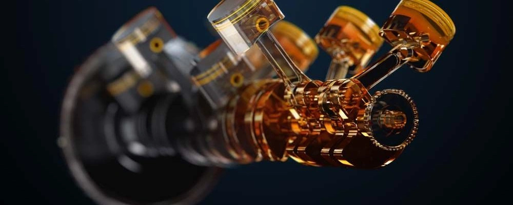

## Principales Homologations et Normes

### Normes API
- **SN Plus / SP** : Validation obligatoire du test de protection anti-LSPI
- **SQ (ILSAC GF-7)** : Standard de dernière génération renforçant la prévention du LSPI, la longévité des chaînes de distribution, l'économie d'énergie et plafonnant les cendres sulfatées (≤ 0,9%) pour préserver les filtres à particules essence (GPF).

### Homologations Constructeurs Européens

| Homologation | HTHS (mPa.s) | TBN (mg KOH/g) | Volatilité Noack (%) |
|------|------|------|------|
| **API SP / SQ** | > 2,6 | Non spécifié | Non spécifié |
| **ACEA A3/B4** | > 3,5 | > 10 | < 13 |
| **ACEA A5/B5** | 2,9 - 3,5 | > 8 | < 13 |
| **ACEA C3** | > 3,5 | > 6 | < 13 |
| **MB 229.5** | > 3,5 | > 10 | < 10 |
| **MB 229.51 / 52** | > 3,5 | > 6 | < 10 |
| **VW 502.00 / 505.00** | > 3,7 | > 7 | - |
| **VW 504.00 / 507.00** | > 3,5 | > 6 | < 11 |
| **BMW Longlife-98** | > 3,5 | > 9,5 | - |
| **BMW Longlife-01** | > 3,5 | > 10 | - |
| **BMW LL-01 FE** | > 3,0 | > 9,5 | - |

## Le Principe du Cumul d'Homologations

- **Norme MB 229.5** : Exigence anti-usure mécanique très haute, mais sans test spécifique anti-LSPI dans ses moutures historiques.
- **Norme API SP / SQ** : Exigences anti-usure générales modérées, mais test anti-LSPI particulièrement rigoureux.
- **Huile cumulant MB 229.5 et API SP/SQ** → Protection maximale contre l'usure mécanique et neutralisation active du LSPI.
- **Visualisation des synergies** : [Outil comparatif relatif Lubrizol](https://online.lubrizol.com/relperftool/pc.html)

## Déjouer les Jeux de Mots sur les Étiquettes

**Mentions attestant une véritable homologation d'usine :**
- Approvals
- Freigaben

**Mentions purement marketing sans homologation officielle (à éviter) :**
- Performance Level
- OEM Performances
- Recommendations
- OEM Compatibility
- Suitable for

## Indicateurs Comparatifs à Homologation Égale

- **Flash Point (Point d'éclair)** : Température d'inflammation des vapeurs ; plus elle est élevée, plus l'huile est stable thermiquement.
- **Viscosité à 100°C** : À grade égal, une valeur plus basse favorise la réduction des frictions fluides.
- **Viscosité à 40°C** : Plus elle est basse, plus l'huile circule promptement lors des départs à froid.
- **Noack (Taux d'évaporation)** : Quantifie les pertes volatiles à haute température ; visez une valeur inférieure à 10%.
- **HTHS (High Temperature High Shear)** : Résistance du film d'huile sous fort cisaillement à 150°C ; un chiffre élevé protège à haut régime, > 2,9 mPa.s est recommandé pour moteurs turbo.
- **TBN (Total Base Number)** : Réserve de neutralisation basique contre l'acidité ; > 8 mg KOH/g recommandé pour les vidanges espacées.
- **Pour Point (Point d'écoulement)** : Température limite de fluidité ; sous -50°C, cela traduit souvent une forte teneur en base PAO.
- **VI (Indice de viscosité)** : Évolution de la viscosité avec la température, à interpréter avec prudence selon la qualité des polymères épaississants.

## Familles d'Huiles de Base

- **Esters / Polyolesters** : Bases nobles, grande affinité polaire avec les métaux, résistance thermique extrême, mais durée de vie plus courte.
- **Naphtalènes Alkylés (AN)** : Bases d'exception, stables chimiquement, souvent combinées au PAO pour solubiliser les additifs.
- **PAO (Polyalphaoléfines)** : Synthèse intégrale du Groupe IV, remarquable stabilité thermique et fluidité à froid.
- **GTL (Gas-to-Liquid)** : Base du Groupe III+ issue du procédé Fischer-Tropsch gaz-vers-liquide, performances très proches du PAO.
- **VHVI (Hydrocraquage sévère)** : Huile minérale hautement hydrotraitée et isomérisée (Groupe III).

## Fonctions des Éléments d'Additivation

- **Calcium (Ca)** : Détergent classique, mais catalyseur reconnu de LSPI ; limité à < 2000 ppm sous API SP/SQ.
- **Magnésium (Mg)** : Détergent alternatif remplaçant le calcium pour prévenir le LSPI.
- **Molybdène (Mo)** : Modificateur de friction et additif anti-usure efficace.
- **Phosphore (P)** : Agent anti-usure d'extrême pression.
- **Zinc (Zn)** : Associé au phosphore sous forme de ZDDP, référence historique de la tribologie anti-usure.
- **Bore (B)** : Dispersant et agent anti-usure complémentaire.
- **Tungstène (W) / Titane (Ti)** : Agents anti-usure de technologie moderne.

## Marques Recommandées

### Usage Courant et Quotidien *(Attention aux contrefaçons : privilégiez les réseaux officiels)*
- **Mobil**
- **Shell**
- **Castrol**

### Moteurs Sportifs et Régimes Élevés
- **Liqui Moly**
- **Motul**
- **AMSOIL**
- **Red Line**
- **Ravenol**

### Critères d'Exclusion
- Marques locales opaques n'ayant aucune usine de raffinage et déléguant leur production à des sous-traitants inconnus.
- Marques anonymes : consultez le portail officiel de Mercedes-Benz (Bevo). Si la marque ne détient pas une liste significative d'homologations réelles, abstenez-vous.

## **Ressource Technique Complémentaire**
- [Technical QA - Forum FerrariChat](https://www.ferrarichat.com/forum/threads/motor-oil-all-chapters-inclusive-copy-and-save-this.136052/)

