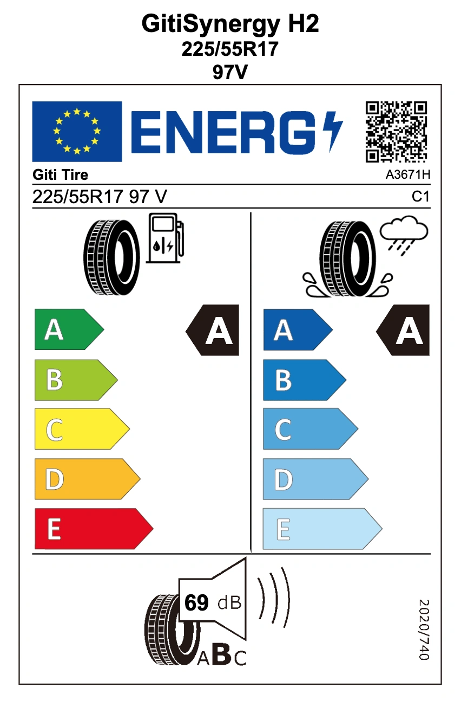
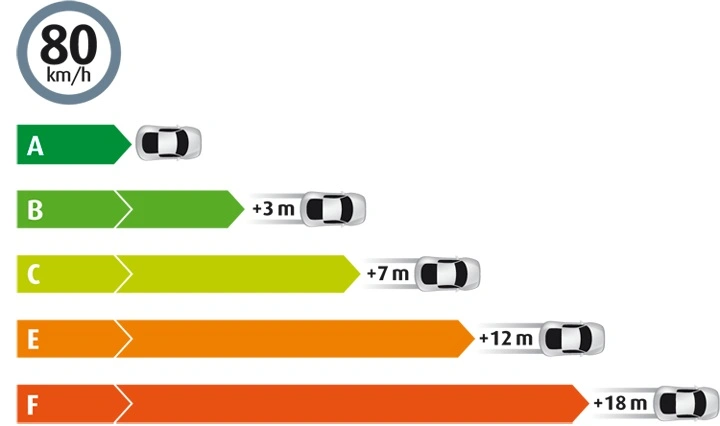

Les averses orageuses soudaines provoquent régulièrement de dangereux phénomènes d'aquaplaning sur autoroute. Beaucoup d'automobilistes concentrent leur choix uniquement sur le prix ou la longévité de la gomme, en ignorant l'**étiquetage de performance du pneumatique**, paramètre qui dicte directement la distance de freinage d'urgence sur chaussée détrempée. Tous les protocoles d'homologation internationaux dérivent du **règlement ONU ECE R117**, qui impose des seuils minimaux stricts pour autoriser la mise sur le marché.

Les consommateurs disposent aujourd'hui de données standardisées et auditées en laboratoire portant sur l'**adhérence sur sol mouillé (A à E)**, la **résistance au roulement (A à E)** et le **bruit de roulement externe (A/B)**, facilement vérifiables via des QR codes sur les étiquettes physiques.

## Outils de Consultation des Étiquettes Pneumatiques

### 1. Bases de Données Internationales
- **Base de Données Européenne EPREL (Union Européenne)** : [https://eprel.ec.europa.eu/screen/product/tyres](https://eprel.ec.europa.eu/screen/product/tyres)
- **Base de Données Japonaise (Kakaku Tire Database)** : [https://kakaku.com/car_goods/tire/](https://kakaku.com/car_goods/tire/)

### 2. Plateformes Régionales et Calculateurs
- **Plateforme Officielle d'Efficacité Énergétique des Pneus (ARTC / CNS 1431)** : [https://tire.artc.org.tw/](https://tire.artc.org.tw/)
- **Calculateur d'Économie de Carburant ARTC RRC** : [https://energy.artc.org.tw/Tire/rrCalculate](https://energy.artc.org.tw/Tire/rrCalculate)

Avant de renouveler votre train de pneus, vérifiez impérativement ces indicateurs. Dès lors que **les dimensions, l'indice de charge et le code de vitesse** sont identiques, la matrice de performance est constante. **Évitez** les pneus dépourvus d'homologation internationale reconnue ou ceux affichant une **adhérence sur sol mouillé inférieure à la classe A**.

À moins que le carburant n'atteigne des sommets historiques, il est déconseillé de sacrifier la sécurité sous la pluie pour un gain marginal de résistance au roulement : l'économie de carburant compense rarement l'écart de prix.  
**Ordre de priorité recommandé** : **Adhérence sur sol mouillé > Confort acoustique > Économie de carburant**.

## Classes d'Adhérence sur Sol Mouillé (Wet Grip)

| Indice d'Adhérence (Valeur G) | Classe UE (Règlement 2020/740) | Classe Japon (JATMA) | Classe Taïwan (CNS 1431) |
| :--- | :---: | :---: | :---: |
| 1,55 ≤ G | **A** | **a** | **A** |
| 1,40 ≤ G ≤ 1,54 | **B** | **b** | **B** |
| 1,25 ≤ G ≤ 1,39 | **C** | **c** | **C** |
| 1,10 ≤ G ≤ 1,24 | **D** | **d** | **D** |
| G ≤ 1,09 | **E** | - | **E** |

> *Note : L'échelle A–E d'adhérence sur sol mouillé est harmonisée à l'échelle internationale sous l'égide du règlement ONU ECE R117.*

## Classes d'Efficacité Énergétique (Résistance au Roulement RRC)

| Coefficient de Résistance (RRC en kg/t) | Classe UE | Classe Japon | Classe Standardisée 2026 |
| :--- | :---: | :---: | :---: |
| RRC ≤ 6,5 | **A** | **AAA** | **A** |
| 6,6 ≤ RRC ≤ 7,7 | **B** | **AA** | **B** |
| 7,8 ≤ RRC ≤ 9,0 | **C** | **A** | **C** |
| 9,1 ≤ RRC ≤ 10,5 | **D** | **B** | **D** |
| RRC ≥ 10,6 | **E** | **C** | **E** |

> *Note : L'échelle européenne à 5 niveaux (A à E) constitue désormais la référence de comparaison internationale.*

## Classes de Bruit de Roulement Externe

| Classe Acoustique | Seuil Réglementaire UE (2020/740) | Description Technique |
| :--- | :---: | :--- |
| **Classe A** | **≥ 3 dB(A) sous la limite légale** | Silence de roulement remarquable, niveau d'émission sonore minimal |
| Classe B | 0 à 2 dB(A) sous la limite légale | Conforme aux exigences réglementaires actuelles |
| Classe C | Supérieur à la limite autorisée | Pneus non autorisés pour la première monte routière |

> *Note : L'étiquette indique également la valeur mesurée exacte en **décibels (dB)** ; un chiffre plus bas indique un pneu plus silencieux.*

## Table de Conversion de Pression des Pneus

### Barème Officiel Mercedes-Benz (Source : Étiquette constructeur A205 584 70 11)
> *Note : Les valeurs en Bar sont ajustées par paliers de 0,05 bar pour correspondre aux manomètres standard d'atelier.*

| PSI | kPa | **Bar** |
| :---: | :---: | :---: |
| 31 | 210 | 2,10 |
| 32 | 220 | 2,20 |
| **33** | **230** | **2,30** |
| **34** | - | **2,35** |
| **35** | **240** | **2,40** |
| **36** | **250** | **2,50** |
| **37** | - | **2,55** |
| **38** | **260** | **2,60** |
| 39 | 270 | 2,70 |
| 40 | - | 2,75 |
| 41 | 280 | 2,80 |
| 42 | 290 | 2,90 |

## Références et Directives Officielles

- **Base de Données Européenne EPREL** : [Portail des Pneumatiques EPREL](https://eprel.ec.europa.eu/screen/product/tyres)
- **Règlement Européen (UE) 2020/740 (PDF)** : [Texte officiel du Parlement Européen](https://eur-lex.europa.eu/legal-content/EN/TXT/PDF/?uri=CELEX:32020R0740&from=EN)
- **Législation JATMA (Japon)** : [Directive d'étiquetage JATMA](https://www.jatma.or.jp/labeling/outline.html)
