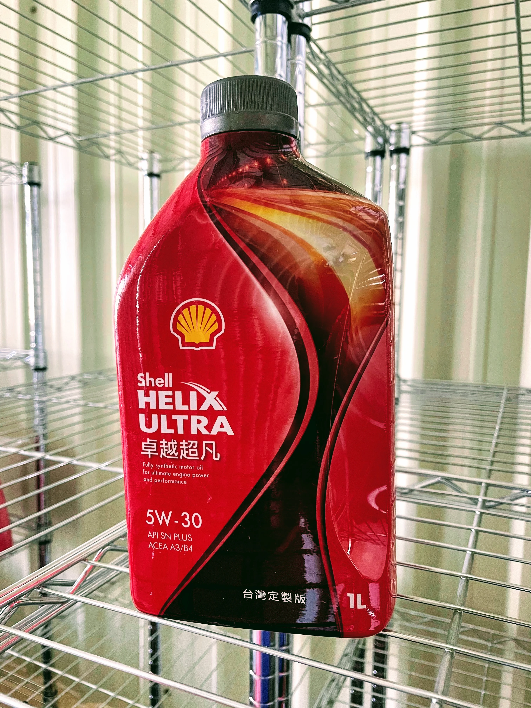

## **Retour d'Expérience : Shell Helix Ultra X 5W-30**
**【Grade SAE 30, Homologation MB 229.5, Normes API SP/SQ, Base Groupe III+ GTL】**

Ceux qui ont suivi les épisodes précédents de ma série sur le choix des lubrifiants savent que mon choix définitif s'est porté sur la **Shell Helix Ultra X 5W-30** (abrégée HUX530). Voici mon bilan d'évaluation après 7 500 km parcourus, comparé à l'huile d'origine concession **MB 229.5 5W-40** (MB540) :

* **Temps de mise en température**
    La phase de chauffe est sensiblement écourtée. La viscosité cinématique plus faible à 40°C permet au lubrifiant de circuler promptement dans la culasse et les turbocompresseurs dès le démarrage.

* **Feutré acoustique au ralenti**
    Les bruits mécaniques et les micro-vibrations au ralenti sont perceptibles à la baisse par rapport à la 5W-40 d'origine. C'est une surprise heureuse pour un grade 30, imputable à l'amortissement vibratoire de la formulation GTL pure.

* **Vivacité à l'accélération et montées en régime**
    Grâce à la fluidité dynamique du grade 30, le 4-cylindres prend ses tours avec une vivacité inédite. Lors des dépassements autoroutiers, les reprises après un rétrogradage de 8e en 7e rapport sont franches et sans inertie.

* **Glisse sur l'élan**
    Le véhicule prolonge sa décélération sur l'élan avec une remarquable fluidité mécanique. Les résistances internes de cisaillement fluide étant abaissées, le frein moteur parasite est atténué.

* **Stabilité thermique et consommation d'huile**
    À 7 500 km, aucune dégradation acoustique ni mollesse à chaud n'est constatée. La vérification à la jauge confirme un niveau strictement stable, attestant d'une volatilité Noack minime.

### **Bilan Global**
Par rapport à l'huile concession standard, la formule HUX530 procure un agrément de conduite immédiatement palpable.

Sur le plan normatif, Shell a fait évoluer cette gamme vers la norme **API SQ**, offrant une protection renforcée de la distribution et une parade définitive au phénomène destructeur de LSPI. Elle demeure à mes yeux l'une des formulations les plus abouties pour la plateforme W205 associant **SAE 30, MB 229.5, API SP/SQ et base GTL Groupe III+**.

