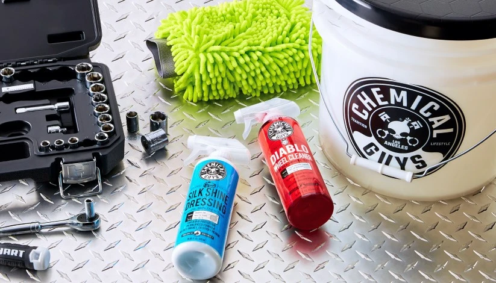

**Ordre d'intervention méthodique : Habitacle > Jantes & Passages de Roues > Carrosserie Extérieure**

### Soin de l'Habitacle (Intérieur)

* **Nettoyage en Profondeur**
    * Meguiar's D101 All Purpose Cleaner (Dilution 1:10)
    * Nettoyant Intérieur Universel SONAX
    * Collinite Leather & Vinyl Wax #855 (Nettoie et nourrit)
* **Protection et Finition (Anti-UV / Aspect Satiné)**
    * Rénovateur Cuir et Vinyle 3M PN38143
    * Meguiar's Ultimate Protectant, G14716
    * Meguiar's Ultimate Interior Detailer, G16216
    * Turtle Wax DASH & GLASS Interior Detailer
    * Turtle Wax INSIDE & OUT Car Protectant

---

**Protocole Carrosserie : Lavage > Décontamination > Compound > Polish > Glaze > Scellant > Cire > Detailer**

### Sélection de Produits Accessibles et Performants (Pour Débuter)

#### 1. Compound / Correction des Défauts (Élimination des Micro-Rayures)
> *Produits abrasifs destinés à aplanir le vernis pour corriger les défauts de surface.*
* **Pâtes Abrasives Lourdes (Correction Sévère) :**
    * Finish Kare BWM 114 : Rubbing Compound
    * Poorboy's Master Cut Super Cut Compound
    * Poorboy's SSR3
    * Meguiar's Ultimate Compound, G17216
* **Polish de Finition / AIO (Tout-en-un - Abrasifs Doux) :**
    * Turtle Wax Hybrid Solutions Ceramic Polish & Wax (AIO)
    * Turtle Wax Hybrid Solutions Pro 1 & Done
    * Collinite 631 (Fleetwax) / 920 (Nettoyant fibre de verre)

#### 2. Glaze (Lustrant / Remplissage des Défauts et Profondeur)
> *Formulations nourrissantes sans abrasifs, conçues pour combler les micro-rayures et enrichir le reflet.*
* Poorboy's White Diamond (Peintures claires) / Black Hole (Peintures sombres)
* 3M Hand Glaze 5990 (Remplisseur pur de finition)

#### 3. Scellants Synthétiques (Sealants - Protection Longue Durée)
> *Polymères synthétiques axés sur la résistance aux intempéries et la durabilité.*
* **Finish Kare 1000P** : Hi-Temp Paste Wax (Résistance thermique et endurance légendaires)
* Finish Kare 2180 / 118
* Meguiar's M21 Synthetic Sealant
* Poorboy's EX Sealant avec Carnauba
* 3M 39030 Performance Finish
* Collinite 476S / 885 (Super double coat detergent-proof)
* Meguiar's M27 SiO2 Sealant
* Turtle Wax Hybrid Solutions Pro to The Max Wax

#### 4. Cires Naturelles de Carnauba (Finition Haute Brillance et Effet Mouillé)
> *Subliment la profondeur de teinte et le perlage hydrophobe ; idéales posées sur un scellant.*
* Finish Kare #2685 : Cherry Pink Paste Wax
* 3M Perfect-It Boat Wax 36112 / 36113
* Collinite 915 (Marque D'Elegance) / Collinite 845 (Insulator Wax liquide)
* Poorboy's World Liquid Natty's Blue / Red
* Turtle Wax Super Hard Shell

#### 5. Sprays de Finition / Quick Detailers (Aide au Séchage et Entretien Rapide)
* **Quick Detailers (Lubrification et Nettoyage Léger) :**
    * Meguiar's Quik Detailer Mist & Wipe, A3316
    * Meguiar's D155 Last Touch Spray Detailer
* **Cires en Spray / Boosters Céramique :**
    * Meguiar's Ultimate Quik Detailer, G14422 (UQD)
    * Meguiar's M799 Pro Hybrid Ceramic Bead Booster
    * Turtle Wax Hybrid Solutions Ceramic Wax 3-in-1 Detailer
    * Turtle Wax Express Shine Carnauba Spray
    * Turtle Wax Pro Graphene Flex Wax

### Références Techniques :
* [Cycle de soin carrosserie en 5 étapes Meguiar's](https://meguiarsonline.com/forum/information-station/how-to-articles/66299-meguiar-s-5-step-paint-care-cycle)
* [Turtle Wax : Guide complet du detailing automobile](https://www.turtlewax.com/blogs/how-to/the-complete-car-detailing-guide)
