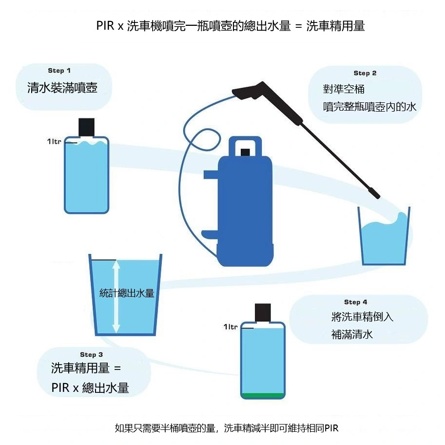

## Comprendre la Notio de PIR (Panel Impact Ratio)

Beaucoup d'amateurs dosent leur shampoing de prélavage au hasard dans le réservoir du canon à mousse (par exemple 1:10), obtenant une mousse soit trop liquide qui s'écoule immédiatement, soit inutilement dense et gaspillée. Cette disparité s'explique par le fait que chaque nettoyeur haute pression possède un débit d'eau et une pression différents.  

Le **PIR** constitue la méthode scientifique la plus rigoureuse pour déterminer la « concentration finale effective » de la mousse déposée sur la carrosserie.

## Mesurer le Débit Réel de Votre Nettoyeur Haute Pression

Avant d'effectuer le calcul, vous devez obligatoirement quantifier le **Débit Total d'Eau** de votre ensemble nettoyeur haute pression et canon à mousse.

### Protocole de Mesure :
1.  **Remplir le réservoir :** Remplissez la bouteille de votre canon à mousse avec exactement **1 litre** d'eau claire (sans shampoing).
2.  **Régler la molette :** Tournez la molette de dosage sur la position de mousse maximale (entièrement fermée vers le signe -).
3.  **Pulvériser et collecter :** Visez l'intérieur d'un grand seau vide gradué et maintenez la gâchette enfoncée jusqu'à aspiration intégrale du litre d'eau du flacon.
4.  **Relever le volume dans le seau :** Mesurez la quantité totale d'eau collectée dans le seau.  
    * *Exemple : Si vous recueillez 10 litres d'eau au total dans le seau, le ratio de dilution de votre matériel est de 1:10.*

## La Formule Fondamentale de Calcul du PIR

Une fois votre **Débit Total d'Eau** connu, appliquez le pourcentage de PIR recommandé par le fabricant du shampoing pour calculer le volume exact de produit pur à injecter :

> **Dosage de Shampoing Pur = Taux PIR x Débit Total d'Eau**

### Exemple Pratique :
Si vous utilisez le shampoing **Meguiar's D110 Hyper Wash** dont le PIR recommandé est de **1:100 (soit 1%)**, et que votre **Débit Total d'Eau** mesuré est de **10 000 ml (10 L)** :

* **10 000 ml x 0,01 (1%) = 100 ml**

**Conclusion :** Vous devez verser **100 ml** de shampoing pur dans le flacon du canon, puis compléter avec de l'eau tiède. Ainsi, la mousse pulvérisée sur votre véhicule respectera rigoureusement la proportion optimale de 1:100 recommandée par le chimiste.

## Pourquoi le Calcul du PIR est-il Essentiel ?

1.  **Économie Financière :** Évite le surdosage et le gaspillage coûteux de produits professionnels haut de gamme.
2.  **Efficacité Chimique Optimale :** Garantit un pouvoir lubrifiant suffisant pour ramollir et encapsuler le film routier sans décaper vos cires de protection.
3.  **Reproductibilité Parfaite :** Même si vous changez de nettoyeur haute pression ou de buse, le calcul du PIR vous assure un résultat constant.

### Astuce Pro :
L'installation d'un **gicleur calibré de 1,1 mm** (au lieu du gicleur standard de 1,25 mm) sur les nettoyeurs haute pression grand public à débit modéré modifie le volume d'eau aspiré. Recommencez toujours la mesure d'eau en cas de changement de matériel !
