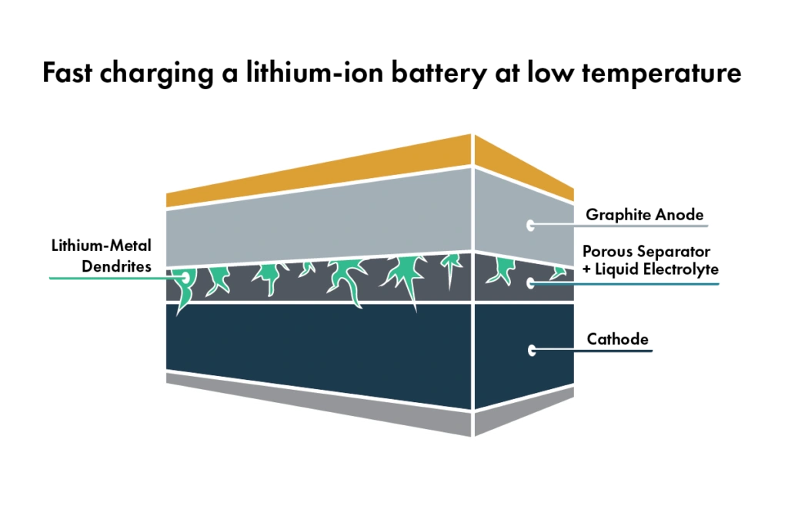

La norme SAE J537 est un standard d'essai de démarrage à froid établi par la **Society of Automotive Engineers (SAE)** exclusivement pour les **batteries au plomb-acide**. Elle vise à mesurer la capacité de décharge des batteries de démarrage traditionnelles dans des conditions hivernales sévères. Or, certains fabricants appliquent abusivement ce protocole aux batteries Lithium Fer Phosphate (LiFePO₄) pour vanter leurs performances. Cette pratique est techniquement infondée et induit l'automobiliste en erreur.

## Contenu et Méthodologie du Protocole SAE J537

L'épreuve officielle SAE J537 impose :
- Une mise en condition de la batterie à **-18°C** durant 24 heures consécutives.
- Une décharge sous fort courant continu (par exemple 150 A pendant 30 secondes).
- **Une recharge effectuée à température ambiante contrôlée.**
- Le relevé de la chute de tension et de la perte de capacité résiduelle.

Ce protocole a été modélisé pour la cinétique chimique du plomb-acide. **Il ignore totalement le comportement électrochimique propre aux ions lithium lors de la charge.**

## Le Risque Majeur Ignoré : La Charge à Froid et le Placage de Lithium

Les accumulateurs lithium font face à une vulnérabilité critique lorsqu'ils reçoivent du courant par température négative (en particulier sous **0°C**) : **le placage de lithium (Lithium Plating)**.

1.  **Placage métallique :** À basse température, la diffusion des ions lithium ralentit drastiquement. Incapables de s'intercaler dans la structure cristalline de l'anode en graphite, les ions se réduisent en lithium métallique pur à sa surface.
2.  **Croissance des dendrites :** Au fil des cycles de charge par temps froid, ce dépôt cristallise sous forme d'arborescences microscopiques acérées appelées **dendrites**.
3.  **Court-circuit interne franc :** Ces aiguilles finissent par transpercer le séparateur polymère micro-poreux, générant un court-circuit interne brutal susceptible de déclencher un emballement thermique (feu chimique).

**La faille méthodologique majeure de la norme SAE J537 réside dans le fait qu'elle réchauffe la batterie à température ambiante avant la recharge.** Ce protocole évacue précisément la situation la plus courante et dangereuse en automobile : un alternateur injectant 50 à 100 ampères dans une batterie lithium glaciale par un matin d'hiver à -5°C.

## Conclusion : Dépasser le Discours Marketing

Lorsqu'un fabricant de batteries lithium met en avant la validation de la norme SAE J537, il s'abrite derrière un protocole tronqué qui esquive les contraintes sécuritaires de la charge à basse température.

La véritable robustesse d'une batterie de démarrage lithium s'atteste à travers des homologations strictes comme **UL 2580** ou **IEC 62660**, épaulées par un système de gestion électronique (BMS) coupant impérativement la charge sous 0°C tant que les cellules n'ont pas été préchauffées.
