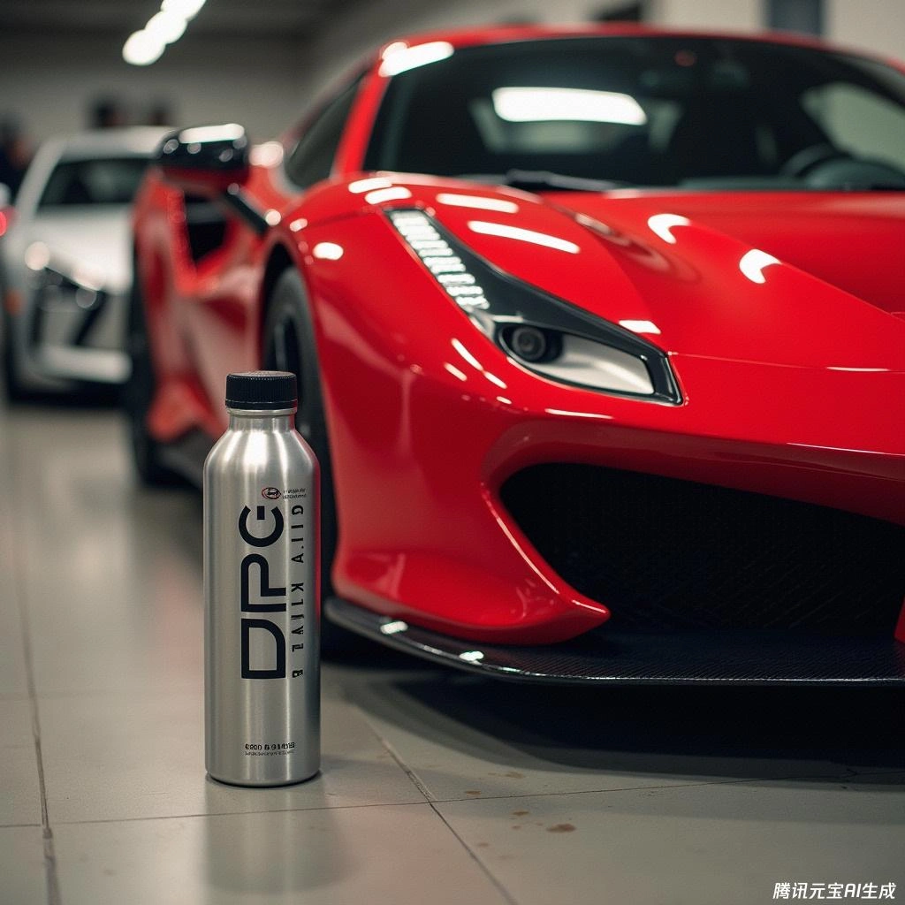

## RedLine SI-1 (Additif Polyétheramine PEA)

> **Base de calcul de la concentration théorique** > 15 oz pour 20 gallons US ≈ 0,0058 (0,6 %)

### Traitement Curatif (Nettoyage Choc des Injecteurs)
* **25 L d'Essence : 150 ml**

### Traitement d'Entretien Préventif
* **25 L d'Essence : 75 ml**

## Chevron Techron Concentrate Plus (Formule Concentrée)

> **Base de calcul de la concentration théorique** > 1 oz pour 1 gallon US ≈ 0,0078 (0,8 %)

### Ratio Recommandé
* **25 L d'Essence : 200 ml**

## Alcool Isopropylique (IPA) Déshydratant de Réservoir

> **Base de calcul de la concentration théorique** > 8 oz pour 17 gallons US ≈ 0,0036 (0,37 %)

### Ratio Recommandé
* **25 L d'Essence : 92 ml**

## Formule Artisanale DPC Mix (DIY Fuel Additive)

> ⚠️ **【Avertissement de Sécurité & Clause de Non-Responsabilité】** ⚠️
> La composition et les ratios du mélange DPC présentés ici sont partagés uniquement à des fins d'échange technique et documentaire entre passionnés avertis.
> * **Risques de manipulation :** L'essence minérale désaromatisée et le pétrole sont des solvants inflammables et volatils. Tout mélange doit être réalisé impérativement en extérieur ventilé, loin de toute source d'ignition, avec gants nitrile et lunettes de protection.
> * **Tolérances mécaniques :** Chaque moteur et circuit d'injection présente des tolérances spécifiques vis-à-vis des solvants et des élastomères de joints.
> * **Clause légale :** L'application de cette formule artisanale relève de l'entière responsabilité de l'utilisateur. L'auteur et le site déclinent toute responsabilité en cas de dysfonctionnement mécanique. Pour un usage serein, l'achat d'additifs de grandes marques homologués reste vivement conseillé.

### Plafonds de Concentration Maximale dans le Réservoir
* Gazole (Diesel) < 1 %
* Pétrole désaromatisé < 0,2 %
* Essence minérale (Naphta nettoyant) < 0,05 %

### Proportions du Prémélange Concentré
> **D (Diesel) : P (Pétrole) : C (Solvant minéral) = 2 L : 0,5 L : 0,1 L**

### Dosage dans le Réservoir lors du Plein
* **25 L d'Essence : 300 ml**
* **27 L d'Essence : 325 ml**
